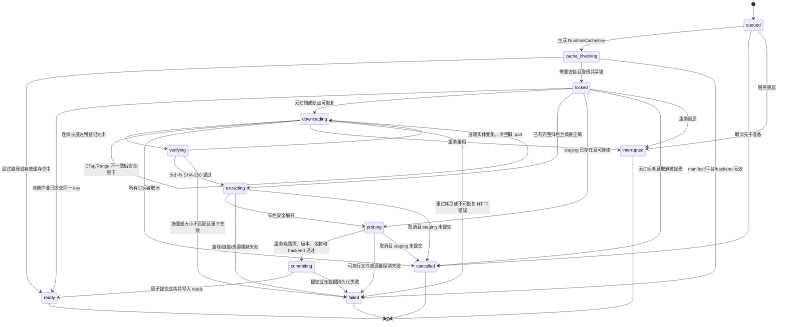
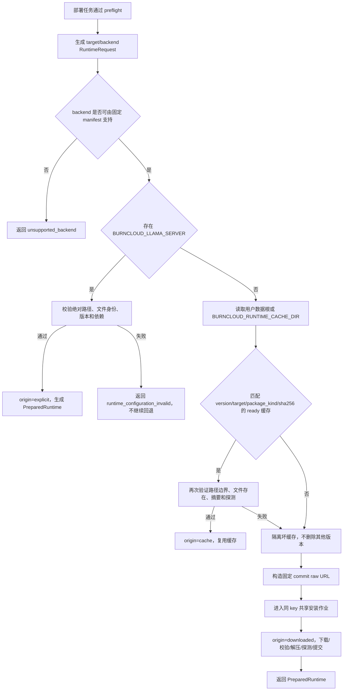
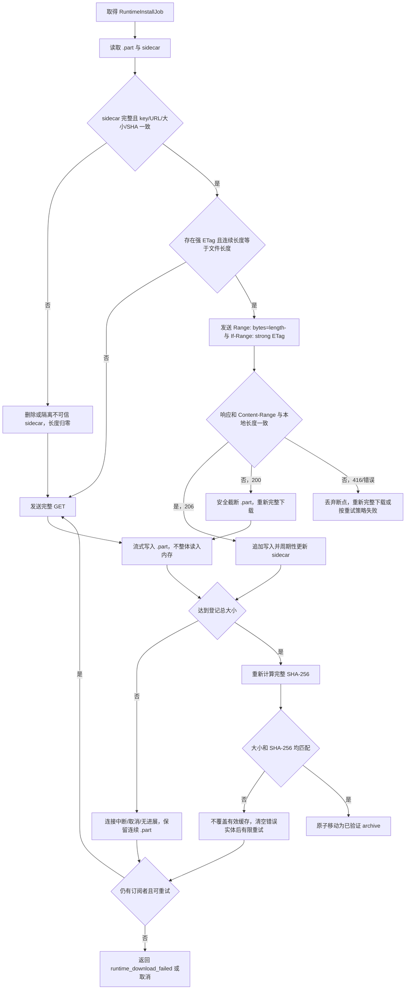
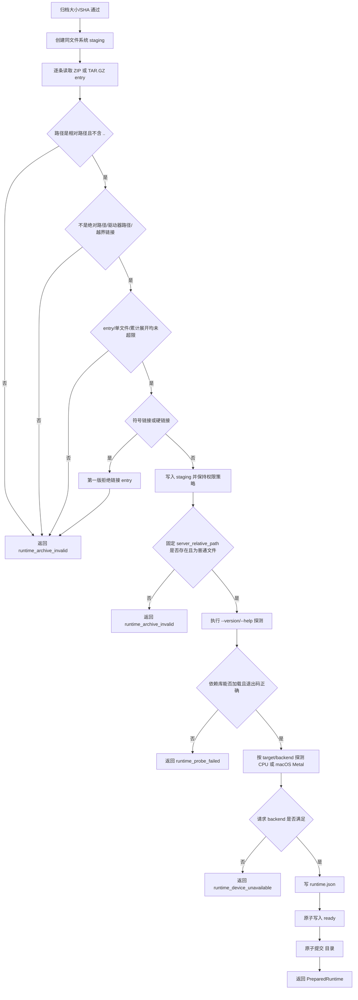
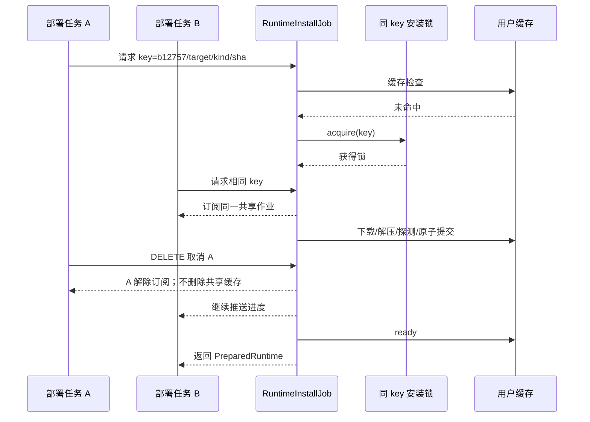

# Gitee 运行期获取 llama.cpp 流程图

> 开发序号：5；标题短名：gitee-runtime-download。
> 状态：方案二修订正式流程图。它只描述运行时准备增量；自动部署父任务、模型下载、进程生命周期和路由状态沿用 `local-model-auto-deploy-flowchart.md`。
> 设计日期：2026-11-26。运行时来源固定为 Gitee commit `51d01f6e526bc6d45b9d252b1d2d487efb6625d8`。

## 一、核心实体

| 实体 | 说明 | 关键属性 | 所有权与关系 |
| --- | --- | --- | --- |
| `RuntimeManifest` | 服务端可信运行时清单 | schema、version、provider、repository、commit、target、backend、filename、format、size、sha256、server path、limits | 只读配置；客户端不能覆盖 |
| `RuntimeRequest` | 由部署任务内部生成的运行时请求 | target、requested_backend、effective_backend、cache root、取消令牌、父任务引用 | 不接受 HTTP 中的版本、URL、摘要或路径 |
| `RuntimeCacheKey` | 运行时安装身份 | version、target、package_kind、archive_sha256 | 同一 key 共享下载、解压和探测结果 |
| `RuntimeDownloadState` | 运行时归档及断点元数据 | `.part`、sidecar、URL、ETag、连续长度、总长度、重试计数 | 只允许原生 reqwest 下载作业写入 |
| `RuntimeInstallJob` | 同一缓存 key 的共享准备作业 | job id、key、状态、订阅者、取消令牌、进度、错误 | 服务级共享；一个部署取消不能删除其他订阅者的缓存 |
| `PreparedRuntime` | 已通过完整校验和探测的运行时 | `llama-server` 绝对路径、target、backend、version、archive sha256、origin | 只读地交给现有 `DeploymentService` |
| `RuntimeProgress` | 父部署任务可见的运行时子进度 | status、stage、phase、origin、version、字节进度、错误 | 由部署任务持久化/快照，不暴露独立 runtime API |
| `DeploymentTask` | 现有自动部署任务 | task status、stage、model branch、runtime branch、cancel flag | runtime 只是一个共享依赖；父任务拥有自己的进程和路由 |

运行时不是模型文件。Gitee 运行时只提供 `llama-server` 及其随包依赖；GGUF 仍由既有模型来源、模型下载与摘要校验链路负责。

## 二、运行时内部状态

运行时内部状态只用于服务内部协调，不新增 HTTP 父任务状态。HTTP `RuntimeProgress.status` 仍复用父任务的 `queued/running/succeeded/failed/cancelled/interrupted`。

| 内部状态 | 含义 | 是否终态 | 可转移到 |
| --- | --- | --- | --- |
| `queued` | 已根据可信 manifest 生成运行时 key，等待缓存命中或安装锁 | 否 | `cache_checking`、`cancelled`、`interrupted` |
| `cache_checking` | 检查有效缓存、显式路径和管理员缓存根 | 否 | `ready`、`locked`、`failed` |
| `locked` | 已取得同一 key 的跨线程/跨进程安装锁 | 否 | `downloading`、`extracting`、`probing`、`ready`、`cancelled`、`interrupted` |
| `downloading` | 正在下载 Gitee 归档或续传 `.part` | 否 | `verifying`、`cancelled`、`interrupted`、`failed` |
| `verifying` | 校验归档大小和完整 SHA-256 | 否 | `extracting`、`downloading`、`failed` |
| `extracting` | 在 staging 目录安全解压并检查资源限制 | 否 | `probing`、`failed`、`cancelled` |
| `probing` | 检查 `llama-server`、版本、依赖和目标后端设备 | 否 | `committing`、`failed`、`cancelled` |
| `committing` | 写入元数据、ready 标记并原子提交缓存目录 | 否 | `ready`、`failed` |
| `ready` | 已有可复用的完整运行时 | 是 | 无 |
| `failed` | 当前安装作业失败，旧有效缓存不受影响 | 是 | 无 |
| `cancelled` | 当前订阅者已退出且作业未提交；`.part` 可保留 | 是 | 无 |
| `interrupted` | 服务重启使未完成共享作业失去所有者 | 是 | 无 |



## 三、部署父任务与运行时子任务

父任务状态和阶段继续使用旧流程图定义：

- 父状态：`queued`、`running`、`succeeded`、`failed`、`cancelled`、`interrupted`；
- 父阶段：`preflight`、`preparing_runtime`、`downloading_model`、`verifying`、`starting`、`health_checking`、`attaching_route`；
- 运行时准备期间父阶段保持 `preparing_runtime`；`RuntimeProgress.phase` 才显示下载、校验、解压、探测和提交细节；
- 运行时 ready 后，父任务才能继续模型分支汇合、`starting`、`health_checking` 和 `attaching_route`；
- 运行时子任务的共享作业成功不等于所有父任务成功。每个父任务仍需完成自己的模型校验、进程启动、健康检查和路由绑定。

## 四、来源选择与缓存命中流程



约束：

1. `BURNCLOUD_LLAMA_SERVER` 是管理员级环境配置，不是 HTTP 输入；配置存在但无效时 fail-closed，不能悄悄下载另一个程序。
2. `BURNCLOUD_RUNTIME_CACHE_DIR` 只改变缓存根，不改变 manifest、URL、版本、摘要或解压路径；环境变量解析失败时任务失败。
3. 缓存命中必须再次检查路径边界、`runtime.json` 身份、实际文件存在、摘要和平台可执行性；`ready` 只是加速标记。
4. 没有有效显式配置和缓存时，只能使用固定 commit 组成的 URL；不调用 Gitee API 做生产期版本发现。
5. `xcframework` 不在任何 `llama-server` 目标映射中。

## 五、下载与断点恢复流程



- 只有强 ETag、Range 起点、`Content-Range` 起点和本地连续长度同时一致时才追加；弱 ETag、无 ETag、响应范围异常或远端实体变化都不能续传。
- 服务器对 Range 返回 200 时不得把响应拼接到 `.part` 后面；必须截断后重新计算完整摘要。
- 取消只影响当前父任务的订阅关系；共享作业仍有其他订阅者时继续运行。最后一个订阅者取消后可停止网络读取，但保留已确认连续的 `.part` 和 sidecar。
- 重试只在网络连接、5xx、无进展和可恢复的范围异常时发生；403/404/固定来源不存在直接报告来源错误，不改用其他站点。

## 六、安全解压、探测和原子提交



v1 的安全规则：

- 拒绝绝对路径、Windows 驱动器/UNC 路径、包含 `..` 的规范化路径和任何会越出 staging 根的路径；
- 拒绝符号链接和硬链接 entry，避免平台间链接语义差异和链接链逃逸；
- 限制最大路径 4096 字节、最大 entry 数 100000、单文件最大 2 GiB、总展开最大 4 GiB；
- 目标路径必须来自 manifest，不能从归档中搜索“第一个同名文件”；
- `runtime.json` 和 `ready` 必须最后写入；任何失败只清理本次 staging，不删除已有有效版本。

## 七、并发、取消和重启



- 共享作业的身份必须包含 `version + target + package_kind + sha256`，不能只按文件名或版本共享。
- 进程内共享通过服务级并发表；跨进程共享通过同一缓存根的安装锁和 ready/元数据观察完成。
- 锁持有者退出时，新的服务实例可以读取 sidecar 和 staging，先验证身份，再恢复下载或重新解压；不能假设未完成作业已成功。
- 服务重启把本机未完成父任务标为 `interrupted`，不自动启动 `llama-server`；新任务可复用有效缓存和安全断点。
- 取消一个父任务只释放其订阅关系和本任务资源，不停止其他父任务需要的共享作业，不删除有效旧版本。

## 八、状态流转约束

| 约束 | 说明 | 违反结果 |
| --- | --- | --- |
| 可信登记优先 | 目标、backend、文件名、大小、SHA、server path 均由 manifest 决定 | `runtime_manifest_invalid` 或 `unsupported_backend` |
| 不可漂移来源 | URL 必须含固定 commit；不读 `master` 做生产发现 | `runtime_source_unavailable` |
| 摘要强绑定 | 完整文件 SHA-256 与大小均通过后才进入 archive | `runtime_checksum_mismatch` / `runtime_size_mismatch` |
| 原子提交 | 只有解压、探测和元数据写入成功才生成 ready 并提交 | 缓存保持旧版本或不存在，不产生半安装缓存 |
| 旧版本保留 | 新版本失败不删除已有有效 key | 部署失败但旧版本仍可供既有任务使用 |
| 取消隔离 | 当前父任务取消不改变其他订阅者结果 | 取消任务为 `cancelled`，共享作业可继续 |
| 后端不降级 | CUDA 当前无 Gitee 资源；显式 Metal 探测失败不改成 CPU | `unsupported_backend` / `runtime_device_unavailable` |
| 运行时与模型分离 | 运行时只返回可执行路径，模型仍走既有 GGUF 链路 | 不允许用运行时包替代模型校验 |
| ready 非事实 | ready 只能加速查找，必须再次检查路径、摘要、版本和可执行性 | 坏缓存被隔离并重新准备 |

## 九、与现有部署流程的汇合

```mermaid
flowchart LR
    A[POST 创建部署任务] --> B[preflight]
    B --> C1[模型准备分支]
    B --> C2[运行时准备分支]
    C2 --> D[返回 PreparedRuntime]
    C1 --> E[模型文件已校验]
    D --> F{两分支均 succeeded}
    E --> F
    F --> G[现有 DeploymentService 启动]
    G --> H[/health]
    H --> I[/v1/models]
    I --> J[/slots]
    J --> K[绑定本地路由]
    K --> L[succeeded + ready_to_chat]
```

运行时准备器不负责：进程启动、端口分配、readiness、health、路由绑定、停止或模型 GGUF 下载。上述职责仍由现有 `DeploymentService`、`LlamaCppRuntimeAdapter` 和部署任务执行器承担。
