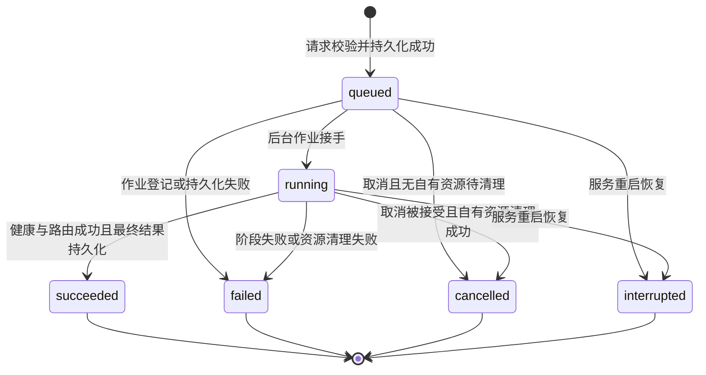
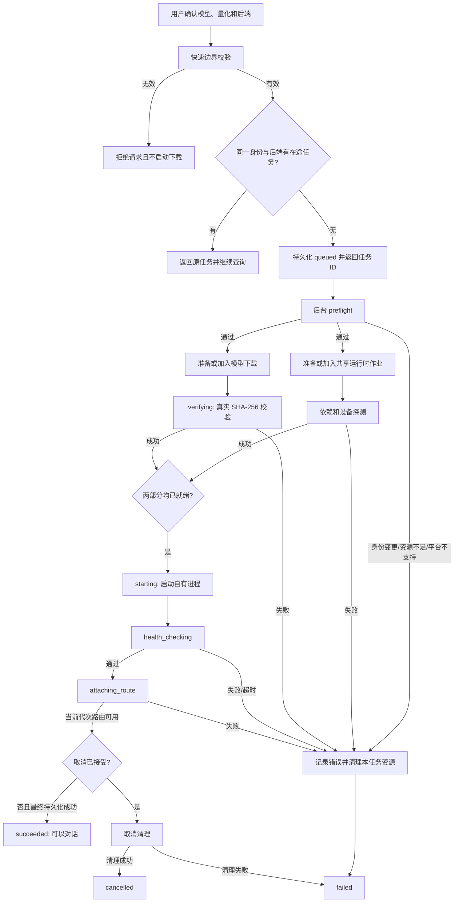
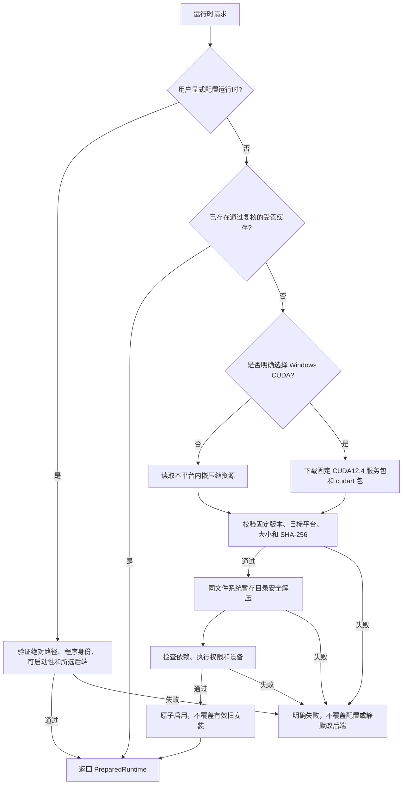

# BurnCloud 本机模型自动部署流程图

> 开发序号：5；关联 Issue：songyi77101/burncloud-1112#13。
> 标题短名：local-model-auto-deploy，与已确认开发分支一致。
> 状态：已于 2026-11-24 经用户确认定稿；接口契约、开发文档仍须按阶段分别确认。
> 需求来源：用户已确认的《BurnCloud 本机模型自动部署完善计划》；基于现有代码继续设计。

## 一、核心实体与复用边界

| 实体 | 说明 | 关键属性 | 关系与所有权 |
| --- | --- | --- | --- |
| 部署任务 | 一次用户确认的自动部署请求，持久化到现有数据库 | 任务 ID、模型身份、请求后端、实际后端、任务状态、阶段、两个子任务、错误、部署/路由结果 | 独占本任务创建的进程与路由；只持有共享工件和运行时的使用权 |
| 模型工件 | 由服务端仓库发现结果确认的 GGUF 文件 | 模型、来源、修订、文件、SHA-256、大小、本地校验结果 | 不信任客户端任意 URL 或路径；不同部署任务可以共享同一可信文件 |
| 运行时准备作业 | 准备同一版本、平台和包类型的运行时 | b8581、目标平台、CPU/原生/CUDA 包、归档摘要、阶段、下载进度 | 由服务级所有者持有；一个部署取消不终止其他部署的准备 |
| 受管运行时 | 原子启用并通过探测的 llama.cpp 安装 | 安装目录、可执行文件、依赖、许可、版本、包摘要 | 安装在用户数据目录；多个模型共享；不写系统 PATH 或库目录 |
| 已有部署服务 | 管理进程、健康检查、心跳和停止操作 | 部署标识、进程代次、PID、就绪事件 | 继续复用 DeploymentService，不另造进程管理器 |
| 已有路由绑定 | 把健康的本机服务接入 BurnCloud 路由 | 路由模型标识、attachment ID、进程代次、路由状态 | 只有本任务拥有的代次可撤销；不能清理别的部署 |

基础运行时不是模型：发行物内嵌基础压缩运行包；用户选模型后才下载 GGUF。基础运行时准备不联网；Windows CUDA 的两个包只在用户主动选择后下载。

## 二、任务生命周期与状态

任务状态与部署阶段分离。任务状态表示是否仍在执行，阶段表示正在做什么；模型和运行时各自有子任务状态，不能用一个伪造的总百分比代替。

| 任务状态 | 含义 | 终态 | 进入条件 | 可退出到 |
| --- | --- | --- | --- | --- |
| queued | 已持久化，等待后台作业接手 | 否 | 有效请求成功登记，或复用同一在途任务 | running、failed、cancelled、interrupted |
| running | 后台正在执行部署阶段或取消清理 | 否 | 作业接手，开始 preflight | succeeded、failed、cancelled、interrupted |
| succeeded | 健康检查通过且当前代次路由接入成功 | 是 | 最终路由与任务结果持久化成功，且没有已接受的取消 | 不再流转；停止走既有停止接口 |
| failed | 某阶段失败，或取消/失败后的资源清理失败 | 是 | 错误及本任务进程/路由的清理结果已记录 | 不再流转；重试创建新任务 |
| cancelled | 取消已接受，且本任务资源清理完成 | 是 | 尚未成功完成；自有进程/路由均不再活动 | 不再流转；保留有效共享缓存 |
| interrupted | 服务重启发现未完成任务 | 是 | 启动恢复阶段发现本机上一次运行的 queued/running 记录 | 不自动启动；用户重试创建新任务 |

服务重启只处理本机所有者的记录，不能在使用 PostgreSQL 时把其他主机的任务一并中断。恢复只清理可证明属于原任务的进程/路由，不按同名进程粗暴终止。

`cancel_requested` 表示取消意图，不新增一个含糊的终态。取消请求和完成提交串行判定：先成功提交则不能再取消；先接受取消则迟到结果不能把任务改成成功。

## 三、部署阶段

| 阶段 | 职责 | 进入条件 | 结束条件/失败去向 |
| --- | --- | --- | --- |
| preflight | 校验平台、后端、权威模型身份、资源门槛、依赖与磁盘预算 | 后台作业接手 | 通过后并行准备；不满足则 failed |
| preparing_runtime | 显式运行时校验、缓存复用或内嵌安装；CUDA 明确选择才下载 | preflight 通过 | 依赖与设备探测成功得到 PreparedRuntime；否则 failed |
| downloading_model | 创建或加入模型下载，显示真实字节进度 | preflight 通过 | 下载落盘后进入 verifying；传输失败则 failed |
| verifying | 实际读取 GGUF 计算 SHA-256，验证与服务端确认的工件身份一致 | 下载完成或命中待复核文件 | 校验成功得到可信工件；不匹配则 failed |
| starting | 使用已准备运行时和已校验工件启动本任务拥有的进程 | 模型与运行时都成功 | 成功进入 health_checking；否则清理并 failed |
| health_checking | 等待进程存活及运行时健康端点达到就绪条件 | 本任务进程启动成功 | 健康通过进入 attaching_route；退出/超时则清理并 failed |
| attaching_route | 接入既有本地路由，并核对代次和路由状态 | 健康检查通过 | 路由可用且最终状态持久化后 succeeded；否则清理并 failed |

模型下载/校验与运行时准备是真正的并行分支。任务同时暴露两个子任务的阶段与状态；父阶段只是摘要，不以父阶段推断另一分支已完成。解压、依赖探测、设备探测和健康检查只显示阶段及可知结果，不显示编造的百分比。

## 四、运行时准备分支

### 后端选择

- 请求默认 `auto`；Windows/Linux 选择 CPU，macOS 从原生包实际探测 Metal，不能只根据架构名称推断 Metal 可用。
- 用户明确选择 CPU 时强制 CPU 参数，不因同一包包含 GPU 能力而自动启用 GPU。
- Windows CUDA 必须明确选择；先展示服务包与 cudart 的合计下载量、空间预算和驱动要求。
- CUDA 实际设备不可用、驱动不兼容或依赖缺失时明确失败，只有用户重新选择 CPU 才能降级。
- macOS `auto` 的 Metal 探测不可用时可选 CPU，这属于已确认的 auto 语义；必须显示实际后端及原因。
- 硬件校验保留原始目录要求，按所选后端解释 RAM/VRAM 与工件驻留需求；CPU 不能因 GPU 专用 VRAM 门槛被一概拒绝，也不能通过清空清单门槛放行。

### 内嵌与解压约束

- 官方构建启用 `bundled-runtime`；每个目标仅嵌入一份本平台基础归档，不带其他平台或默认 CUDA。
- 发布流水线先下载并校验；Cargo 构建脚本不联网。平台、版本、摘要不一致或必需资源缺失则构建失败。
- 开发构建不要求内嵌资源，继续支持显式配置；缺少资源必须报告可操作错误，不在用户机器上临时转向源码编译。
- Windows 保留依赖 DLL；微软 VC++ 再分发程序随授权发行物提供，缺依赖时提示用户安装。需要 UAC 时由用户授权，不伪装无权限安装。
- macOS/Linux 保留依赖、相对路径与可执行权限；内部符号链接仅在最终解析仍位于安装根目录时允许。
- 拒绝绝对路径、路径穿越、目标外链接、特殊设备、重复冲突条目以及超出文件数/解压体积上限的归档；不能先沿归档符号链接写出根目录再事后检查。
- 不删除隔离属性、不关闭 Gatekeeper、不向全局目录写文件；平台签名与所需许可是发行门禁。

## 五、下载、并发与取消

| 事件 | 触发方/时机 | 行为与流转 |
| --- | --- | --- |
| 重复提交 | 同一模型身份、摘要与后端在途 | 复用原任务，不能因双击创建两个进程 |
| 下载续传 | 存在原生 HTTP 部分文件 | 重新检查本地文件和远端身份；Range/实体校验不成立时从零重下，不能拼接不同实体 |
| 旧 aria2 记录恢复 | 升级后发现旧记录 | 保留稳定数据库任务 ID，重新建立 HTTP 传输身份；aria2 GID 不能当作 HTTP 身份或已验证断点 |
| 取消未启动任务 | queued 且没有自有资源 | 持久化取消意图并完成取消终态 |
| 取消执行任务 | running | 停止推进；释放该任务对共享准备/下载的使用权，清理本任务自有进程和路由 |
| 取消一个共享使用者 | 其他任务仍使用同一运行时/模型下载 | 其他使用者继续；不能取消其依赖的传输或解压 |
| 最后一个使用者取消 | 不再有其他任务依赖下载 | 取消可停止的传输并保留可恢复部分文件；正在执行的本地解压可安全完成到缓存，但不得回写已取消任务 |
| 迟到结果 | 取消已接受或任务已终态 | 依据任务状态与进程代次拒绝覆盖；如果刚启动了本任务自有进程，仍须清理 |
| 页面刷新 | 浏览器恢复已保存任务 ID | 继续 GET 查询持久化状态，不自动重发部署请求 |
| 服务重启 | 应用恢复本机记录 | queued/running 标记 interrupted；不自动重复启动，用户重试复用有效缓存和下载断点 |
| 停止已成功模型 | 用户使用既有停止入口 | 停止部署及路由，不把 succeeded 改成 cancelled |

取消成功必须等到自有资源清理完成；清理失败需要可见错误，不能谎报 cancelled。失败/取消不删除其他任务使用的运行时、已校验模型或用户手工配置。

## 六、事件与非法流转

| 约束 | 违反时的结果 |
| --- | --- |
| 未核对权威目录身份不能下载和启动 | 任务 failed，报告身份校验错误 |
| 模型只是下载完成，不等于校验完成 | 继续 verifying，不能进入 starting |
| 只满足一个准备分支不能启动 | 保持等待另一分支，不能构造 Verified 工件 |
| 子进程创建成功不等于健康就绪 | 继续 health_checking；失败清理进程 |
| 进程健康但路由失败不能成功 | 任务 failed，记录路由错误并撤销本任务资源 |
| 同名文件不等于相同模型 | 以完整工件身份和后端确定部署归属，避免现有 file_stem 标识冲突 |
| 共享缓存损坏不能直接复用 | 重新校验并隔离损坏副本，在暂存目录修复；不能覆盖仍在使用的安装 |
| 数据库更新失败不能只改内存后声称成功 | 返回持久化错误；必要时清理本次新建进程与路由 |
| 终态不可被迟到进度、健康或路由事件覆盖 | 忽略状态写入并按代次清理本任务遗留资源 |
| 取消成功不得删共享资源或全局终止 llama-server | 仅操作本任务自有进程句柄和路由 attachment |

## 七、对现有实现的落点

以下为本轮只读代码核对，不表示代码已实现：

| 现有位置 | 当前事实 | 后续改造边界 |
| --- | --- | --- |
| `crates/platform/storage/download/src/operations.rs` | `with_store` 调用 `quick_start` 启动 aria2 | 保留 DownloadManager 的任务接口和稳定数据库 ID，替换传输实现 |
| `crates/platform/storage/download/src/utils.rs` | 提供 URL、目录与文件名边界处理 | 原生 HTTP 重定向、断点与路径检查不能削弱已有安全约束 |
| `crates/interfaces/server/src/api/model_resolution.rs` | 已有远端仓库发现和内置资源要求合并 | 自动部署复用权威发现，按所选后端校验资源，不接受任意 URL |
| `crates/interfaces/server/src/api/model_download.rs` | 已有异步下载与 SHA-256 校验 | 保留旧 HTTP 契约，供自动部署复用其下载与验证语义 |
| `crates/interfaces/server/src/node_runtime.rs` | 运行时准备仅使用 BURNCLOUD_LLAMA_SERVER | 增加受管安装与后端探测，显式配置仍优先且不被覆盖 |
| `crates/interfaces/server/src/node_deployment.rs` | 手动路径部署会直接构造已校验工件 | 保留手动入口；自动部署必须走真正摘要校验后的可信工件入口 |
| `crates/interfaces/server/src/api/node_deployment.rs` | 已有手动启动、查询、停止路由 | 不替换或混用其停止语义 |
| `crates/interfaces/client/src/domains/chat/` | 现有下载后再手动部署的编排 | 改为异步部署任务，保留取消和过期结果隔离 |
| `crates/platform/storage/database/src/migration/mod.rs` | 最后登记 0019 下载稳定身份迁移 | SQLite/PostgreSQL 同步增加部署任务迁移，不能只新增 SQL 文件而漏登记 |
| `.github/workflows/cd-release.yml` | 当前只有 Windows 发行任务 | 扩展四目标各自携带唯一基础资源的便携发行物 |

## 八、范围与发布门禁

| 目标 | 基础运行包 | 首期实机验收基线 |
| --- | --- | --- |
| Windows x64 | llama-b8581-bin-win-cpu-x64.zip | Windows 10/11 x64 |
| macOS ARM64 | llama-b8581-bin-macos-arm64.tar.gz | macOS 14+ |
| macOS x64 | llama-b8581-bin-macos-x64.tar.gz | macOS 13.3+ |
| Linux x64 | llama-b8581-bin-ubuntu-x64.tar.gz | Ubuntu 24.04 LTS x64 |

额外选择仅 Windows CUDA12.4，且必须同时准备服务包与 cudart 包。不包含 Linux CUDA/ARM64、Alpine/musl、驱动/Toolkit 自动安装、用户端编译、远程节点、非 GGUF 转换或新安装器。

正式兼容清单必须有对应干净环境证据：阻断直连 GitHub、无预装和缓存，完成运行时准备、固定摘要轻量模型下载、BurnCloud 路由真实对话，以及第二模型复用、取消/重试/刷新/重启/损坏恢复。CUDA 必须在 Windows NVIDIA 实机另测。记录实际发行体积增量、许可/授权和签名结果；未测平台不能标为通过。

## 九、人工确认门禁

用户已于 2026-11-24 确认本流程图定稿；该确认不等于接口契约、开发文档或代码已完成。下一步据此制定具体 HTTP 字段/错误码契约，再按项目规则确认接口契约和开发文档，最后拆分任务并编码。当前尚未执行任务拆分、业务代码修改或真实部署验收。
