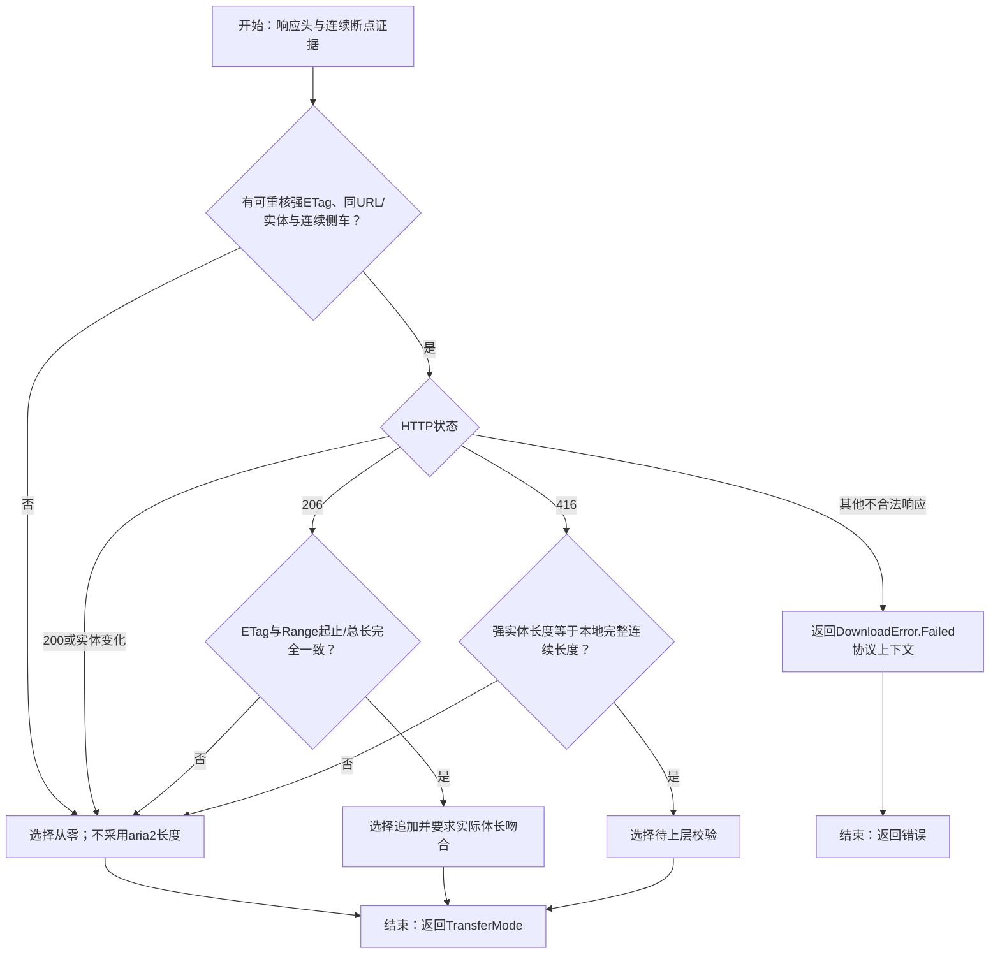
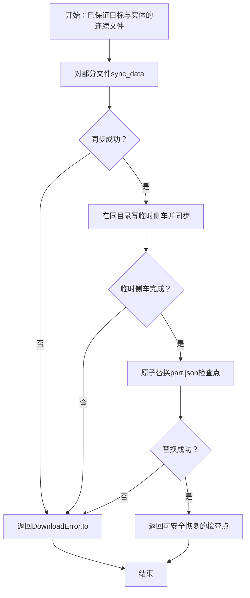

```json
{
  "编号": "002",
  "依赖": []
}
```

# 002 实现连续断点证据与续传判定

- 任务：实现连续断点证据与续传判定
- 工作区：download（读写）——crates/platform/storage/download/src/http.rs、error.rs、必要Cargo.toml、README.md；独立断点/错误链测试
- 工作区：project-root（读写）——Cargo.lock（仅实际依赖解析更新）
- 产出：ResumeMetadata、续传判定与原子检查点，以及已批准的Transport/Io源错误变体
- 前置任务：无
- 后置任务：003 实现受限跨平台 HTTP 流式传输
- 设计依据：第三节 3.2；F33、F34；第六节 6.4 的 ResponseHeaders/TransferMode
- 验收标准：
  - 仅强 ETag、同 URL/实体和一致 Content-Range 的 206 允许追加；200、实体变化、弱/缺 ETag、非法范围与不可靠 416 不拼接旧文件。
  - 416 只有已确认完整实体长度等于连续文件长度时进入待校验；短体/超长体和协议不一致返回明确错误。
  - 先 sync_data 再同目录原子写侧车；模拟断电后，文件长于 committed_bytes 截断，短于时重下，所有 IO 失败传播。
  - 没有原生有效侧车的 aria2 稀疏/分片记录不凭文件长度续传；侧车不作为最终 SHA 证明。
  - 在现有DownloadError中仅新增已批准Transport(reqwest::Error)与Io(std::io::Error)，保留Aria2等旧变体和source链；更新必要穷尽匹配、中文rustdoc/README与独立错误测试，为后续传输提供可编译前置。

> 来源：开发序号5、用户于2026-11-24确认的 `../local-model-auto-deploy-dev-doc.md`、同目录流程图与接口契约；分支 `codex/local-model-auto-deploy`，工作区以 `../dev-context.md` 为准。任务定义不代表业务代码或实机验收已完成；实际执行次序只采用脚本生成的 `execution-order.md`。

## 范围与执行约束

- ResponseHeaders/TransferMode 保持私有，纯判定不重复校验已保证的调用参数；自己读取的响应与存储内容仍按边界检查。
- 只实现本任务摘录的定稿设计；新函数/方法/字段默认私有，跨文件和跨crate可见性不得超过开发文档第六节公开清单，不为测试导出内部实现。
- 注释与rustdoc使用中文；公共边界黑盒校验，内部公有函数白盒契约检查；私有函数不重复校验已保证参数，但新读取的网络/磁盘/归档/进程结果仍须验证。
- 测试写入独立文件；每个公有API/内部公有方法有独立测试，关键公共模块提供可编译# Examples，修复有回归；不使用unsafe、外部输入unwrap/expect或静默丢弃Result。
- 只写上述登记工作区和具体范围；project-root仅登记允许的Cargo.toml/Cargo.lock/README.md/本轮文档。不得覆盖用户target运行时、未跟踪server/docs文件、开发规范或dev-context.md。
- 编码/测试/提交状态由后续任务报告如实记录；提交使用Conventional Commits，提交前后均执行cargo fmt、cargo clippy、cargo test并记录实际feature/target与结果。真实硬件、许可、签名或测试资源缺失不填假证据。

## 实现内容

### 数据结构

- 名称：ResumeMetadata
- 类型：私有传输侧车
- 说明：仅是安全断点证据，不能由部署请求覆盖。
- 结构：

```python
class ResumeMetadata:
    task_id: i64  # 独占拥有；原下载稳定 ID
    url: str  # 独占拥有；原始经过验证地址
    entity_url: str  # 独占拥有；最终实体地址
    strong_etag: Optional[str]  # 独占拥有；没有强 ETag 则不追加
    total_bytes: Optional[u64]  # 独占拥有；实体总长度
    committed_bytes: u64  # 独占拥有；已同步的连续文件长度
```

### 实现约束原文摘录

#### 3.2 HTTP 流式传输与断点

- 保留 DownloadManager 现有公有函数、数字 task_id、任务状态/数据库记录、取消、等待及上层摘要确认机制；不初始化 aria2，不请求其 RPC。gid 保留为 `http:<随机UUID>` 形状的不透明传输代次，重试可变，旧 GID 不作 HTTP 身份。
- 显式关闭自动重试 POST；文件 GET 使用单流、有限重试（沿现有 MAX_RETRIES=1），连接超时 15 秒、无字节进展 60 秒超时。长文件不设过短总下载时限；取消令牌参与每轮请求/读写。保持有界块缓冲，不将文件读入内存。
- 通用下载入口按原规则拒绝非 HTTP(S)、凭证 URL、私网/回环/链路本地等目标。每一跳最多五次手动重定向，重新检查 URL 和解析 IP，并将已校验地址固定给实际连接，防 DNS 重绑定；环境 HTTP 代理导致目标解析不能被固定验证时拒绝该路径，不宣称已防重绑定，固定 HTTPS 镜像/Release 代理 URL 不受此限制；HTTPS 不允许降级 HTTP，不向新主机转发敏感头。测试回环传输通过私有测试注入，不在正式构建开放 SSRF 开关。
- 自动模型入口先约束到所选仓库源构造的 HTTPS 地址，仍校验所有跳转。CUDA 入口只能来自固定清单代理路径，重定向若转向 github.com、api.github.com、githubusercontent.com、githubassets.com 等直连资源域名则失败，不借跳转偷偷改成用户直连 GitHub。
- 文件名优先来自已经核对的目标文件标识；DownloadManager 现有 URL 推导补充通用 basename，不能信任 Content-Disposition 写任意路径。旧记录继续使用原已校验文件名，不自动重命名用户旧模型。
- 私有原子侧车 `<文件>.part.json` 记录本机下载 task_id、URL、已解析实体身份、强 ETag、总大小、已同步连续长度。先写并 sync 部分文件，再原子更新侧车；断电后文件多于已确认长度时截断到该长度，少于时安全重下。侧车不替代最终 SHA。
- 恢复只在部分文件、当前 URL 和强 ETag 可重新核对时发送 Range 与 If-Range；请求 Accept-Encoding:identity，禁用透明内容解压。只有 206 的起点/终点/总量、ETag 和实际体长吻合才追加。200、实体变化、弱/缺少 ETag、非法 Content-Range 或不可靠 416 一律丢弃未验证断点安全重下，不拼接。
- 416 只有在本地连续长度等于经强实体核对的完整长度时才可进入 verifying；否则重下。200 从零写入，206 截短/超长失败，200 在 EOF 时检查 Content-Length（存在时）。最终 SHA 由上层实际读取全文件计算。
- aria2 旧部分文件可能为非连续分片/稀疏文件：没有本下载器有效侧车时不凭文件长度续传，保留旧记录稳定 ID，但重新开始 HTTP 文件；旧完整文件可重新算 SHA 后复用。旧 .aria2 元数据不作为新传输身份，不删除不属于本次任务的文件。
- 写完临时文件并完成传输状态持久化才进入 Verifying；未进行真实摘要确认不能返回 Succeeded。取消保留可验证的部分文件；恢复重新核对实体，不信任旧下载速度或旧 GID。

### 函数定义

#### F33 resume_decision

- 函数名称：`resume_decision`
- 公开属性：私有函数
- 多线程属性：普通
- 函数归属：独立函数
- 所属模块或包：`download::http`
- 职责说明：将本轮已检查的响应头及断点证据转换为追加/从零/错误，不做多次猜测拼接。
- 入参列表：

| 名称 | 类型 | 是否必填 | 含义 |
| --- | --- | --- | --- |
| metadata | `Option<&ResumeMetadata>` | 否 | 侧车证据 |
| response | `&ResponseHeaders` | 是 | 状态、实体和 Content-Range |
| file_length | `u64` | 是 | 已核对连续长度 |

- 返回值列表：

| 名称 | 类型 | 含义 |
| --- | --- | --- |
| result | `Result<TransferMode, DownloadError>` | 从零、追加或实体确认后的待校验结果 |

- 错误返回：DownloadError::Failed 保留明确协议上下文
- 校验规则：不校验；前置：HTTP 门面已完成 URL 和侧车形状检查；响应内容一致性属于新输入校验。
- 调用关系：

| 方向 | 函数 |
| --- | --- |
| 调用 | 无；纯判定 |
| 被调用 | run_http_transfer |

- 函数内部流程图（本任务依据定稿职责与上游状态流转设计）：



---

#### F34 persist_checkpoint

- 函数名称：`persist_checkpoint`
- 公开属性：私有函数
- 多线程属性：异步
- 函数归属：独立函数
- 所属模块或包：`download::http`
- 职责说明：先同步文件连续字节再原子落侧车；写库与侧车失配不可虚报完成。
- 入参列表：

| 名称 | 类型 | 是否必填 | 含义 |
| --- | --- | --- | --- |
| file | `&mut tokio::fs::File` | 是 | 本次部分文件 |
| metadata | `&ResumeMetadata` | 是 | 已经确认的实体与连续长度 |
| sidecar | `&Path` | 是 | 同受管根内侧车 |

- 返回值列表：

| 名称 | 类型 | 含义 |
| --- | --- | --- |
| result | `Result<(), DownloadError>` | 可安全恢复的检查点 |

- 错误返回：DownloadError::Io；数据库错误由调用方处理
- 校验规则：不校验；前置：根、文件名和实体已核对；IO 错误必须传播。
- 调用关系：

| 方向 | 函数 |
| --- | --- |
| 调用 | 文件 sync_data；同目录临时文件原子替换 |
| 被调用 | run_http_transfer |

- 函数内部流程图（本任务依据定稿职责与上游状态流转设计）：



---
