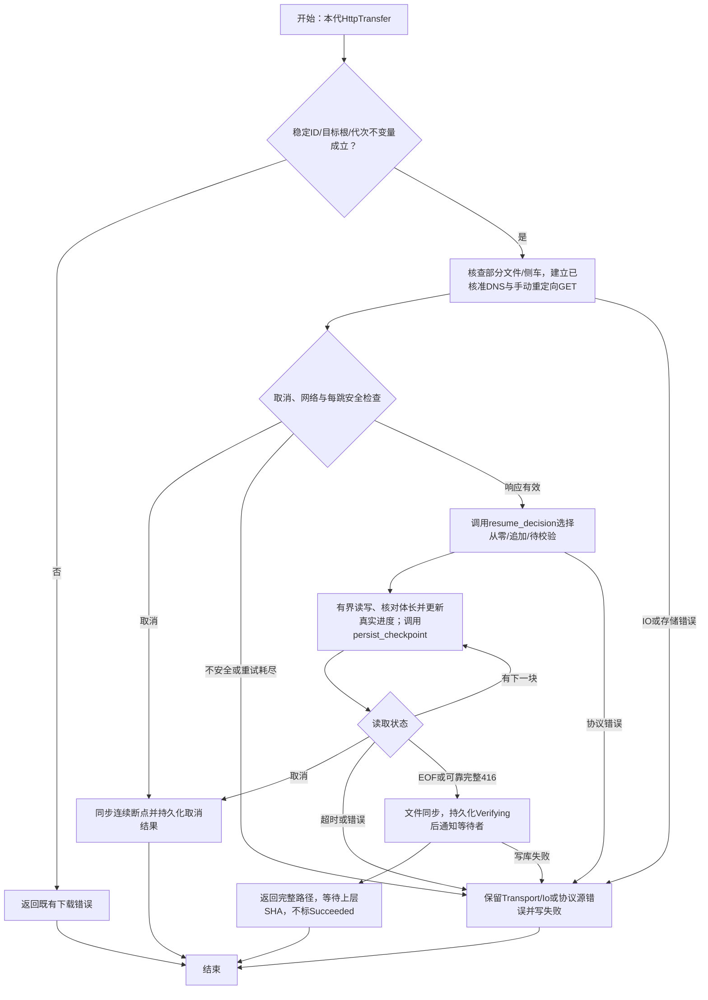

```json
{
  "编号": "003",
  "依赖": [
    "002"
  ]
}
```

# 003 实现受限跨平台 HTTP 流式传输

- 任务：实现受限跨平台 HTTP 流式传输
- 工作区：download（读写）——crates/platform/storage/download/src/http.rs、utils.rs；独立传输与安全测试
- 产出：可取消、可续传、真实进度的 reqwest worker
- 前置任务：002 实现连续断点证据与续传判定
- 后置任务：004 切换下载门面并兼容已有任务
- 设计依据：第三节 3.1、3.2；F32；第六节 6.4 的 HttpTransfer
- 验收标准：
  - 下载使用有界块缓冲；连接超时 15 秒、无进展 60 秒、沿用 MAX_RETRIES=1，不为长文件设置过短总时限，不运行 aria2/curl。
  - 每跳手动重定向重新检查 URL/IP 并将核准地址固定到连接；最多五跳，拒绝凭证 URL、私网/回环/链路本地、HTTPS 降级和敏感头跨主机泄漏。
  - CUDA 固定代理路径若跳到 GitHub/资源直连域名则拒绝；无法固定验证解析的环境 HTTP 代理路径明确失败。
  - 传输落盘及状态持久化后进入 Verifying 而非 Succeeded；取消保留可核验连续断点；数据库/网络/磁盘错误均可观察且不吞源错误。
  - 受管 models 与 runtimes/downloads 可写而 executable/models 不可写时，新受管任务仍可初始化；任意根外/链接/跨文件系统目标拒绝。
  - 独立测试以私有注入访问回环测试服务，生产构建不存在 SSRF 放行开关；覆盖续传、远端变化、取消、ENOSPC 与重定向回归。

> 来源：开发序号5、用户于2026-11-24确认的 `../local-model-auto-deploy-dev-doc.md`、同目录流程图与接口契约；分支 `codex/local-model-auto-deploy`，工作区以 `../dev-context.md` 为准。任务定义不代表业务代码或实机验收已完成；实际执行次序只采用脚本生成的 `execution-order.md`。

## 范围与执行约束

- 仅使用已有下载任务及 DownloadDB 能力，不新增通用传输插件框架或公共下载入口。
- 只实现本任务摘录的定稿设计；新函数/方法/字段默认私有，跨文件和跨crate可见性不得超过开发文档第六节公开清单，不为测试导出内部实现。
- 注释与rustdoc使用中文；公共边界黑盒校验，内部公有函数白盒契约检查；私有函数不重复校验已保证参数，但新读取的网络/磁盘/归档/进程结果仍须验证。
- 测试写入独立文件；每个公有API/内部公有方法有独立测试，关键公共模块提供可编译# Examples，修复有回归；不使用unsafe、外部输入unwrap/expect或静默丢弃Result。
- 只写上述登记工作区和具体范围；project-root仅登记允许的Cargo.toml/Cargo.lock/README.md/本轮文档。不得覆盖用户target运行时、未跟踪server/docs文件、开发规范或dev-context.md。
- 编码/测试/提交状态由后续任务报告如实记录；提交使用Conventional Commits，提交前后均执行cargo fmt、cargo clippy、cargo test并记录实际feature/target与结果。真实硬件、许可、签名或测试资源缺失不填假证据。

## 实现内容

### 函数定义

#### F32 run_http_transfer

- 函数名称：`run_http_transfer`
- 公开属性：公有函数（pub(super)）
- 多线程属性：异步
- 函数归属：独立函数
- 所属模块或包：`download::http`
- 职责说明：执行一代原生 HTTP 传输，真实更新进度，响应取消并落盘状态。
- 入参列表：

| 名称 | 类型 | 是否必填 | 含义 |
| --- | --- | --- | --- |
| task | `HttpTransfer` | 是 | 由下载门面创建的严格传输目标 |
| client | `reqwest::Client` | 是 | 受限 HTTP 客户端 |
| cancelled | `CancellationToken` | 是 | 该下载任务取消通知 |

- 返回值列表：

| 名称 | 类型 | 含义 |
| --- | --- | --- |
| result | `Result<PathBuf, DownloadError>` | 完整文件进入 Verifying，尚非上层 Verified |

- 错误返回：现有 DownloadError；新 Transport/Io 保留源错误，见六节
- 校验规则：白盒校验：稳定 ID/目标根/代次不变量；每跳 URL、DNS、HTTP 响应和文件写入是新外部边界。
- 调用关系：

| 方向 | 函数 |
| --- | --- |
| 调用 | resume_decision；persist_checkpoint；既有 DownloadDB 状态/进度方法 |
| 被调用 | DownloadManager 既有 start_or_join/restore_incomplete 改造 |

- 函数内部流程图（本任务依据定稿职责与上游状态流转设计）：



---
