```json
{
  "编号": "004",
  "依赖": [
    "003"
  ]
}
```

# 004 切换下载门面并兼容已有任务

- 任务：切换下载门面并兼容已有任务
- 工作区：download（读写）——crates/platform/storage/download/src/{manager,operations,monitor,types,lib}.rs、Cargo.toml、README.md；独立API测试
- 工作区：database-sys（读写）——crates/platform/storage/database-sys/src/download.rs 中传输语义文档
- 工作区：project-root（读写）——Cargo.lock（仅实际依赖解析更新）
- 产出：不引导 aria2 的 DownloadManager、旧记录恢复与完整公共 API 回归
- 前置任务：003 实现受限跨平台 HTTP 流式传输
- 后置任务：010 实现共享受管运行时准备与原子启用；012 实现模型共享下载与真实摘要启用；025 同步本机自动部署用户说明与支持边界
- 设计依据：第三节 3.2；第五节 5.1、F35、F54–F63；第六节 6.1
- 验收标准：
  - 既有全部公共方法签名、可见性、稳定数字 task_id 和快照字段保持；gid 采用 http:UUID，不再 quick_start、RPC 或轮询 aria2。
  - new/with_database/with_store 使用既有连接与唯一下载器；升级后旧下载记录保留稳定 ID，旧 GID 不作实体凭据，完整旧文件经实际 SHA 后方可复用。
  - 身份登记不得在途换文件；上层真实摘要与期望及状态一致才 mark_task_verified；成功、失败、取消竞争不覆盖终态。
  - cancel_task 先落库再通知本下载；wait_for_task 等待者断开不取消共享传输；download 仍只保证传输完成，不假称已做上层 SHA。
  - 保留 DownloadError::Aria2 等旧变体；仅按已批准公开清单新增 Transport(reqwest::Error)、Io(std::io::Error)，保留错误链并更新工作区内穷尽匹配。
  - F54–F63 各自具有独立文件中的公共 API 测试；中文 rustdoc、关键 # Examples 与 download README 同步；旧 CLI/模型下载接口通过回归。

> 来源：开发序号5、用户于2026-11-24确认的 `../local-model-auto-deploy-dev-doc.md`、同目录流程图与接口契约；分支 `codex/local-model-auto-deploy`，工作区以 `../dev-context.md` 为准。任务定义不代表业务代码或实机验收已完成；实际执行次序只采用脚本生成的 `execution-order.md`。

## 范围与执行约束

- 不删除 aria2 crate，不扩大允许下载根，不把父任务取消转成共享下载 cancel_task。
- 只实现本任务摘录的定稿设计；新函数/方法/字段默认私有，跨文件和跨crate可见性不得超过开发文档第六节公开清单，不为测试导出内部实现。
- 注释与rustdoc使用中文；公共边界黑盒校验，内部公有函数白盒契约检查；私有函数不重复校验已保证参数，但新读取的网络/磁盘/归档/进程结果仍须验证。
- 测试写入独立文件；每个公有API/内部公有方法有独立测试，关键公共模块提供可编译# Examples，修复有回归；不使用unsafe、外部输入unwrap/expect或静默丢弃Result。
- 只写上述登记工作区和具体范围；project-root仅登记允许的Cargo.toml/Cargo.lock/README.md/本轮文档。不得覆盖用户target运行时、未跟踪server/docs文件、开发规范或dev-context.md。
- 编码/测试/提交状态由后续任务报告如实记录；提交使用Conventional Commits，提交前后均执行cargo fmt、cargo clippy、cargo test并记录实际feature/target与结果。真实硬件、许可、签名或测试资源缺失不填假证据。

## 实现内容

### 实现约束原文摘录

#### 5.1 既有下载公共 API 保持与实现约束

下列函数的签名和可见性保持原状，并分别提供独立测试；它们是既有函数，不增加新的对外下载接口。其传输生命周期由上述 HTTP 传输与 with_store 定义接续，不再通过 aria2。

| 函数名称 | 公开属性 | 多线程属性 | 入参/返回沿用 | 校验与调用 |
| --- | --- | --- | --- | --- |
| DownloadManager::new | 公有函数 pub | 异步 | 无 / Result<Self> | 初始化数据库白盒检查；调用 with_store |
| DownloadManager::with_database | 公有函数 pub | 异步 | Arc<Database> / Result<Self> | 共享连接有效；调用 with_store，不另开库 |
| DownloadManager::start_download | 公有函数 pub | 异步 | url,dir / Result<DownloadTaskHandle> | 黑盒 URL/路径边界在入口完成；身份键与稳定 ID 保留；调用原生传输 |
| DownloadManager::get_task | 公有函数 pub | 异步 | task_id / Result<Option<DownloadTaskSnapshot>> | 正数字 ID 与记录白盒核对；新快照无 aria2 RPC |
| DownloadManager::set_task_identity | 公有函数 pub | 异步 | 沿现有身份参数 / Result | 严格身份、摘要格式和稳定 ID 白盒核对；不可更换在途工件 |
| DownloadManager::mark_task_verified | 公有函数 pub | 异步 | 沿现有任务/摘要参数 / Result | 实际摘要由上层给出，白盒核对格式/任务阶段；与取消/终态串行 |
| DownloadManager::mark_task_verification_failed | 公有函数 pub | 异步 | 沿现有任务/错误参数 / Result | 白盒核对状态和错误；失败文件不得登记可信 |
| DownloadManager::cancel_task | 公有函数 pub | 异步 | task_id / Result | 白盒核对可取消状态；先落盘意图再取消该下载令牌 |
| DownloadManager::wait_for_task | 公有函数 pub | 异步 | task_id / Result<PathBuf> | 白盒 ID/阶段；Verifying 仍由上层做真实 SHA |
| DownloadManager::download | 公有函数 pub | 异步 | url,dir / Result<PathBuf> | 保留原 start+wait 语义，不假称上层已 Verified |

上述方法属于下载 crate 已有对外能力，其 URL/目录来自外部时，入口执行黑盒安全校验，不因内部调用而跳过。其余只有内部严格类型的调用按白盒契约处理。被调用方继续是现有 CLI/旧模型下载 HTTP 和新模型/运行时准备作业；错误继续用 DownloadError，恢复/进度/GID 文档同步去除强绑定 aria2 的描述。

### 函数定义

#### F35 DownloadManager::with_store（既有私有改造）

- 函数名称：`DownloadManager::with_store（既有私有改造）`
- 公开属性：私有函数
- 多线程属性：异步
- 函数归属：DownloadManager 方法
- 所属模块或包：`download::operations`
- 职责说明：不再 quick_start；建立 reqwest 管理器并恢复旧下载记录。
- 入参列表：

| 名称 | 类型 | 是否必填 | 含义 |
| --- | --- | --- | --- |
| db | `DownloadDB` | 是 | 现有下载数据库门面 |

- 返回值列表：

| 名称 | 类型 | 含义 |
| --- | --- | --- |
| result | `Result<DownloadManager, DownloadError>` | 唯一管理器；不启动外部下载程序 |

- 错误返回：沿用 DownloadError；新增源错误见六节
- 校验规则：不校验；前置：new/with_database 已取得可用门面；恢复数据库/文件时做新输入检查。
- 调用关系：

| 方向 | 函数 |
| --- | --- |
| 调用 | 既有 restore_incomplete；run_http_transfer |
| 被调用 | DownloadManager::new/with_database |

- 函数内部流程图（本任务依据定稿职责与上游状态流转设计）：

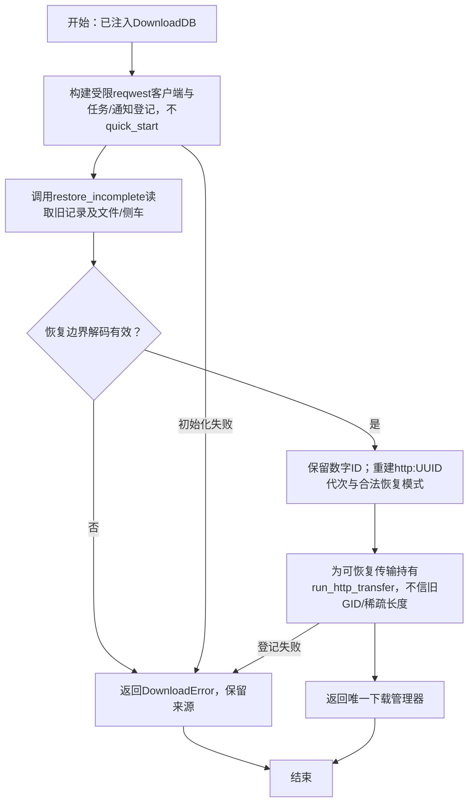

---

#### F54 DownloadManager::new

- 函数名称：`DownloadManager::new`
- 公开属性：公有函数（保持 pub）
- 多线程属性：异步
- 函数归属：DownloadManager 方法
- 所属模块或包：`download::operations`
- 职责说明：保留无参初始化，改用原生传输而非 aria2。
- 入参列表：

| 名称 | 类型 | 是否必填 | 含义 |
| --- | --- | --- | --- |
| 无 | — | — | 无业务入参；方法接收者按所属类型借用 |

- 返回值列表：

| 名称 | 类型 | 含义 |
| --- | --- | --- |
| result | `Result<DownloadManager, DownloadError>` | 初始化完成的管理器 |

- 错误返回：沿既有 DownloadError，Transport/Io 保留来源
- 校验规则：白盒校验：初始化环境和数据库可用；恢复外部记录重新核对。
- 调用关系：

| 方向 | 函数 |
| --- | --- |
| 调用 | DownloadDB::new；with_store |
| 被调用 | 现有调用方及下载器示例 |

- 函数内部流程图（本任务依据定稿职责与上游状态流转设计）：

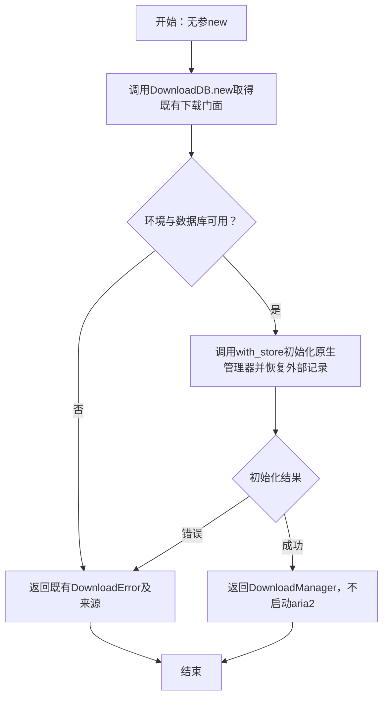

---

#### F55 DownloadManager::with_database

- 函数名称：`DownloadManager::with_database`
- 公开属性：公有函数（保持 pub）
- 多线程属性：异步
- 函数归属：DownloadManager 方法
- 所属模块或包：`download::operations`
- 职责说明：使用主服务已打开连接初始化唯一下载器。
- 入参列表：

| 名称 | 类型 | 是否必填 | 含义 |
| --- | --- | --- | --- |
| db | `Arc<Database>` | 是 | 现有共享连接 |

- 返回值列表：

| 名称 | 类型 | 含义 |
| --- | --- | --- |
| result | `Result<DownloadManager, DownloadError>` | 不另开数据库的管理器 |

- 错误返回：沿既有 DownloadError
- 校验规则：白盒校验：已初始化连接；不在客户端重复创建下载器。
- 调用关系：

| 方向 | 函数 |
| --- | --- |
| 调用 | DownloadDB::new_shared_db；with_store |
| 被调用 | 现有服务 AppState 初始化 |

- 函数内部流程图（本任务依据定稿职责与上游状态流转设计）：

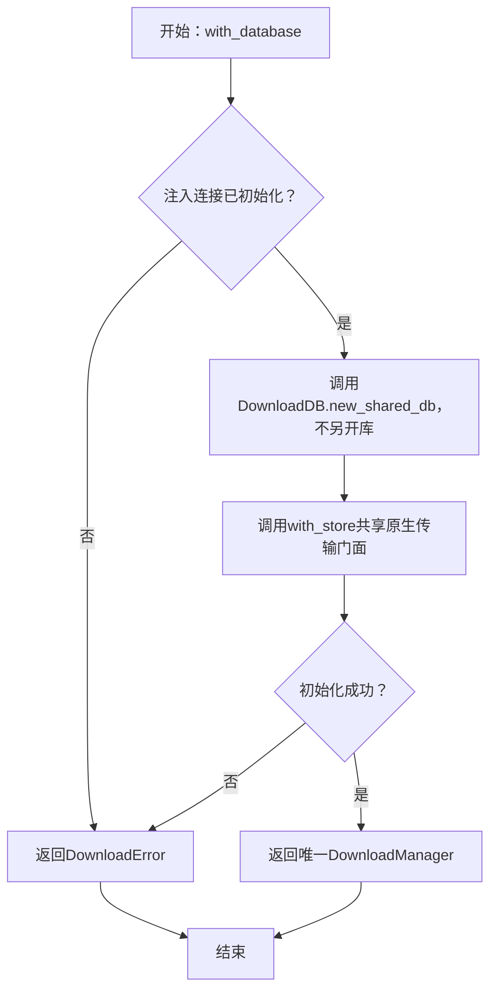

---

#### F56 DownloadManager::start_download

- 函数名称：`DownloadManager::start_download`
- 公开属性：公有函数（保持 pub）
- 多线程属性：异步
- 函数归属：DownloadManager 方法
- 所属模块或包：`download::operations`
- 职责说明：保留稳定任务登记/复用接口，选择原生 HTTP worker。
- 入参列表：

| 名称 | 类型 | 是否必填 | 含义 |
| --- | --- | --- | --- |
| url | `&str` | 是 | 文件 HTTP(S) URL |
| dir | `&str` | 是 | 旧模型根或明确的受管子根 |

- 返回值列表：

| 名称 | 类型 | 含义 |
| --- | --- | --- |
| result | `Result<DownloadTaskHandle, DownloadError>` | 稳定数字 ID、当前不透明 gid 与状态 |

- 错误返回：InvalidUrl；InvalidDirectory；InvalidFilename；Database；Transport；Io
- 校验规则：黑盒校验：URL/DNS/根/文件名边界完成后转严格 HttpTransfer；内部调用不能跳过该公共安全边界。
- 调用关系：

| 方向 | 函数 |
| --- | --- |
| 调用 | 原 start_or_join；run_http_transfer |
| 被调用 | 旧下载 HTTP；prepare_model；install_runtime |

- 函数内部流程图（本任务依据定稿职责与上游状态流转设计）：

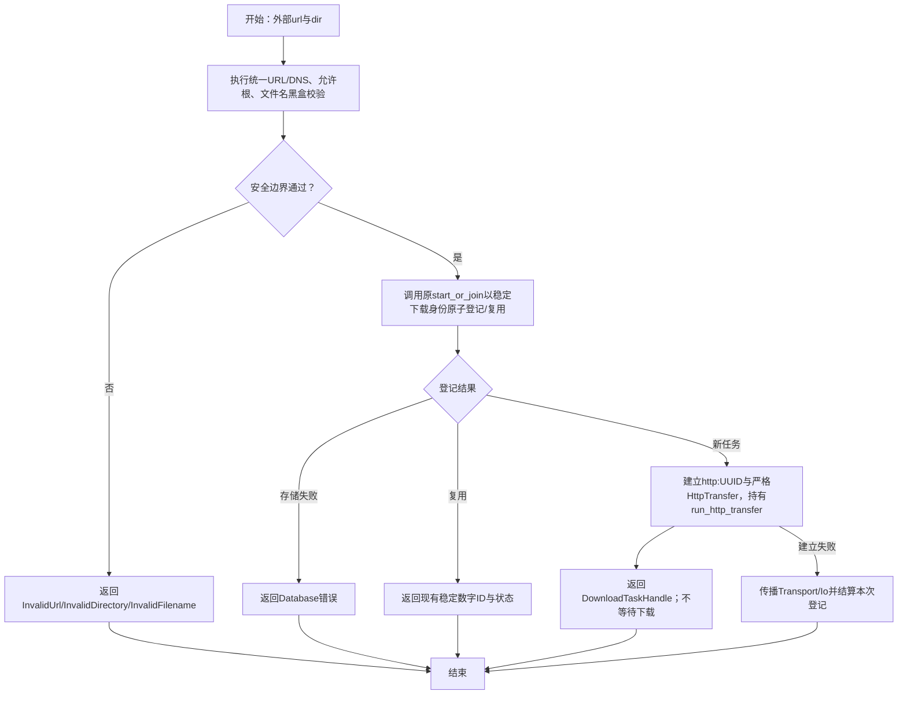

---

#### F57 DownloadManager::get_task

- 函数名称：`DownloadManager::get_task`
- 公开属性：公有函数（保持 pub）
- 多线程属性：异步
- 函数归属：DownloadManager 方法
- 所属模块或包：`download::operations`
- 职责说明：按稳定数字 ID 读取原生传输快照。
- 入参列表：

| 名称 | 类型 | 是否必填 | 含义 |
| --- | --- | --- | --- |
| task_id | `i64` | 是 | 下载稳定 ID |

- 返回值列表：

| 名称 | 类型 | 含义 |
| --- | --- | --- |
| result | `Result<Option<DownloadTaskSnapshot>, DownloadError>` | 不存在为 None；已有字段保持兼容 |

- 错误返回：Database；InvalidRecord
- 校验规则：白盒校验：正数 ID，数据库字段/字节计数/路径按外部存储边界解码；不询问旧 aria2 GID。
- 调用关系：

| 方向 | 函数 |
| --- | --- |
| 调用 | DownloadDB::get_by_id；本管理器传输状态 |
| 被调用 | 新旧模型接口；下载进度订阅 |

- 函数内部流程图（本任务依据定稿职责与上游状态流转设计）：

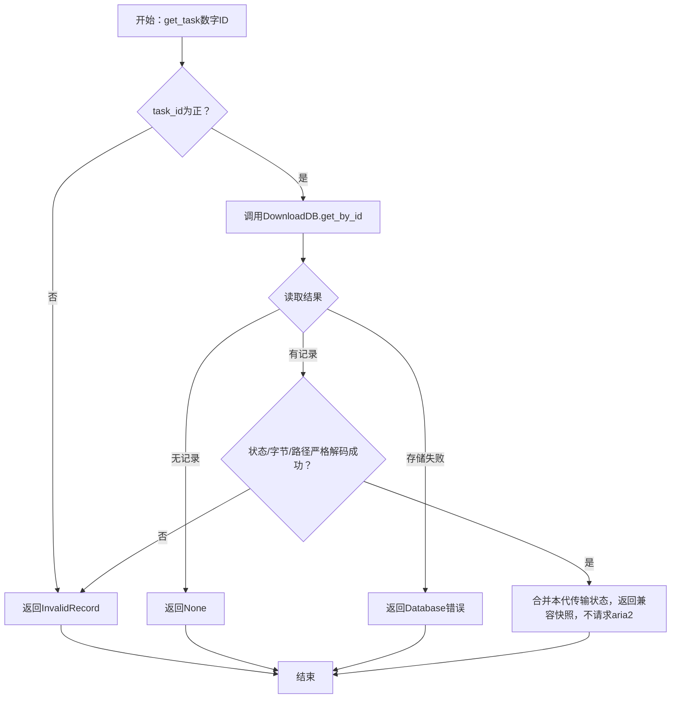

---

#### F58 DownloadManager::set_task_identity

- 函数名称：`DownloadManager::set_task_identity`
- 公开属性：公有函数（保持 pub）
- 多线程属性：异步
- 函数归属：DownloadManager 方法
- 所属模块或包：`download::operations`
- 职责说明：保留原始模型身份与期望摘要持久化。
- 入参列表：

| 名称 | 类型 | 是否必填 | 含义 |
| --- | --- | --- | --- |
| task_id | `i64` | 是 | 稳定下载 ID |
| model | `&str` | 是 | 仓库模型 |
| source | `&str` | 是 | 来源 |
| revision | `&str` | 是 | 修订 |
| variant_id | `&str` | 是 | 所选文件 |
| artifact_uri | `&str` | 是 | 上层已经验证的来源地址 |
| checksum | `&str` | 是 | 期望 SHA |

- 返回值列表：

| 名称 | 类型 | 含义 |
| --- | --- | --- |
| result | `Result<(), DownloadError>` | 身份登记结果；此函数不表示文件实际通过 SHA |

- 错误返回：TaskNotFound；Database；InvalidRecord
- 校验规则：白盒校验：ID、规范身份和 SHA/URI 与任务一致；不接受在途换文件。
- 调用关系：

| 方向 | 函数 |
| --- | --- |
| 调用 | get_task；DownloadDB 既有身份更新 |
| 被调用 | 旧下载注册；prepare_model |

- 函数内部流程图（本任务依据定稿职责与上游状态流转设计）：

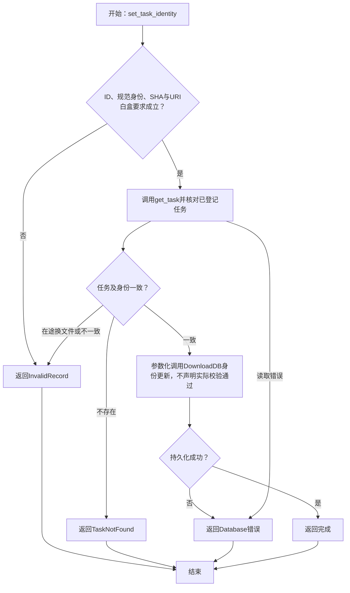

---

#### F59 DownloadManager::mark_task_verified

- 函数名称：`DownloadManager::mark_task_verified`
- 公开属性：公有函数（保持 pub）
- 多线程属性：异步
- 函数归属：DownloadManager 方法
- 所属模块或包：`download::operations`
- 职责说明：将上层全量计算出的实际 SHA 登记为验证成功。
- 入参列表：

| 名称 | 类型 | 是否必填 | 含义 |
| --- | --- | --- | --- |
| task_id | `i64` | 是 | 稳定下载 ID |
| actual_sha256 | `&str` | 是 | 真实计算结果 |

- 返回值列表：

| 名称 | 类型 | 含义 |
| --- | --- | --- |
| result | `Result<(), DownloadError>` | 任务 Succeeded；与取消/失败终态串行 |

- 错误返回：TaskNotFound；Database；InvalidRecord
- 校验规则：白盒校验：ID/摘要规范、实际与已登记期望一致、允许阶段且未取消；不能复制期望值假验。
- 调用关系：

| 方向 | 函数 |
| --- | --- |
| 调用 | get_task；DownloadDB::mark_verified |
| 被调用 | 真实模型/运行包验证调用方 |

- 函数内部流程图（本任务依据定稿职责与上游状态流转设计）：

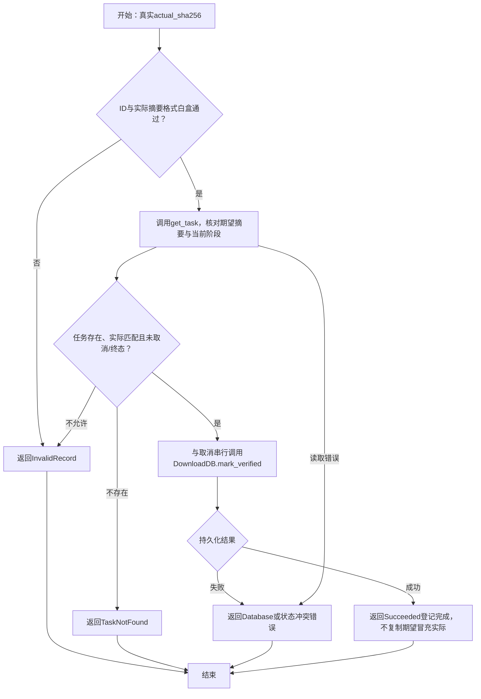

---

#### F60 DownloadManager::mark_task_verification_failed

- 函数名称：`DownloadManager::mark_task_verification_failed`
- 公开属性：公有函数（保持 pub）
- 多线程属性：异步
- 函数归属：DownloadManager 方法
- 所属模块或包：`download::operations`
- 职责说明：持久化真实校验失败和可得的实际摘要。
- 入参列表：

| 名称 | 类型 | 是否必填 | 含义 |
| --- | --- | --- | --- |
| task_id | `i64` | 是 | 稳定下载 ID |
| actual_sha256 | `Option<&str>` | 否 | 可得时的真实摘要 |
| error | `&str` | 是 | 明确失败原因 |

- 返回值列表：

| 名称 | 类型 | 含义 |
| --- | --- | --- |
| result | `Result<(), DownloadError>` | 失败终态；不登记为可信缓存 |

- 错误返回：TaskNotFound；Database；InvalidRecord
- 校验规则：白盒校验：ID/摘要格式与状态合理；不覆盖已取消/已成功终态。
- 调用关系：

| 方向 | 函数 |
| --- | --- |
| 调用 | get_task；DownloadDB::mark_verification_failed |
| 被调用 | 真实模型/运行包验证调用方 |

- 函数内部流程图（本任务依据定稿职责与上游状态流转设计）：

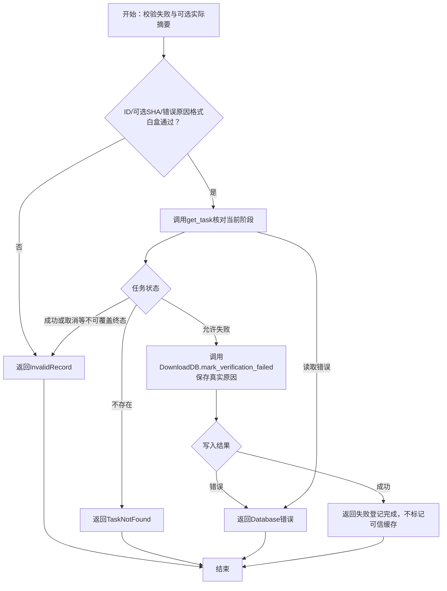

---

#### F61 DownloadManager::cancel_task

- 函数名称：`DownloadManager::cancel_task`
- 公开属性：公有函数（保持 pub）
- 多线程属性：异步
- 函数归属：DownloadManager 方法
- 所属模块或包：`download::operations`
- 职责说明：保留旧下载取消语义，原生令牌仅针对该下载任务。
- 入参列表：

| 名称 | 类型 | 是否必填 | 含义 |
| --- | --- | --- | --- |
| task_id | `i64` | 是 | 下载稳定 ID |

- 返回值列表：

| 名称 | 类型 | 含义 |
| --- | --- | --- |
| result | `Result<DownloadTaskSnapshot, DownloadError>` | 取消快照或原已取消快照 |

- 错误返回：TaskNotFound；TaskNotCancellable；Database；Compensation
- 校验规则：白盒校验：ID/当前状态，先持久化再取消；不把父任务取消直接转此调用以免影响共享下载。
- 调用关系：

| 方向 | 函数 |
| --- | --- |
| 调用 | get_task；DownloadDB 取消写入；本下载令牌 |
| 被调用 | 原下载 HTTP DELETE；不由新父任务取消直接调用 |

- 函数内部流程图（本任务依据定稿职责与上游状态流转设计）：

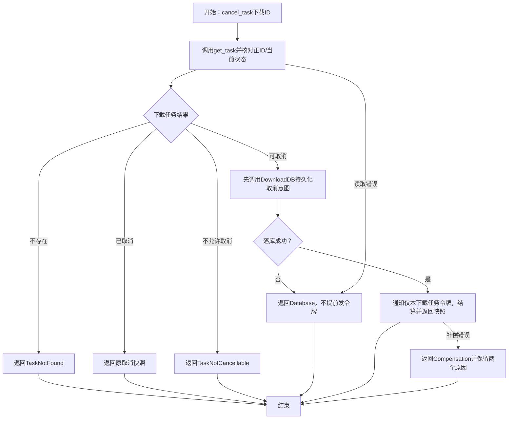

---

#### F62 DownloadManager::wait_for_task

- 函数名称：`DownloadManager::wait_for_task`
- 公开属性：公有函数（保持 pub）
- 多线程属性：异步
- 函数归属：DownloadManager 方法
- 所属模块或包：`download::operations`
- 职责说明：等待已登记下载文件落盘，保留等待者通知与错误传播。
- 入参列表：

| 名称 | 类型 | 是否必填 | 含义 |
| --- | --- | --- | --- |
| task_id | `i64` | 是 | 稳定下载 ID |

- 返回值列表：

| 名称 | 类型 | 含义 |
| --- | --- | --- |
| result | `Result<PathBuf, DownloadError>` | 传输完成的文件；不替代上层全量 SHA |

- 错误返回：TaskNotFound；Failed；NotificationClosed；Database
- 校验规则：白盒校验：正数 ID/允许状态，返回路径确属任务；等待者断开不取消共享传输。
- 调用关系：

| 方向 | 函数 |
| --- | --- |
| 调用 | get_task；现有 oneshot 等待机制 |
| 被调用 | DownloadManager::download；prepare_model；install_runtime |

- 函数内部流程图（本任务依据定稿职责与上游状态流转设计）：

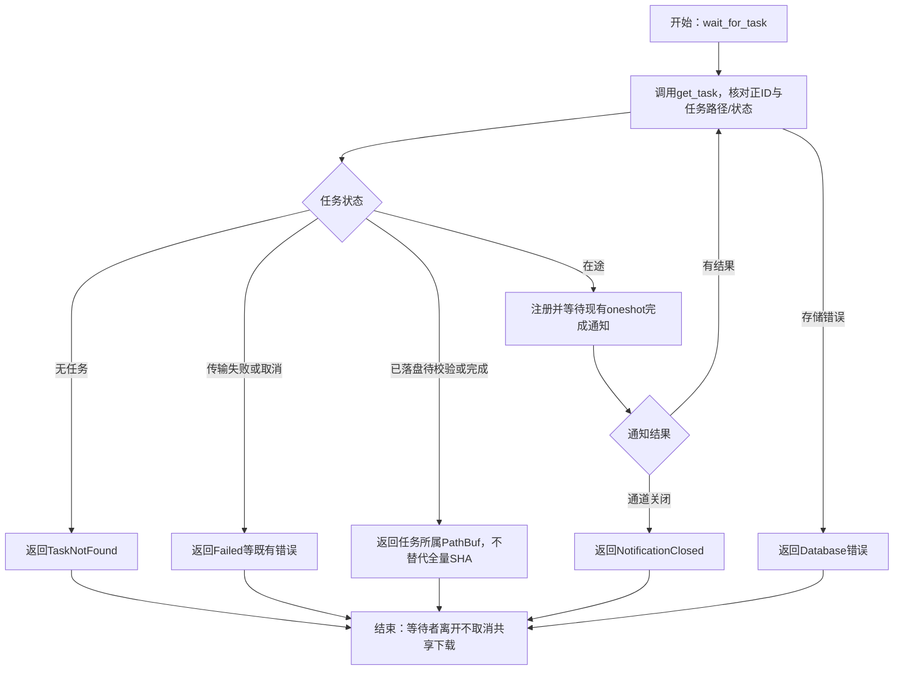

---

#### F63 DownloadManager::download

- 函数名称：`DownloadManager::download`
- 公开属性：公有函数（保持 pub）
- 多线程属性：异步
- 函数归属：DownloadManager 方法
- 所属模块或包：`download::operations`
- 职责说明：保留原 start+wait 便捷调用。
- 入参列表：

| 名称 | 类型 | 是否必填 | 含义 |
| --- | --- | --- | --- |
| url | `&str` | 是 | 外部文件地址 |
| dir | `&str` | 是 | 允许下载根 |

- 返回值列表：

| 名称 | 类型 | 含义 |
| --- | --- | --- |
| result | `Result<PathBuf, DownloadError>` | 文件落盘；仍由上层验证 SHA |

- 错误返回：沿 start_download/wait_for_task 错误
- 校验规则：黑盒校验委托同一 start_download 公共入口完成，不引入第二套宽松下载路径。
- 调用关系：

| 方向 | 函数 |
| --- | --- |
| 调用 | start_download；wait_for_task |
| 被调用 | 现有 CLI/示例调用方 |

- 函数内部流程图（本任务依据定稿职责与上游状态流转设计）：

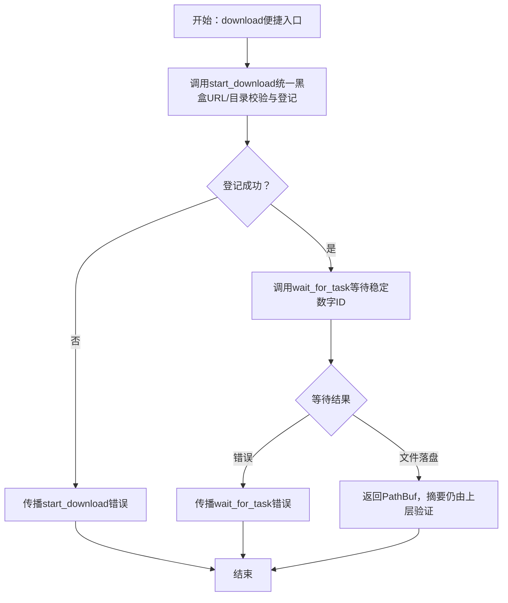

---
