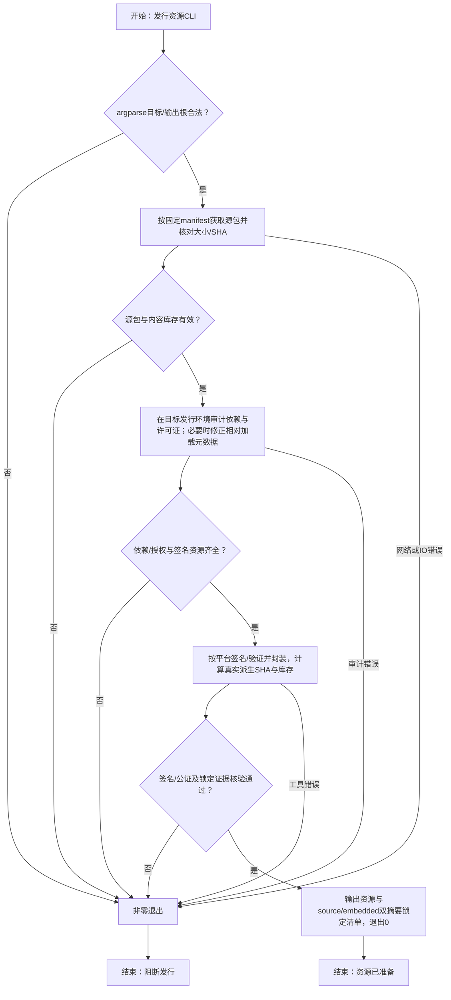

```json
{
  "编号": "006",
  "依赖": [
    "005"
  ]
}
```

# 006 实现发行环境固定资源准备工具

- 任务：实现发行环境固定资源准备工具
- 工作区：runtime-assets（读写）——deploy/scripts/prepare_runtime_assets.py；独立脚本测试与 deploy/runtime/README.md
- 产出：预取/校验/封装运行包及证据锁定工具
- 前置任务：005 登记固定运行包与可信资源库存
- 后置任务：007 实现本平台唯一运行包离线内嵌
- 设计依据：F37；第七节 7.1、7.2
- 验收标准：
  - target 严格限四目标且输出根受限；只获取 manifest 固定源包，下载后先核 SHA/长度，再枚举库存，错误页/包缺失明确非零退出。
  - macOS 相对加载修正先于由内到外签名；派生包独立记录 embedded_sha256、库存和签名/公证证据，不沿用源摘要冒充。
  - Linux 审计必要 so 与相对加载路径，不打包替换 glibc，不要求用户 apt/Homebrew；新增再分发内容具有真实许可证据。
  - Windows VC++ 安装程序独立锁定摘要、微软签名及再分发授权；证据缺失非零退出，不提供跳过门禁参数。
  - 测试覆盖源/派生摘要差异、错误 target、错包、缺库存/授权/签名与合法固定输入；工具只在发行环境运行，不作为客户端安装前提。

> 来源：开发序号5、用户于2026-11-24确认的 `../local-model-auto-deploy-dev-doc.md`、同目录流程图与接口契约；分支 `codex/local-model-auto-deploy`，工作区以 `../dev-context.md` 为准。任务定义不代表业务代码或实机验收已完成；实际执行次序只采用脚本生成的 `execution-order.md`。

## 范围与执行约束

- 实现可用的 fail-closed 工具不等于已取得所有平台签名授权；缺失的真实资源如实留作发行阻断。
- 只实现本任务摘录的定稿设计；新函数/方法/字段默认私有，跨文件和跨crate可见性不得超过开发文档第六节公开清单，不为测试导出内部实现。
- 注释与rustdoc使用中文；公共边界黑盒校验，内部公有函数白盒契约检查；私有函数不重复校验已保证参数，但新读取的网络/磁盘/归档/进程结果仍须验证。
- 测试写入独立文件；每个公有API/内部公有方法有独立测试，关键公共模块提供可编译# Examples，修复有回归；不使用unsafe、外部输入unwrap/expect或静默丢弃Result。
- 只写上述登记工作区和具体范围；project-root仅登记允许的Cargo.toml/Cargo.lock/README.md/本轮文档。不得覆盖用户target运行时、未跟踪server/docs文件、开发规范或dev-context.md。
- 编码/测试/提交状态由后续任务报告如实记录；提交使用Conventional Commits，提交前后均执行cargo fmt、cargo clippy、cargo test并记录实际feature/target与结果。真实硬件、许可、签名或测试资源缺失不填假证据。

## 实现内容

### 函数定义

#### F37 prepare_runtime_assets.py::main

- 函数名称：`prepare_runtime_assets.py::main`
- 公开属性：私有函数
- 多线程属性：普通
- 函数归属：独立函数
- 所属模块或包：`deploy/scripts`
- 职责说明：发行环境预取固定资产并核对摘要/许可/包库存；不在用户端运行。
- 入参列表：

| 名称 | 类型 | 是否必填 | 含义 |
| --- | --- | --- | --- |
| target | `str` | 是 | 四目标之一 |
| output | `Path` | 是 | CI 明确暂存根 |

- 返回值列表：

| 名称 | 类型 | 含义 |
| --- | --- | --- |
| result | `exit code` | 仅在资源与清单/证据一致时成功 |

- 错误返回：非零退出阻断发行；不伪造许可/签名/测试证据
- 校验规则：不校验；CLI 参数是外部边界，由 argparse 的严格 choices/路径检查负责，下载内容再核验。
- 调用关系：

| 方向 | 函数 |
| --- | --- |
| 调用 | 固定运行时 manifest；标准库 HTTP/归档/SHA；发行签名验证工具 |
| 被调用 | cd-release 工作流资源阶段 |

- 函数内部流程图（本任务依据定稿职责与上游状态流转设计）：



---
