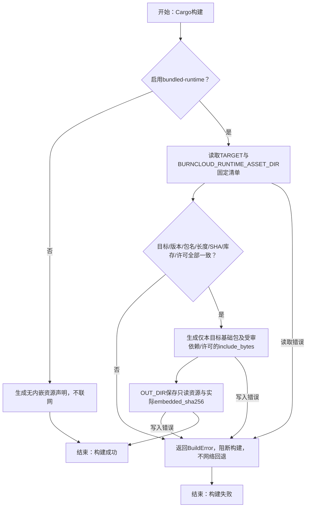

```json
{
  "编号": "007",
  "依赖": [
    "006"
  ]
}
```

# 007 实现本平台唯一运行包离线内嵌

- 任务：实现本平台唯一运行包离线内嵌
- 工作区：server（读写）——crates/interfaces/server/build.rs、Cargo.toml 与私有只读资源声明；独立构建测试
- 工作区：project-root（读写）——Cargo.toml 的 bundled-runtime feature 及必要 Cargo.lock
- 产出：按 TARGET/feature 校验的离线构建资源
- 前置任务：006 实现发行环境固定资源准备工具
- 后置任务：008 实现受审归档安全解压；009 实现运行时实测与固定后端启动参数；010 实现共享受管运行时准备与原子启用；024 扩展四目标便携发行与证据门禁
- 设计依据：F36；第七节 7.2；第六节 6.1
- 验收标准：
  - 根 feature 转发 server feature；默认开发不内嵌，发行启用；build.rs 只读取 BURNCLOUD_RUNTIME_ASSET_DIR 和固定清单，绝不联网或调用下载工具。
  - 资源缺失、target/version/name/长度/实际 SHA/展开库存或许可记录不符均构建失败；签名派生包与真实 embedded_sha256 匹配。
  - 每目标生成的 include_bytes 只包含该平台一份基础压缩包与本平台必要受审依赖/许可，不内嵌其他平台或 CUDA。
  - 无 feature 开发构建可编译，显式运行时仍可用；不具内嵌资源时运行期错误为 bundled_runtime_missing 而非在线回退。
  - 独立构建测试检查有效资源与全部拒绝分支；资源和许可随主二进制保留，单文件更新不丢必要说明。

> 来源：开发序号5、用户于2026-11-24确认的 `../local-model-auto-deploy-dev-doc.md`、同目录流程图与接口契约；分支 `codex/local-model-auto-deploy`，工作区以 `../dev-context.md` 为准。任务定义不代表业务代码或实机验收已完成；实际执行次序只采用脚本生成的 `execution-order.md`。

## 范围与执行约束

- 不扩建安装器/updater，不将四个平台压缩资源合并编入一个程序。
- 清单对应RuntimeAsset的Rust只读类型与资源声明在本任务落地；任务005只登记发行清单，不使运行期依赖尚未实现的类型。
- 只实现本任务摘录的定稿设计；新函数/方法/字段默认私有，跨文件和跨crate可见性不得超过开发文档第六节公开清单，不为测试导出内部实现。
- 注释与rustdoc使用中文；公共边界黑盒校验，内部公有函数白盒契约检查；私有函数不重复校验已保证参数，但新读取的网络/磁盘/归档/进程结果仍须验证。
- 测试写入独立文件；每个公有API/内部公有方法有独立测试，关键公共模块提供可编译# Examples，修复有回归；不使用unsafe、外部输入unwrap/expect或静默丢弃Result。
- 只写上述登记工作区和具体范围；project-root仅登记允许的Cargo.toml/Cargo.lock/README.md/本轮文档。不得覆盖用户target运行时、未跟踪server/docs文件、开发规范或dev-context.md。
- 编码/测试/提交状态由后续任务报告如实记录；提交使用Conventional Commits，提交前后均执行cargo fmt、cargo clippy、cargo test并记录实际feature/target与结果。真实硬件、许可、签名或测试资源缺失不填假证据。

## 实现内容

### 函数定义

#### F36 build.rs::main

- 函数名称：`build.rs::main`
- 公开属性：私有函数
- 多线程属性：普通
- 函数归属：独立函数
- 所属模块或包：`server 构建脚本`
- 职责说明：按 Cargo TARGET 和 bundled-runtime feature 校验并生成唯一内嵌资源声明；绝不联网。
- 入参列表：

| 名称 | 类型 | 是否必填 | 含义 |
| --- | --- | --- | --- |
| 无 | — | — | 无业务入参；方法接收者按所属类型借用 |

- 返回值列表：

| 名称 | 类型 | 含义 |
| --- | --- | --- |
| result | `Result<(), BuildError>` | OUT_DIR 生成只读资源引用；无 feature 则无内嵌资源 |

- 错误返回：构建失败，不映射 HTTP 错误码
- 校验规则：不校验；环境/清单/归档是构建外部输入，必须验证 target、版本、文件名、长度、SHA 和展开元数据。
- 调用关系：

| 方向 | 函数 |
| --- | --- |
| 调用 | sha2；固定 manifest 读取；include_bytes 生成 |
| 被调用 | cargo build |

- 函数内部流程图（本任务依据定稿职责与上游状态流转设计）：



---
