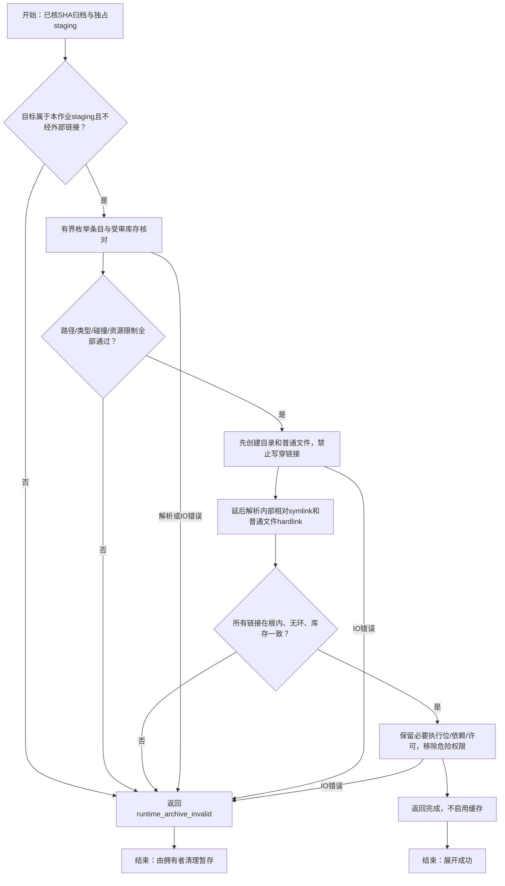

```json
{
  "编号": "008",
  "依赖": [
    "007",
    "015"
  ]
}
```

# 008 实现受审归档安全解压

- 任务：实现受审归档安全解压
- 工作区：server（读写）——crates/interfaces/server/src/runtime_archive.rs、Cargo.toml；独立恶意归档与权限测试
- 工作区：project-root（读写）——Cargo.lock（仅 tar/flate2 等实际依赖）
- 产出：受限 ZIP/tar.gz 提取与安全内部链接处理
- 前置任务：007 实现本平台唯一运行包离线内嵌；015 实现部署任务数据与本机仓储 CAS
- 后置任务：010 实现共享受管运行时准备与原子启用
- 设计依据：F25；第三节 3.4 第 3–7 项
- 验收标准：
  - 拒绝绝对/盘符/UNC/..、反斜线混淆、NUL、Windows ADS/设备名、大小写碰撞、重复冲突、设备/FIFO、越界或循环链接；不存在 staging 外部写入。
  - 约束路径≤4096字节、条目≤100000、单文件≤2GiB、总量≤4GiB，且不超过固定库存；畸形/截断/炸弹归档明确失败。
  - 先目录/普通文件后解析链接；hardlink 仅指已提取普通文件，symlink 相对且最终在根内，无沿已有链接写穿；Windows 未受审链接拒绝。
  - 保留受审 DLL/dylib/so、许可、相对路径和必要执行位，移除 suid/sgid/多余写权限；CUDA 两包重叠仅受审同内容或明确组合清单允许。
  - 目标仅独占 staging；失败不启用缓存，清理失败返回可见错误；不调用 shell 解压或依赖用户工具。

> 来源：开发序号5、用户于2026-11-24确认的 `../local-model-auto-deploy-dev-doc.md`、同目录流程图与接口契约；分支 `codex/local-model-auto-deploy`，工作区以 `../dev-context.md` 为准。任务定义不代表业务代码或实机验收已完成；实际执行次序只采用脚本生成的 `execution-order.md`。

## 范围与执行约束

- 摘要通过后仍逐条验证归档结构；不为测试将解压器对 crate 外公开。
- 只实现本任务摘录的定稿设计；新函数/方法/字段默认私有，跨文件和跨crate可见性不得超过开发文档第六节公开清单，不为测试导出内部实现。
- 注释与rustdoc使用中文；公共边界黑盒校验，内部公有函数白盒契约检查；私有函数不重复校验已保证参数，但新读取的网络/磁盘/归档/进程结果仍须验证。
- 测试写入独立文件；每个公有API/内部公有方法有独立测试，关键公共模块提供可编译# Examples，修复有回归；不使用unsafe、外部输入unwrap/expect或静默丢弃Result。
- 只写上述登记工作区和具体范围；project-root仅登记允许的Cargo.toml/Cargo.lock/README.md/本轮文档。不得覆盖用户target运行时、未跟踪server/docs文件、开发规范或dev-context.md。
- 编码/测试/提交状态由后续任务报告如实记录；提交使用Conventional Commits，提交前后均执行cargo fmt、cargo clippy、cargo test并记录实际feature/target与结果。真实硬件、许可、签名或测试资源缺失不填假证据。

## 实现内容

### 实现约束原文摘录

#### 3.4 受管运行时与安全解压

1. 显式 BURNCLOUD_LLAMA_SERVER 存在时只验证并探测该程序，不回退搜索 PATH，不替换、不下载覆盖。版本约束以请求和实测为准；显式版本不是自动谎报 b8581。失败明确 runtime_configuration_invalid/runtime_probe_failed。
2. 否则按 b8581+目标+包类型加入服务级共享准备作业；先验证受管缓存，再从本平台内嵌资源准备；macOS CPU/Metal 共享同一原生包安装，设备选择仍逐次探测。开发构建无资源、无有效缓存时 bundled_runtime_missing，不临时访问 GitHub 或编译。
3. Windows cuda 固定准备两个包，均通过各自 SHA 后才解压合并；同路径同内容可复用，同路径不同内容必须在受审组合清单中明确，否则拒绝。不下载 Toolkit 或驱动。
4. 归档在随机 staging 中处理；受信包先核对压缩字节 SHA，再枚举条目。拒绝绝对/盘符/UNC 路径、..、反斜线混淆、NUL、Windows ADS/保留设备名、大小写碰撞、重复冲突条目、设备/FIFO、越界/循环链接及写穿已有链接。路径上限 4096 字节、最多 100000 条目、单文件上限 2 GiB、总展开上限 4 GiB，同时不得超过受审包清单上界。
5. 先创建目录和普通文件，所有链接延后统一解析到安装根内的有效目标；hardlink 只指向已提取普通文件，symlink 只能使用相对路径，链必须无环。后续文件不能写入链接目录。Windows 的首期 ZIP 如出现未受审链接则拒绝；macOS/Linux 保留受审内部链接及必要执行权限，去除 suid/sgid 和多余写权限。不调用 shell 解压或要求用户安装工具。
6. 受管资源完整保留 DLL/dylib/so 和许可证；mac/Linux 归档顶层 llama-b8581 按清单定位，不靠全盘找第一个同名程序。完成版本、动态库、依赖、设备探测后写 ready.json，再将同文件系统 staging 原子 rename 成内容寻址安装。已有有效目录不覆盖；损坏或使用中的目录不原地修补。物理目录名加安装 ID，允许保留被使用的坏副本并原子启用新副本；逻辑缓存键仍为版本/平台/包类型，不增设数据库全局指针。
7. 缓存 ready.json 不是信任根。复用时根据内置固定包 SHA 验证保留归档，并以归档内容或受审只读库存核对安装文件、内部链接和权限；仅有一个可改 marker 不足以视为缓存有效。失败在新 staging 重建，不修改已有运行实例目录。
8. 探测子进程只执行固定参数 `--version`、`--list-devices`，每次 15 秒、捕获输出上限 1 MiB；超时由自有句柄终止并等待退出，失败返回错误。CPU 不要求 GPU 存在；Metal/CUDA 必须确认设备被实际枚举并将设备标识交给适配器，启动后仍须健康验证。
9. 启动参数由适配器生成：CPU 使用 `--n-gpu-layers 0`；选定 Metal/CUDA 使用固定 GPU layers 设置和实际设备选择参数，不能仅依赖自动默认值。显式启用 `/slots` 所需固定选项（b8581 以实际 `--help` 核对 `--slots`），同时核对 `/v1/models` 精确别名与容量；不能健康通过却因缺容量端点永久不可路由。参数支持性以固定版本 `--help` 的受审验收为门禁；不使用 shell 拼接用户内容。目标始终 loopback，别名为服务端 model_id。
10. Windows 缺 VC++ 时先将受审内嵌安装程序解出到用户根 dependencies/vc_redist.x64.exe（已存在则核对摘要/签名，不覆盖未知文件），界面给出固定相对位置与用户确认操作，不为此新增 HTTP 运行命令端点。随后提示安装本发行内嵌的、授权与签名/摘要均经过审核的 x64 安装程序；写到用户根内，由用户确认运行和系统授权，不自动提权。macOS 不关闭 Gatekeeper、不删除隔离属性，签名/系统拦截如实报告。

### 函数定义

#### F25 unpack_runtime_archive

- 函数名称：`unpack_runtime_archive`
- 公开属性：公有函数（pub(super)）
- 多线程属性：普通（在 spawn_blocking 上执行）
- 函数归属：独立函数
- 所属模块或包：`server::runtime_archive`
- 职责说明：处理可信摘要之后仍不可信的归档结构，受限提取并保留安全内部链接/执行位。
- 入参列表：

| 名称 | 类型 | 是否必填 | 含义 |
| --- | --- | --- | --- |
| archive | `&Path` | 是 | 摘要已通过的压缩包 |
| destination | `&Path` | 是 | 独占新 staging |
| asset | `&RuntimeAsset` | 是 | 固定条目及展开限制 |

- 返回值列表：

| 名称 | 类型 | 含义 |
| --- | --- | --- |
| result | `Result<(), TaskError>` | 完整安全展开或错误；不得留下已启用缓存 |

- 错误返回：runtime_archive_invalid
- 校验规则：白盒校验：目标属于本作业 staging；归档每个路径/类型/链接/资源消耗做黑盒校验，细则见 3.4。
- 调用关系：

| 方向 | 函数 |
| --- | --- |
| 调用 | zip/tar/flate2 安全 API；不直接调用无约束 unpack |
| 被调用 | install_runtime |

- 函数内部流程图（本任务依据定稿职责与上游状态流转设计）：



---
