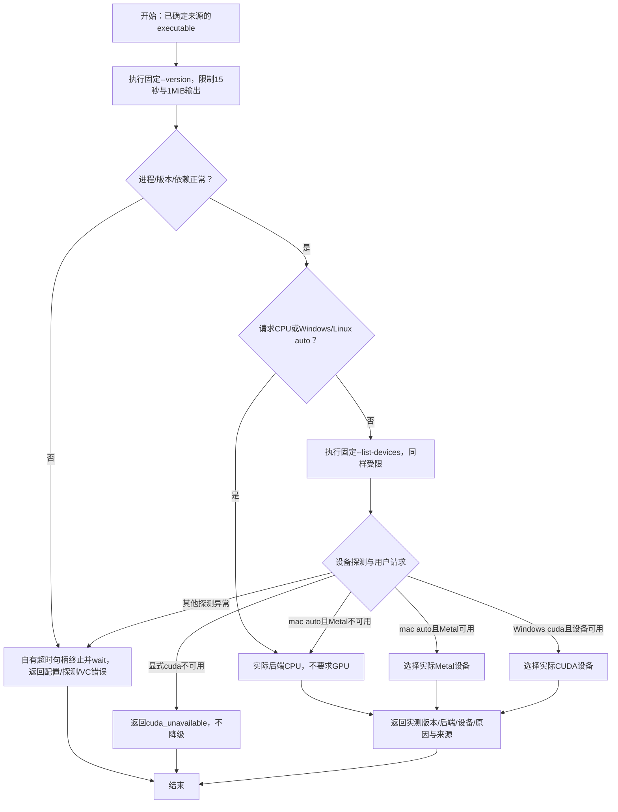
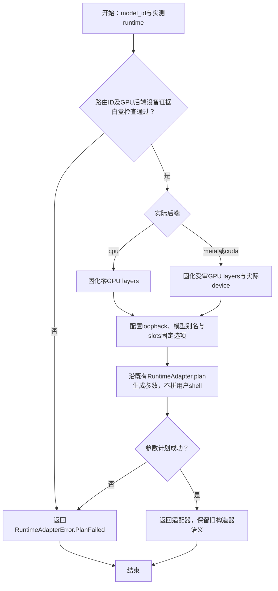

```json
{
  "编号": "009",
  "依赖": [
    "007",
    "015"
  ]
}
```

# 009 实现运行时实测与固定后端启动参数

- 任务：实现运行时实测与固定后端启动参数
- 工作区：server（读写）——crates/interfaces/server/src/managed_runtime.rs、node_runtime.rs；独立探测/参数测试
- 产出：PreparedRuntimeInfo、受限探测与实际设备适配器
- 前置任务：007 实现本平台唯一运行包离线内嵌；015 实现部署任务数据与本机仓储 CAS
- 后置任务：010 实现共享受管运行时准备与原子启用；014 接通可信启动与精确进程路由清理
- 设计依据：F24、F27；第三节 3.4 第 1、8–10 项；第五节 5.2；第六节 6.2
- 验收标准：
  - 固定 --version/--list-devices 探测各 15 秒、输出≤1MiB，超时由自有句柄终止并 wait；错误退出、截断输出、缺动态库均明确失败。
  - 显式配置不被替换、不搜 PATH；实际版本/后端如实返回。CPU 不要求 GPU；mac auto 只有实测 Metal 不可用才 CPU；Windows CUDA 必须枚举实际设备，不静默降级。
  - CPU 参数明确 --n-gpu-layers 0；Metal/CUDA 固定设备与 GPU layers，地址 loopback、别名服务端 model_id，不拼 shell 用户参数。
  - 按 b8581 实际 --help 核对 --slots 及所需选项，并验证 /slots 与 /v1/models 精确别名/容量可满足路由；未做实包验证不冒充兼容通过。
  - Windows 缺 VC++ 将受审安装程序放固定 dependencies 路径并提示用户授权；未知已有文件不覆盖，不自动提权或新增执行命令接口。
  - PreparedRuntime/RuntimeRequest 的公共形状与旧 adapter 构造器可见性不变；for_backend 的内部 API 测试和中文文档完整。

> 来源：开发序号5、用户于2026-11-24确认的 `../local-model-auto-deploy-dev-doc.md`、同目录流程图与接口契约；分支 `codex/local-model-auto-deploy`，工作区以 `../dev-context.md` 为准。任务定义不代表业务代码或实机验收已完成；实际执行次序只采用脚本生成的 `execution-order.md`。

## 范围与执行约束

- 本任务只实现探测和参数固化，不负责安装/共享任务调度；签名与系统安全拦截不得绕过。
- 只实现本任务摘录的定稿设计；新函数/方法/字段默认私有，跨文件和跨crate可见性不得超过开发文档第六节公开清单，不为测试导出内部实现。
- 注释与rustdoc使用中文；公共边界黑盒校验，内部公有函数白盒契约检查；私有函数不重复校验已保证参数，但新读取的网络/磁盘/归档/进程结果仍须验证。
- 测试写入独立文件；每个公有API/内部公有方法有独立测试，关键公共模块提供可编译# Examples，修复有回归；不使用unsafe、外部输入unwrap/expect或静默丢弃Result。
- 只写上述登记工作区和具体范围；project-root仅登记允许的Cargo.toml/Cargo.lock/README.md/本轮文档。不得覆盖用户target运行时、未跟踪server/docs文件、开发规范或dev-context.md。
- 编码/测试/提交状态由后续任务报告如实记录；提交使用Conventional Commits，提交前后均执行cargo fmt、cargo clippy、cargo test并记录实际feature/target与结果。真实硬件、许可、签名或测试资源缺失不填假证据。

## 实现内容

### 数据结构

- 名称：PreparedRuntimeInfo
- 类型：服务模块内不可变结果
- 说明：实际探测结果；与现有PreparedRuntime形状兼容。
- 结构：

```python
class PreparedRuntimeInfo:
    prepared: PreparedRuntime  # 独占拥有；保留现有 executable 公有形状
    effective_backend: EffectiveBackend  # 独占拥有；实际选择
    device: Optional[str]  # 独占拥有；实际设备标识
    origin: str  # 独占拥有；本次来源
    version: str  # 独占拥有；实测版本
    install_root: Optional[PathBuf]  # 独占拥有；受管目录；显式配置不拥有用户目录
```

### 函数定义

#### F24 probe_runtime

- 函数名称：`probe_runtime`
- 公开属性：私有函数
- 多线程属性：异步
- 函数归属：独立函数
- 所属模块或包：`server::managed_runtime`
- 职责说明：执行固定版本/设备探测，限制输出和时间，确认 CPU/Metal/CUDA 与依赖。
- 入参列表：

| 名称 | 类型 | 是否必填 | 含义 |
| --- | --- | --- | --- |
| executable | `&Path` | 是 | 显式或暂存中的程序 |
| backend | `RequestedBackend` | 是 | 用户请求 |
| origin | `RuntimeOrigin` | 是 | 实际来源 |

- 返回值列表：

| 名称 | 类型 | 含义 |
| --- | --- | --- |
| result | `Result<PreparedRuntimeInfo, TaskError>` | 实际版本、后端、设备与选择说明 |

- 错误返回：runtime_configuration_invalid；runtime_probe_failed；vc_runtime_missing；cuda_unavailable
- 校验规则：不校验；前置：调用者已确定路径来源；程序输出/退出码是外部结果，严格解析并按句柄清理超时探测。
- 调用关系：

| 方向 | 函数 |
| --- | --- |
| 调用 | tokio::process::Command；固定清单参数 |
| 被调用 | install_runtime；ManagedRuntimes::prepare |

- 函数内部流程图（本任务依据定稿职责与上游状态流转设计）：



---

#### F27 LlamaCppRuntimeAdapter::for_backend

- 函数名称：`LlamaCppRuntimeAdapter::for_backend`
- 公开属性：公有函数（pub(crate)）
- 多线程属性：普通
- 函数归属：LlamaCppRuntimeAdapter 方法
- 所属模块或包：`server::node_runtime`
- 职责说明：为自动链路固定实际后端和设备；旧 new 的可见性/语义不擅自改变。
- 入参列表：

| 名称 | 类型 | 是否必填 | 含义 |
| --- | --- | --- | --- |
| model_id | `String` | 是 | 服务端路由标识 |
| runtime | `&PreparedRuntimeInfo` | 是 | 探测结果 |

- 返回值列表：

| 名称 | 类型 | 含义 |
| --- | --- | --- |
| result | `Result<LlamaCppRuntimeAdapter, RuntimeAdapterError>` | 计划参数固化后的适配器 |

- 错误返回：保留 RuntimeAdapterError::PlanFailed；上层映射 process_start_failed
- 校验规则：白盒校验：model_id 满足 34 字符限制，GPU 后端设备证据存在；不接受任意参数字符串。
- 调用关系：

| 方向 | 函数 |
| --- | --- |
| 调用 | 既有 RuntimeAdapter::plan（增加固定后端参数生成） |
| 被调用 | NodeDeploymentState::start_verified |

- 函数内部流程图（本任务依据定稿职责与上游状态流转设计）：



---
