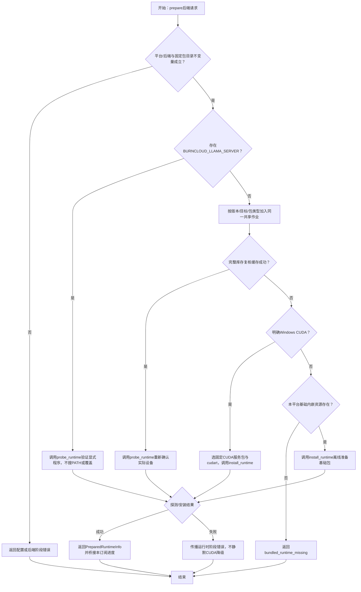
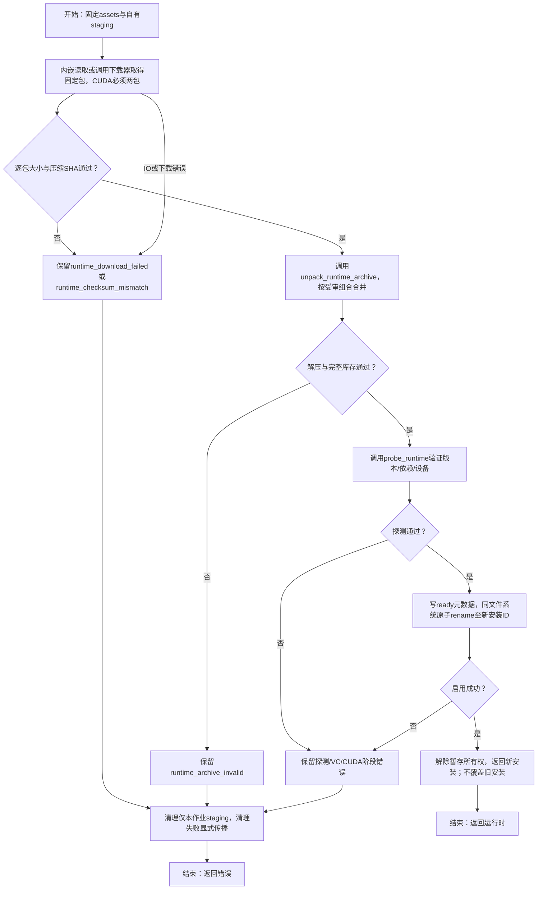
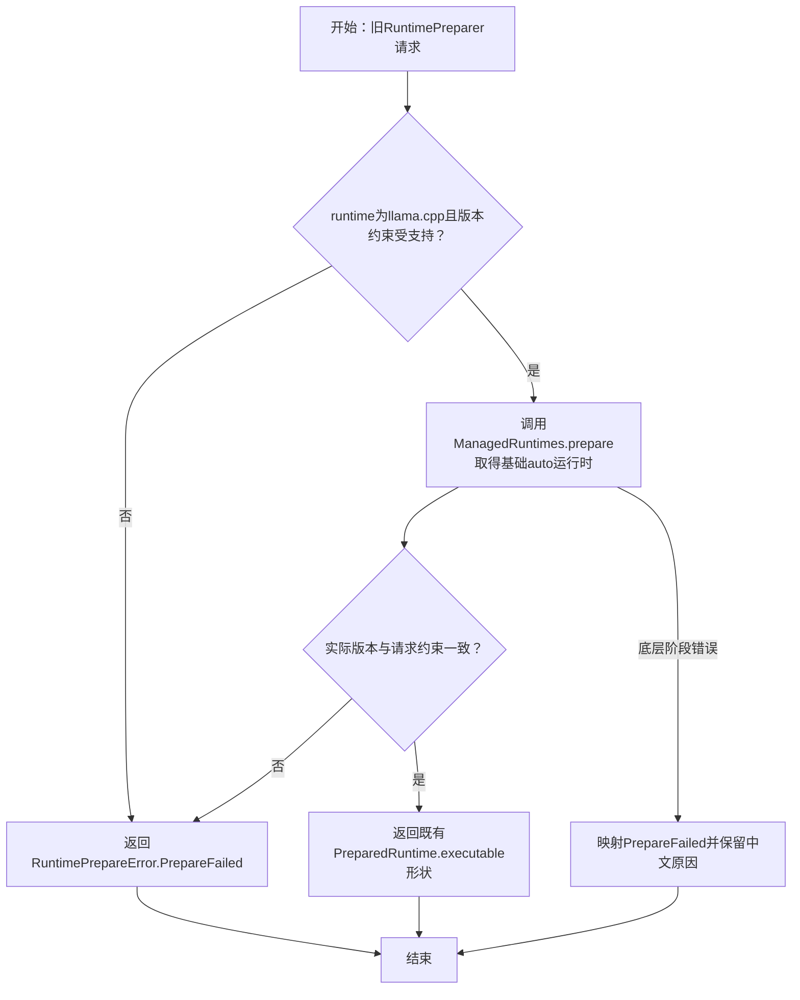
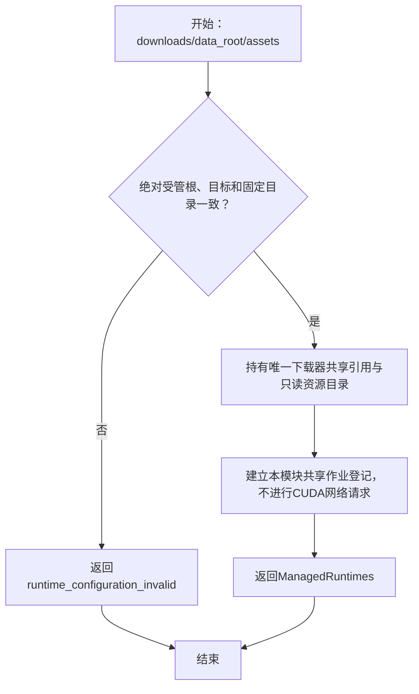

```json
{
  "编号": "010",
  "依赖": [
    "004",
    "007",
    "008",
    "009"
  ]
}
```

# 010 实现共享受管运行时准备与原子启用

- 任务：实现共享受管运行时准备与原子启用
- 工作区：server（读写）——crates/interfaces/server/src/managed_runtime.rs、node_runtime.rs；独立缓存/共享/安装测试
- 产出：ManagedRuntimes、基础离线安装与可选 CUDA 双包准备
- 前置任务：004 切换下载门面并兼容已有任务；007 实现本平台唯一运行包离线内嵌；008 实现受审归档安全解压；009 实现运行时实测与固定后端启动参数
- 后置任务：011 实现权威工件核对与后端磁盘预检；016 实现双分支部署执行器与终态清理；020 扩展目录解析后端与预算预览；024 扩展四目标便携发行与证据门禁；025 同步本机自动部署用户说明与支持边界
- 设计依据：F22、F23、F26、F49；第三节 3.1、3.4；第二节 2.3
- 验收标准：
  - 严格按显式配置→完整复核缓存→本平台内嵌基础包的顺序；配置无效明确失败，开发缺资源报 bundled_runtime_missing，不临时联网编译。
  - Windows cuda 仅显式选择后通过唯一下载器取固定服务包+cudart；两包各自 SHA、大小、依赖与设备全部通过才成功；取消订阅不取消其他父任务。
  - 版本/目标/包类型只运行一个共享准备；mac CPU/Metal 共用原生安装但设备逐次实测；构造器无 CUDA 下载副作用。
  - staging 完成完整库存/依赖/设备探测后原子 rename，新物理安装带安装ID；损坏或在用安装不原地覆盖。ready.json 不能单独证明可信。
  - 共享准备所有者结算 JoinHandle、超时与暂存清理；最后订阅者离开也只继续有界缓存准备，不启动模型，服务 shutdown 可结算。
  - 既有 RuntimePreparer trait 的名称/显式版本约束保留；返回既有 PreparedRuntime 形状，详细信息不扩为新的跨 crate 公共结构。

> 来源：开发序号5、用户于2026-11-24确认的 `../local-model-auto-deploy-dev-doc.md`、同目录流程图与接口契约；分支 `codex/local-model-auto-deploy`，工作区以 `../dev-context.md` 为准。任务定义不代表业务代码或实机验收已完成；实际执行次序只采用脚本生成的 `execution-order.md`。

## 范围与执行约束

- 本任务独占运行时 SharedPreparation 的暂存与 join 清理，父任务仅断开订阅；有效缓存不随服务析构删除。
- 只实现本任务摘录的定稿设计；新函数/方法/字段默认私有，跨文件和跨crate可见性不得超过开发文档第六节公开清单，不为测试导出内部实现。
- 注释与rustdoc使用中文；公共边界黑盒校验，内部公有函数白盒契约检查；私有函数不重复校验已保证参数，但新读取的网络/磁盘/归档/进程结果仍须验证。
- 测试写入独立文件；每个公有API/内部公有方法有独立测试，关键公共模块提供可编译# Examples，修复有回归；不使用unsafe、外部输入unwrap/expect或静默丢弃Result。
- 只写上述登记工作区和具体范围；project-root仅登记允许的Cargo.toml/Cargo.lock/README.md/本轮文档。不得覆盖用户target运行时、未跟踪server/docs文件、开发规范或dev-context.md。
- 编码/测试/提交状态由后续任务报告如实记录；提交使用Conventional Commits，提交前后均执行cargo fmt、cargo clippy、cargo test并记录实际feature/target与结果。真实硬件、许可、签名或测试资源缺失不填假证据。

## 实现内容

### 数据结构

- 名称：SharedPreparation
- 类型：服务模块内共享作业
- 说明：模型、运行时共享作业使用同样的所有权规则，但不新建通用插件框架。
- 结构：

```python
class SharedPreparation:
    key: Sha256  # 独占拥有；模型身份键或运行时包键
    progress: WatchSender  # 独占拥有；最新不可变进度快照
    completion: SharedResult  # 共享；完成结果及错误，不是父任务终态
    join: JoinHandle  # 独占拥有；服务负责等待和暂存清理
    staging: Optional[TempDir]  # 独占拥有；受管 staging，成功 rename 后解除临时所有权
```

### 函数定义

#### F22 ManagedRuntimes::prepare

- 函数名称：`ManagedRuntimes::prepare`
- 公开属性：公有函数（pub(crate)）
- 多线程属性：异步
- 函数归属：ManagedRuntimes 方法
- 所属模块或包：`server::managed_runtime`
- 职责说明：优先显式配置，然后共享缓存作业，按需离线安装或下载 CUDA。
- 入参列表：

| 名称 | 类型 | 是否必填 | 含义 |
| --- | --- | --- | --- |
| backend | `RequestedBackend` | 是 | 主动请求后端 |
| progress | `WatchSender` | 是 | 本调用者进度桥接；不取消共享作业 |

- 返回值列表：

| 名称 | 类型 | 含义 |
| --- | --- | --- |
| result | `Result<PreparedRuntimeInfo, TaskError>` | 带实测版本/设备/来源的现有 PreparedRuntime |

- 错误返回：bundled_runtime_missing；runtime_configuration_invalid；runtime_download_failed；runtime_checksum_mismatch；runtime_archive_invalid；vc_runtime_missing；cuda_unavailable；runtime_probe_failed
- 校验规则：白盒校验：backend 在当前平台范围，包清单完整；显式配置和缓存内容是新的外部输入，不能只查文件存在。
- 调用关系：

| 方向 | 函数 |
| --- | --- |
| 调用 | install_runtime；probe_runtime；DownloadManager 既有 API |
| 被调用 | run_task；LlamaCppRuntimePreparer::prepare |

- 函数内部流程图（本任务依据定稿职责与上游状态流转设计）：



---

#### F23 install_runtime

- 函数名称：`install_runtime`
- 公开属性：私有函数
- 多线程属性：异步
- 函数归属：独立函数
- 所属模块或包：`server::managed_runtime`
- 职责说明：按固定包列表验证压缩 SHA，安全解压，探测成功后原子启用新安装。
- 入参列表：

| 名称 | 类型 | 是否必填 | 含义 |
| --- | --- | --- | --- |
| assets | `&[RuntimeAsset]` | 是 | 清单已选定，CUDA 恰有两包 |
| staging | `TempDir` | 是 | 本共享作业拥有的暂存 |
| progress | `WatchSender` | 是 | 网络或阶段进度 |

- 返回值列表：

| 名称 | 类型 | 含义 |
| --- | --- | --- |
| result | `Result<PreparedRuntimeInfo, TaskError>` | 启用完成的安装；失败显式清理 staging |

- 错误返回：runtime_download_failed；runtime_checksum_mismatch；runtime_archive_invalid；runtime_probe_failed；vc_runtime_missing；cuda_unavailable
- 校验规则：不校验；前置：准备门面已选定包；归档字节/设备/操作系统结果按新输入边界验证。
- 调用关系：

| 方向 | 函数 |
| --- | --- |
| 调用 | unpack_runtime_archive；probe_runtime；已有下载 API；同文件系统 rename |
| 被调用 | ManagedRuntimes::prepare 的共享 worker |

- 函数内部流程图（本任务依据定稿职责与上游状态流转设计）：



---

#### F26 LlamaCppRuntimePreparer::prepare（既有 trait 实现）

- 函数名称：`LlamaCppRuntimePreparer::prepare（既有 trait 实现）`
- 公开属性：公有函数（保持 RuntimePreparer trait 边界）
- 多线程属性：异步
- 函数归属：LlamaCppRuntimePreparer 方法
- 所属模块或包：`server::node_runtime`
- 职责说明：保留 RuntimeRequest/PreparedRuntime 形状，手动旧入口也可取得基础运行时。
- 入参列表：

| 名称 | 类型 | 是否必填 | 含义 |
| --- | --- | --- | --- |
| request | `RuntimeRequest` | 是 | 运行时名称及可选版本 |

- 返回值列表：

| 名称 | 类型 | 含义 |
| --- | --- | --- |
| result | `Result<PreparedRuntime, RuntimePrepareError>` | 只返回现有 executable；自动链路的后端信息留在私有门面 |

- 错误返回：保留 RuntimePrepareError::PrepareFailed 映射；底层中文原因保留
- 校验规则：白盒校验：只支持 llama.cpp，显式版本约束不能忽略；不以 None 追逐最新版。
- 调用关系：

| 方向 | 函数 |
| --- | --- |
| 调用 | ManagedRuntimes::prepare |
| 被调用 | 既有 NodeDeploymentState::start_local |

- 函数内部流程图（本任务依据定稿职责与上游状态流转设计）：



---

#### F49 ManagedRuntimes::new

- 函数名称：`ManagedRuntimes::new`
- 公开属性：公有函数（pub(crate)）
- 多线程属性：普通
- 函数归属：ManagedRuntimes 方法
- 所属模块或包：`server::managed_runtime`
- 职责说明：建立共享运行时登记和固定资源目录引用。
- 入参列表：

| 名称 | 类型 | 是否必填 | 含义 |
| --- | --- | --- | --- |
| downloads | `Arc<DownloadManager>` | 是 | 唯一下载门面 |
| data_root | `PathBuf` | 是 | 受管根 |
| assets | `StaticRuntimeCatalog` | 是 | 当前构建固定包目录 |

- 返回值列表：

| 名称 | 类型 | 含义 |
| --- | --- | --- |
| result | `Result<ManagedRuntimes, TaskError>` | 无网络副作用的运行时服务 |

- 错误返回：runtime_configuration_invalid
- 校验规则：白盒校验：根/目标/固定目录一致；不提前下载 CUDA。
- 调用关系：

| 方向 | 函数 |
| --- | --- |
| 调用 | 固定 RuntimeAsset 清单 |
| 被调用 | 应用组合根 |

- 函数内部流程图（本任务依据定稿职责与上游状态流转设计）：



---
