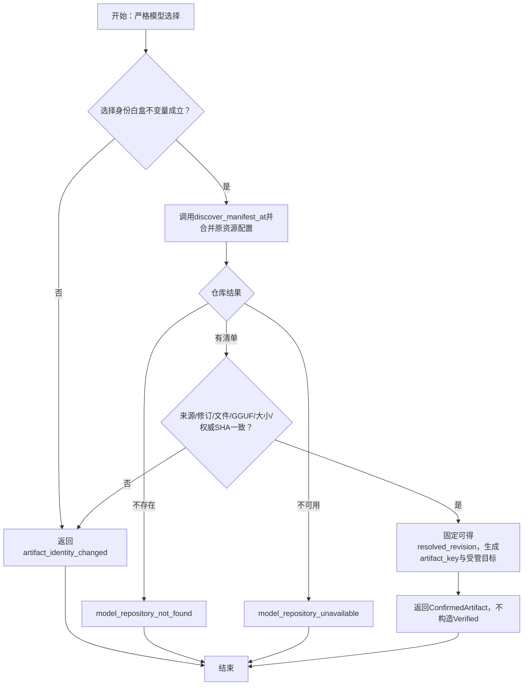
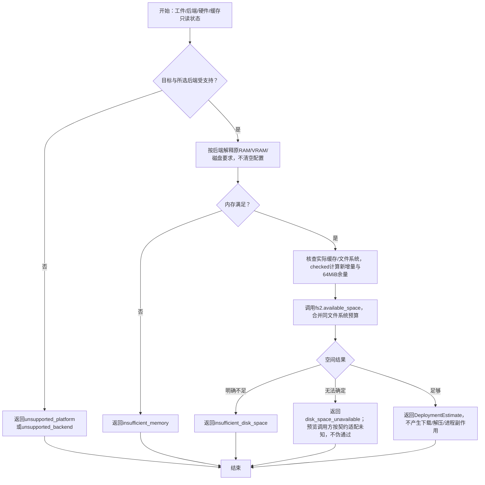

```json
{
  "编号": "011",
  "依赖": [
    "010",
    "015"
  ]
}
```

# 011 实现权威工件核对与后端磁盘预检

- 任务：实现权威工件核对与后端磁盘预检
- 工作区：server（读写）——crates/interfaces/server/src/model_artifacts.rs；独立身份/资源/预算测试
- 产出：ConfirmedArtifact 与无副作用部署预算
- 前置任务：010 实现共享受管运行时准备与原子启用；015 实现部署任务数据与本机仓储 CAS
- 后置任务：012 实现模型共享下载与真实摘要启用；016 实现双分支部署执行器与终态清理；020 扩展目录解析后端与预算预览
- 设计依据：F18、F19；第二节 2.2；第三节 3.1、3.3
- 验收标准：
  - 重新发现所选来源的 model/revision/variant，核对 GGUF、大小、权威 SHA；漂移报 artifact_identity_changed，不替换来源/量化/修订，不接受客户端 URL 或路径。
  - 请求键/工件键按固定顺序规范 JSON 后摘要，工件键不含 backend；同名不同来源/摘要不共享。能取得 resolved_revision 时固定下载地址。
  - 按所选后端解释原 RAM/VRAM/disk 门槛；CPU 不套独立显存下限，也不清空原要求放行；cuda/平台范围正确拒绝。
  - 合并同一受管文件系统的模型剩余、归档、完整暂存、依赖增量及64MiB余量，checked_add/sub 防溢出；有效缓存不重复计，原最低 disk 要求保留。
  - 未知总量/空间失败部署在传输前报错；预览可 sufficient:null，不能伪 true；预览不下载、不解压、不启动。
  - 跨设备挂载/目录链接/Windows reparse point 不能把模型或 staging 移出已核准数据根；缓存实际内容重新检查。

> 来源：开发序号5、用户于2026-11-24确认的 `../local-model-auto-deploy-dev-doc.md`、同目录流程图与接口契约；分支 `codex/local-model-auto-deploy`，工作区以 `../dev-context.md` 为准。任务定义不代表业务代码或实机验收已完成；实际执行次序只采用脚本生成的 `execution-order.md`。

## 范围与执行约束

- 复用既有 discover_manifest_at 与硬件/资源合并，不导出私有发现细节；部署时重新确定检查，不能沿用过期预览放行。
- 只实现本任务摘录的定稿设计；新函数/方法/字段默认私有，跨文件和跨crate可见性不得超过开发文档第六节公开清单，不为测试导出内部实现。
- 注释与rustdoc使用中文；公共边界黑盒校验，内部公有函数白盒契约检查；私有函数不重复校验已保证参数，但新读取的网络/磁盘/归档/进程结果仍须验证。
- 测试写入独立文件；每个公有API/内部公有方法有独立测试，关键公共模块提供可编译# Examples，修复有回归；不使用unsafe、外部输入unwrap/expect或静默丢弃Result。
- 只写上述登记工作区和具体范围；project-root仅登记允许的Cargo.toml/Cargo.lock/README.md/本轮文档。不得覆盖用户target运行时、未跟踪server/docs文件、开发规范或dev-context.md。
- 编码/测试/提交状态由后续任务报告如实记录；提交使用Conventional Commits，提交前后均执行cargo fmt、cargo clippy、cargo test并记录实际feature/target与结果。真实硬件、许可、签名或测试资源缺失不填假证据。

## 实现内容

### 数据结构

- 名称：ConfirmedArtifact
- 类型：模块内严格工件证据
- 说明：只由服务端清单核对产生，未验证字节时不能转换为 PreparedArtifact。
- 结构：

```python
class ConfirmedArtifact:
    command: DeploymentCommand  # 独占拥有；本次确认身份
    resolved_revision: Optional[str]  # 独占拥有；可得时固定远端提交修订
    artifact_key: Sha256  # 独占拥有；模型缓存键
    url: Url  # 独占拥有；服务端构造并经信任边界校验
    size_bytes: u64  # 独占拥有；权威文件大小
    min_ram_bytes: u64  # 独占拥有；原配置，不清零
    min_vram_bytes: u64  # 独占拥有；原配置，不直接套用于 CPU
    disk_size_bytes: u64  # 独占拥有；原配置
    target: PathBuf  # 独占拥有；受管根内目标，不对外返回
```

### 实现约束原文摘录

#### 3.1 用户数据与磁盘预算

用户数据根复用 `burncloud_database::get_default_database_path()` 的父目录，只把它用于目录约定，不跟随外部 PostgreSQL 的地址创建系统路径：Windows 为用户 Local/BurnCloud，macOS/Linux 为当前项目沿用的 ~/.burncloud。

```text
<用户数据根>/
  node-owner.json
  node-deployments.lock
  models/<artifact_key>/<固定文件名及传输断点>
  runtimes/downloads/<版本>/<固定包文件及传输断点>
  runtimes/<版本>/<平台>/<包类型>/<安装摘要>-<安装ID>/
  runtimes/.staging/<随机作业ID>/
```

- 下载器继续允许原 executable/models 根，新增且仅新增上述受管 models 和 runtimes/downloads 根。不能允许整个用户目录或任意绝对路径。旧相对路径语义保留；新服务只传自己生成的绝对路径。受管下载不得为了初始化旧根而强制创建不可写的 executable/models，先按目标根分支再创建。源目录、已存在父级及最终路径都规范化，拒绝越界链接/reparse point。
- 新模型、运行包下载及 staging 固定在同一个受管数据根。不得在其子根上跟随用户创建的挂载或目录链接跨到另一文件系统；Unix 比较设备号，Windows 拒绝子目录 reparse point。最终运行时内经过验证的内部相对链接例外，只能留在安装根内。
- 因新写入根固定在一个已确认文件系统，DiskCheck 合并为 storage:model_and_runtime；不按模型和运行时各自独立放行。同一文件系统的额外空间预算为模型尚需新增文件/断点字节、仍需落盘的归档、完整解压暂存、必要的新依赖副本及 64 MiB 安全余量之和；rename 不重复计整份文件，现有有效安装不重复计。
- 原始 disk_size_bytes 仍作为模型最低空间要求，不得因已有下载量为 0 而清空配置要求。解压精确上界来自固定受审归档清单；未知模型总量或空间查询失败时任务在传输前失败，不能当 0 放行。预算不是磁盘预留，运行中 ENOSPC 仍正常报告失败。
- 候选 resolve 可以返回未知空间 sufficient:null，但不能伪报 true；部署在后台重新做确定检查。预览不下载包、不解压、不启动进程。

---

#### 3.3 模型身份与后端资源检查

- 服务端复用 discover_manifest_at 的 ModelScope/HF 清单和内置资源合并，以完整 source/model/revision/variant_id 定位 GGUF，重新比对 SHA-256、类型及大小。缺权威 SHA 不在本接口承诺可信；身份改变为 artifact_identity_changed，不替换量化/修订/来源。
- 分支修订不是不可变对象：能取到真实提交修订时记录 resolved_revision 用于生成下载地址，否则保留请求修订并以固定 SHA 和下载后全量校验防漂移。resolved_revision 是内部证据，不改写对外 revision。
- 原 min_ram_bytes、min_vram_bytes、disk_size_bytes 不改写。cpu 检查 RAM，不要求 GPU 显存；cuda 检查 RAM 和实际所选 NVIDIA 设备显存；macOS auto 先保证 CPU 可部署的 RAM 基线，Metal 探测且统一内存条件满足才选 Metal，否则保留 CPU 并给出原因。不能将共享内存加总冒充独立 VRAM。
- 预检阶段进行硬件/空间预算，运行时阶段实际探测程序与设备；effective_backend 只在实际选择后写入。显式 cpu 始终使用零 GPU layers，auto 不是 Windows 的隐式 CUDA 授权。
- 缓存命中也重新检查真实文件及全量 SHA；有损坏即隔离为不可信，不改动仍被运行实例使用的旧文件。下载至新暂存并校验后原子启用，Verified 工件只在此时构造。文件句柄/路径身份在启动前再核对，不能仅凭旧日志中的 verified 字样放行。

### 函数定义

#### F18 confirm_artifact

- 函数名称：`confirm_artifact`
- 公开属性：公有函数（pub(crate)）
- 多线程属性：异步
- 函数归属：独立函数
- 所属模块或包：`server::model_artifacts`
- 职责说明：重新发现所选源清单，核对文件身份，构造严格下载证据。
- 入参列表：

| 名称 | 类型 | 是否必填 | 含义 |
| --- | --- | --- | --- |
| client | `&reqwest::Client` | 是 | 受限发现客户端 |
| command | `&DeploymentCommand` | 是 | 已校验选择 |
| data_root | `&Path` | 是 | 受管根 |

- 返回值列表：

| 名称 | 类型 | 含义 |
| --- | --- | --- |
| result | `Result<ConfirmedArtifact, TaskError>` | 固定身份/摘要/大小/服务端 URL |

- 错误返回：model_repository_not_found；model_repository_unavailable；artifact_identity_changed
- 校验规则：白盒校验：选择不变量；元数据响应做文件类型/大小/SHA/仓库归属的黑盒输入验证。
- 调用关系：

| 方向 | 函数 |
| --- | --- |
| 调用 | discover_manifest_at；既有资源配置合并 |
| 被调用 | run_task |

- 函数内部流程图（本任务依据定稿职责与上游状态流转设计）：



---

#### F19 estimate_deployment

- 函数名称：`estimate_deployment`
- 公开属性：公有函数（pub(crate)）
- 多线程属性：异步
- 函数归属：独立函数
- 所属模块或包：`server::model_artifacts`
- 职责说明：按后端解释原资源门槛并合并下载/解压预算，预览无副作用。
- 入参列表：

| 名称 | 类型 | 是否必填 | 含义 |
| --- | --- | --- | --- |
| artifact | `&ConfirmedArtifact` | 是 | 权威工件 |
| backend | `RequestedBackend` | 是 | 用户所选后端 |
| hardware | `&HardwareSnapshot` | 是 | 真实硬件 |
| runtimes | `&ManagedRuntimes` | 是 | 只读包/缓存状态 |

- 返回值列表：

| 名称 | 类型 | 含义 |
| --- | --- | --- |
| result | `Result<DeploymentEstimate, TaskError>` | 网络增量、固定包、磁盘检查、依赖说明 |

- 错误返回：unsupported_platform；unsupported_backend；insufficient_memory；insufficient_disk_space；disk_space_unavailable
- 校验规则：白盒校验：工件大小已知、算术 checked_add/sub 防溢出；缓存与文件系统是新输入，必须实际核对。
- 调用关系：

| 方向 | 函数 |
| --- | --- |
| 调用 | 固定 RuntimeAsset 目录；fs2::available_space；既有硬件探测 |
| 被调用 | run_task；resolve_model |

- 函数内部流程图（本任务依据定稿职责与上游状态流转设计）：



---
