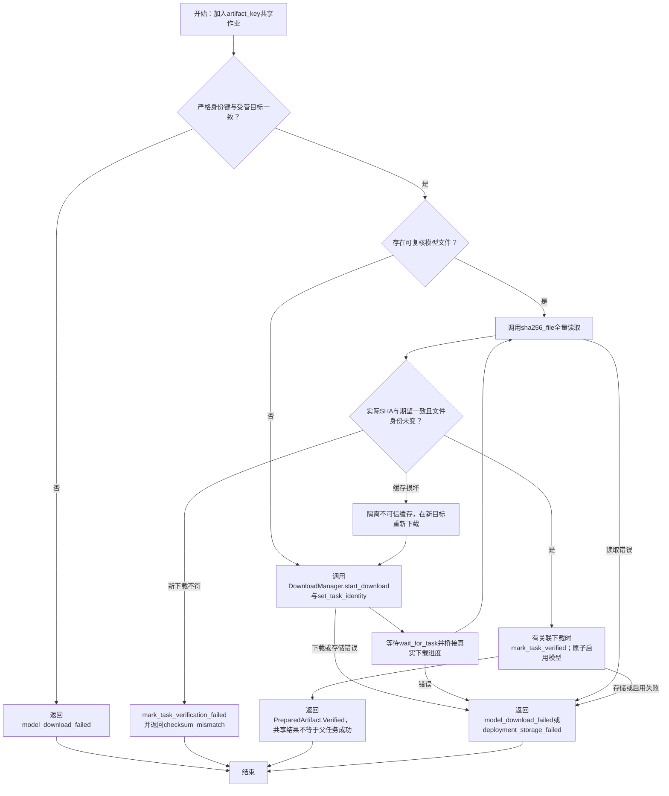
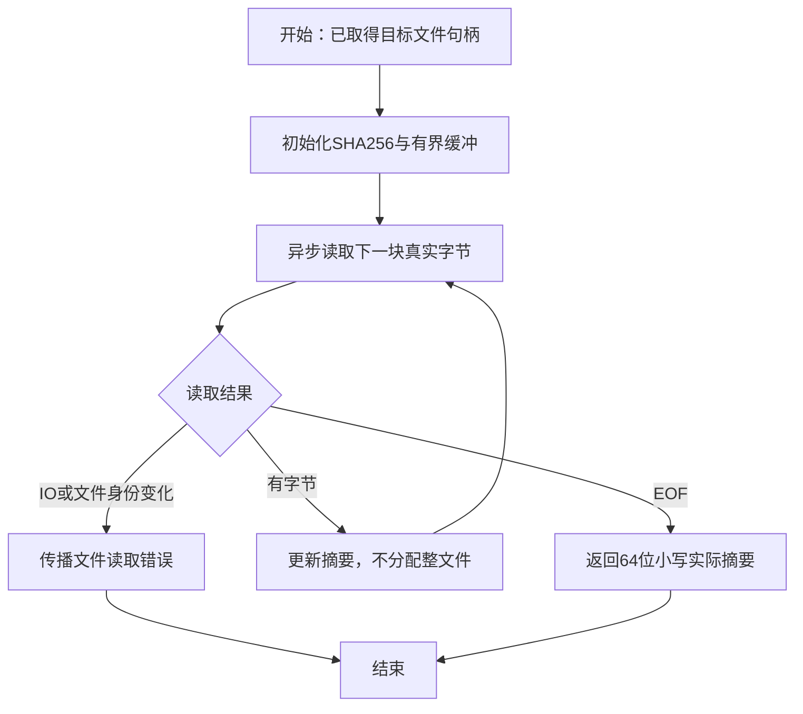
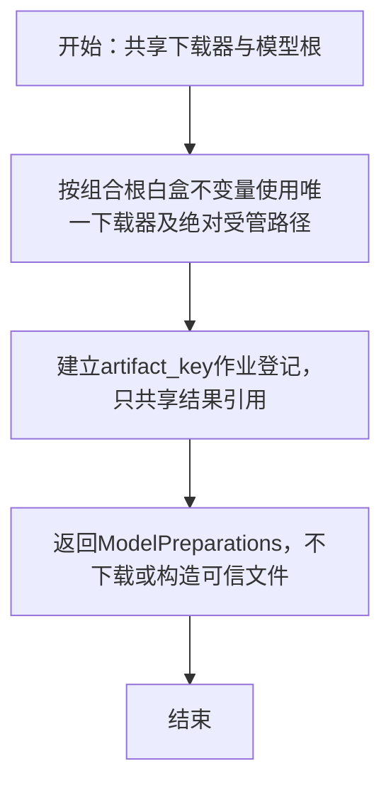

```json
{
  "编号": "012",
  "依赖": [
    "004",
    "011"
  ]
}
```

# 012 实现模型共享下载与真实摘要启用

- 任务：实现模型共享下载与真实摘要启用
- 工作区：server（读写）——crates/interfaces/server/src/model_artifacts.rs；独立缓存/SHA/共享取消测试
- 产出：ModelPreparations 与只由实际字节形成的 Verified 工件
- 前置任务：004 切换下载门面并兼容已有任务；011 实现权威工件核对与后端磁盘预检
- 后置任务：014 接通可信启动与精确进程路由清理；016 实现双分支部署执行器与终态清理
- 设计依据：F20、F21、F50；第三节 3.3；第四节 SharedPreparation 所有权约定
- 验收标准：
  - 按不含 backend 的完整工件键共享同一下载/校验作业；构造器复用唯一下载器和既定绝对受管根。
  - 旧记录与缓存命中也读取全文件计算64位小写实际 SHA，比较规范化摘要字节；期望 sha256: 前缀不造成误判，actual_sha256 不从期望复制。
  - 下载、全量 SHA 与原子启用完成才构造 PreparedArtifact::Verified；启动前文件身份可再核对，坏缓存隔离而不修改在用有效文件。
  - 身份、稳定下载 ID 和真实校验结果通过既有 API 持久化；校验失败不得登记可信缓存，存储失败不得假成功。
  - 父取消只断订阅，已开始共享作业有界完成缓存或在停机结算，不误取消旧 HTTP 下载用户；模型共享 owner 独占自己的 join/临时文件清理。
  - sha256_file 用有界缓冲，文件读取/替换错误传播；独立测试覆盖损坏缓存、同名不同身份、多后端共享、取消与晚到结果。

> 来源：开发序号5、用户于2026-11-24确认的 `../local-model-auto-deploy-dev-doc.md`、同目录流程图与接口契约；分支 `codex/local-model-auto-deploy`，工作区以 `../dev-context.md` 为准。任务定义不代表业务代码或实机验收已完成；实际执行次序只采用脚本生成的 `execution-order.md`。

## 范围与执行约束

- 不新增任意路径 Verified 捷径，不删除共享已校验 GGUF，不另造下载器或数据库连接。
- 只实现本任务摘录的定稿设计；新函数/方法/字段默认私有，跨文件和跨crate可见性不得超过开发文档第六节公开清单，不为测试导出内部实现。
- 注释与rustdoc使用中文；公共边界黑盒校验，内部公有函数白盒契约检查；私有函数不重复校验已保证参数，但新读取的网络/磁盘/归档/进程结果仍须验证。
- 测试写入独立文件；每个公有API/内部公有方法有独立测试，关键公共模块提供可编译# Examples，修复有回归；不使用unsafe、外部输入unwrap/expect或静默丢弃Result。
- 只写上述登记工作区和具体范围；project-root仅登记允许的Cargo.toml/Cargo.lock/README.md/本轮文档。不得覆盖用户target运行时、未跟踪server/docs文件、开发规范或dev-context.md。
- 编码/测试/提交状态由后续任务报告如实记录；提交使用Conventional Commits，提交前后均执行cargo fmt、cargo clippy、cargo test并记录实际feature/target与结果。真实硬件、许可、签名或测试资源缺失不填假证据。

## 实现内容

### 函数定义

#### F20 prepare_model

- 函数名称：`prepare_model`
- 公开属性：公有函数（pub(crate)）
- 多线程属性：异步
- 函数归属：独立函数
- 所属模块或包：`server::model_artifacts`
- 职责说明：加入模型共享作业：复核缓存或下载，实际全量算 SHA，原子启用可信 GGUF。
- 入参列表：

| 名称 | 类型 | 是否必填 | 含义 |
| --- | --- | --- | --- |
| artifact | `Arc<ConfirmedArtifact>` | 是 | 不可变严格证据 |
| preparations | `&ModelPreparations` | 是 | 服务级作业登记，保证同一工件只准备一次 |
| downloads | `Arc<DownloadManager>` | 是 | 现有下载门面 |
| progress | `WatchSender` | 是 | 真实进度输出 |

- 返回值列表：

| 名称 | 类型 | 含义 |
| --- | --- | --- |
| result | `Result<PreparedArtifact, TaskError>` | 仅真实摘要一致时得到 Verified |

- 错误返回：model_download_failed；checksum_mismatch；deployment_storage_failed
- 校验规则：白盒校验：身份键/受管目标一致；私有字节校验不重复检查调用参数。
- 调用关系：

| 方向 | 函数 |
| --- | --- |
| 调用 | DownloadManager 既有 start/wait/identity/mark_verified；sha256_file |
| 被调用 | 模型共享作业所有者；run_task 订阅 |

- 函数内部流程图（本任务依据定稿职责与上游状态流转设计）：



---

#### F21 sha256_file

- 函数名称：`sha256_file`
- 公开属性：私有函数
- 多线程属性：异步
- 函数归属：独立函数
- 所属模块或包：`server::model_artifacts`
- 职责说明：按有界缓冲读取真实 GGUF，返回规范实际摘要，不复制期望值。
- 入参列表：

| 名称 | 类型 | 是否必填 | 含义 |
| --- | --- | --- | --- |
| file | `File` | 是 | 已安全打开的受管普通文件 |

- 返回值列表：

| 名称 | 类型 | 含义 |
| --- | --- | --- |
| result | `Result<Sha256, std::io::Error>` | 全文件实际 SHA-256 |

- 错误返回：上层映射 model_download_failed 或 checksum_mismatch
- 校验规则：不校验；前置：调用方已取得目标文件句柄；读取/身份变化错误必须传播。
- 调用关系：

| 方向 | 函数 |
| --- | --- |
| 调用 | sha2；tokio 文件 IO |
| 被调用 | prepare_model |

- 函数内部流程图（本任务依据定稿职责与上游状态流转设计）：



---

#### F50 ModelPreparations::new

- 函数名称：`ModelPreparations::new`
- 公开属性：公有函数（pub(crate)）
- 多线程属性：普通
- 函数归属：ModelPreparations 方法
- 所属模块或包：`server::model_artifacts`
- 职责说明：建立模型作业登记，下载与验证结果按完整身份共享。
- 入参列表：

| 名称 | 类型 | 是否必填 | 含义 |
| --- | --- | --- | --- |
| downloads | `Arc<DownloadManager>` | 是 | 唯一下载器 |
| data_root | `PathBuf` | 是 | 受管模型根 |

- 返回值列表：

| 名称 | 类型 | 含义 |
| --- | --- | --- |
| result | `ModelPreparations` | 模型共享作业所有者 |

- 错误返回：无
- 校验规则：白盒校验：组合根已保证绝对受管路径与唯一下载器。
- 调用关系：

| 方向 | 函数 |
| --- | --- |
| 调用 | 无 |
| 被调用 | DeploymentTasks::new |

- 函数内部流程图（本任务依据定稿职责与上游状态流转设计）：



---
