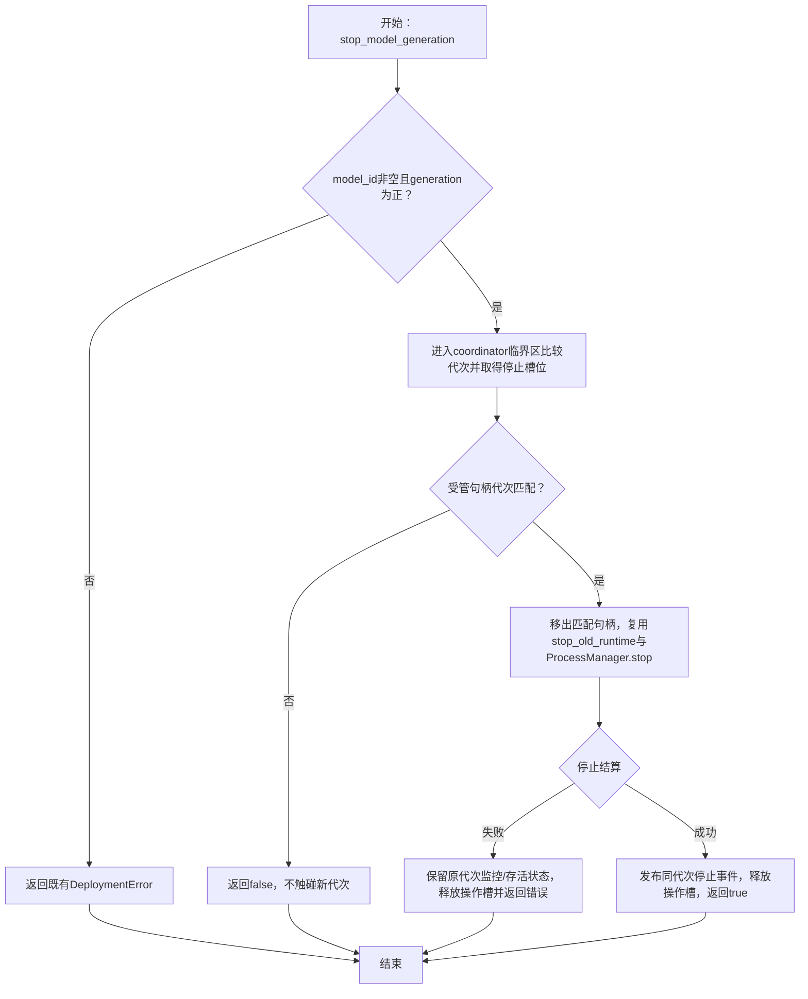

```json
{
  "编号": "013",
  "依赖": []
}
```

# 013 补充原子精确代次停止接口

- 任务：补充原子精确代次停止接口
- 工作区：node（读写）——crates/platform/node/src/deployment/service.rs 及最小相关 coordinator 实现、README.md；独立 API/并发测试
- 产出：唯一新增跨 crate 方法 stop_model_generation 与归属回归
- 前置任务：无
- 后置任务：014 接通可信启动与精确进程路由清理；025 同步本机自动部署用户说明与支持边界
- 设计依据：F31；第六节 6.1、6.2
- 验收标准：
  - 公开签名严格为 stop_model_generation(&str,u64)->Result<bool,DeploymentError>；模型 ID 非空且 generation>0，使用 Result 验证。
  - 代次比较与取得停止槽位/句柄在同一 coordinator 临界区；不存在/已换代返回 false，新代次不被停止。
  - 停止失败保留原代次监控与真实存活状态，不给同一进程伪造新 generation；成功事件只作用于匹配代次。
  - 既有 stop_model 的公开语义不变；不使用先查 status 再按名称 stop 的竞态实现，不增加其他公共接口。
  - 独立测试覆盖非法参数、匹配/失配、替换竞争、停止失败回滚及旧入口；中文 rustdoc 含用途/错误/注意事项/# Examples，并同步 node README。

> 来源：开发序号5、用户于2026-11-24确认的 `../local-model-auto-deploy-dev-doc.md`、同目录流程图与接口契约；分支 `codex/local-model-auto-deploy`，工作区以 `../dev-context.md` 为准。任务定义不代表业务代码或实机验收已完成；实际执行次序只采用脚本生成的 `execution-order.md`。

## 范围与执行约束

- 节点部署服务独占进程句柄，服务端归属 DTO 不成为裸 PID 所有者。
- 只实现本任务摘录的定稿设计；新函数/方法/字段默认私有，跨文件和跨crate可见性不得超过开发文档第六节公开清单，不为测试导出内部实现。
- 注释与rustdoc使用中文；公共边界黑盒校验，内部公有函数白盒契约检查；私有函数不重复校验已保证参数，但新读取的网络/磁盘/归档/进程结果仍须验证。
- 测试写入独立文件；每个公有API/内部公有方法有独立测试，关键公共模块提供可编译# Examples，修复有回归；不使用unsafe、外部输入unwrap/expect或静默丢弃Result。
- 只写上述登记工作区和具体范围；project-root仅登记允许的Cargo.toml/Cargo.lock/README.md/本轮文档。不得覆盖用户target运行时、未跟踪server/docs文件、开发规范或dev-context.md。
- 编码/测试/提交状态由后续任务报告如实记录；提交使用Conventional Commits，提交前后均执行cargo fmt、cargo clippy、cargo test并记录实际feature/target与结果。真实硬件、许可、签名或测试资源缺失不填假证据。

## 实现内容

### 函数定义

#### F31 DeploymentService::stop_model_generation

- 函数名称：`DeploymentService::stop_model_generation`
- 公开属性：公有函数（跨 crate pub，明确新增公开）
- 多线程属性：异步
- 函数归属：DeploymentService 方法
- 所属模块或包：`node::deployment::service`
- 职责说明：在 coordinator 内比较实际 generation 后移走对应受管句柄并停止；保留旧 stop_model 对外语义。精确停止内部需对 generation 比较并取得停止操作槽位，停止失败保留原代次监控，不能给同一存活进程伪造新 generation。
- 入参列表：

| 名称 | 类型 | 是否必填 | 含义 |
| --- | --- | --- | --- |
| model_id | `&str` | 是 | 受管模型标识 |
| generation | `u64` | 是 | 必须为正的精确进程代次 |

- 返回值列表：

| 名称 | 类型 | 含义 |
| --- | --- | --- |
| result | `Result<bool, DeploymentError>` | true 表示停止匹配代次，false 表示不存在/已换代；不停止新代次 |

- 错误返回：沿用 DeploymentError/DeploymentErrorKind，不新增 HTTP 码
- 校验规则：白盒校验：非空模型 ID、generation>0；比较与移走在同一 coordinator 临界区，不先查后调用旧 stop_model。
- 调用关系：

| 方向 | 函数 |
| --- | --- |
| 调用 | 最小复用既有 stop_old_runtime；比较/移走同一临界区，停止操作槽位保护至结算；ProcessManager::stop；同代次停止事件 |
| 被调用 | NodeDeploymentState::stop_owned |

- 函数内部流程图（本任务依据定稿职责与上游状态流转设计）：



---
