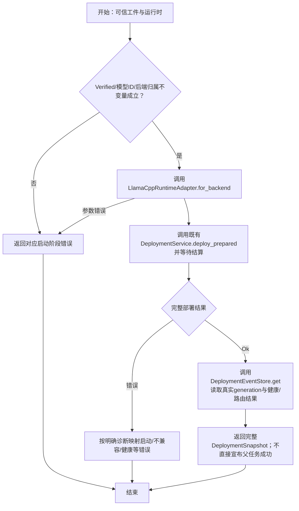
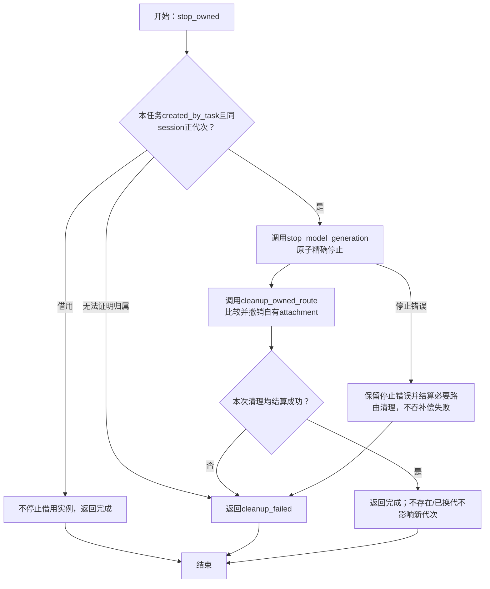
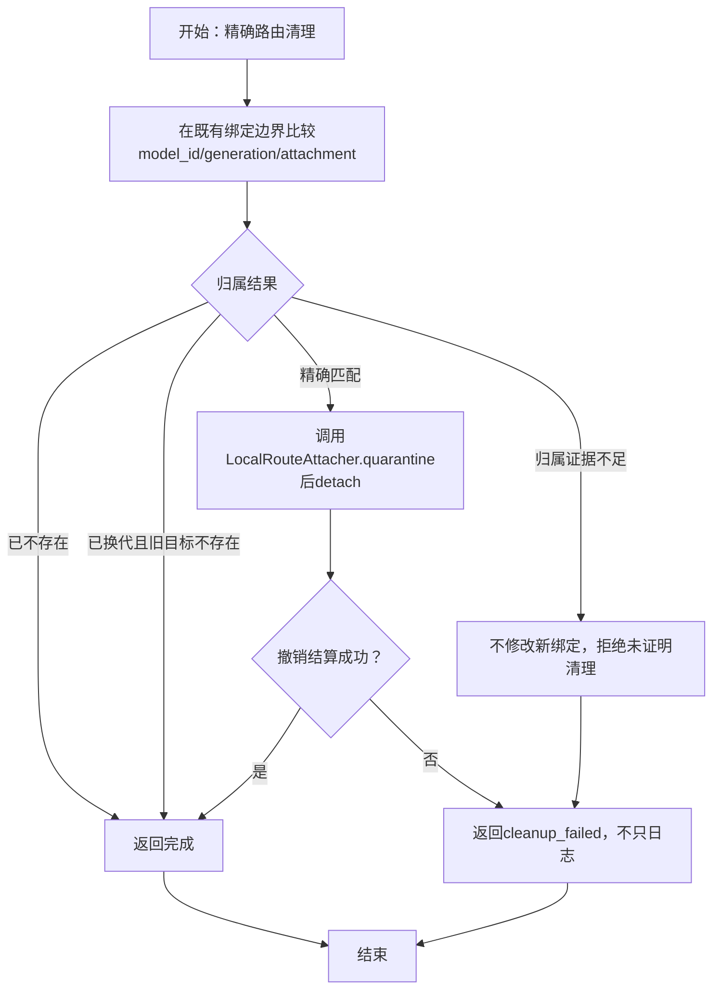

```json
{
  "编号": "014",
  "依赖": [
    "009",
    "012",
    "013",
    "015"
  ]
}
```

# 014 接通可信启动与精确进程路由清理

- 任务：接通可信启动与精确进程路由清理
- 工作区：server（读写）——crates/interfaces/server/src/node_deployment.rs 及现有事件/路由适配；独立代次/失败测试
- 产出：start_verified、stop_owned 与 cleanup_owned_route
- 前置任务：009 实现运行时实测与固定后端启动参数；012 实现模型共享下载与真实摘要启用；013 补充原子精确代次停止接口；015 实现部署任务数据与本机仓储 CAS
- 后置任务：016 实现双分支部署执行器与终态清理
- 设计依据：F28–F30；第二节 2.2、2.3；第六节 6.2
- 验收标准：
  - 自动入口只收真实 Verified 工件与探测运行时，绕过 start_local 路径捷径；复用 deploy_prepared，保留真实 generation、健康结果与可观察路由错误。
  - Ok(Unhealthy) 不能视为成功；模型明确不兼容与普通启动/健康失败按已有阶段错误区分，不凭超时臆断模型不兼容。
  - stop_owned 仅处理本会话 created_by_task 的正代次；借用实例不停止，按 stop_model_generation 原子操作，不按 PID/名称全局杀进程。
  - 路由清理精确比较 model_id/generation/attachment 后 quarantine/detach；换代、旧事件或未知归属不撤销新绑定。
  - 清理错误用 cleanup_failed 返回调用方，不只写日志；进程/路由两种错误不吞，必要补偿保留原始原因。
  - 本机健康/容量探测 no_proxy、禁止重定向；真实 /slots 与模型别名验证可满足既有 LocalRouteAttacher，不改模型下载 HTTP 配置。

> 来源：开发序号5、用户于2026-11-24确认的 `../local-model-auto-deploy-dev-doc.md`、同目录流程图与接口契约；分支 `codex/local-model-auto-deploy`，工作区以 `../dev-context.md` 为准。任务定义不代表业务代码或实机验收已完成；实际执行次序只采用脚本生成的 `execution-order.md`。

## 范围与执行约束

- 手动本地部署和已有停止接口语义保留；本任务只提供启动/清理能力，不决定父任务 succeeded。
- 只实现本任务摘录的定稿设计；新函数/方法/字段默认私有，跨文件和跨crate可见性不得超过开发文档第六节公开清单，不为测试导出内部实现。
- 注释与rustdoc使用中文；公共边界黑盒校验，内部公有函数白盒契约检查；私有函数不重复校验已保证参数，但新读取的网络/磁盘/归档/进程结果仍须验证。
- 测试写入独立文件；每个公有API/内部公有方法有独立测试，关键公共模块提供可编译# Examples，修复有回归；不使用unsafe、外部输入unwrap/expect或静默丢弃Result。
- 只写上述登记工作区和具体范围；project-root仅登记允许的Cargo.toml/Cargo.lock/README.md/本轮文档。不得覆盖用户target运行时、未跟踪server/docs文件、开发规范或dev-context.md。
- 编码/测试/提交状态由后续任务报告如实记录；提交使用Conventional Commits，提交前后均执行cargo fmt、cargo clippy、cargo test并记录实际feature/target与结果。真实硬件、许可、签名或测试资源缺失不填假证据。

## 实现内容

### 函数定义

#### F28 NodeDeploymentState::start_verified

- 函数名称：`NodeDeploymentState::start_verified`
- 公开属性：公有函数（pub(crate)）
- 多线程属性：异步
- 函数归属：NodeDeploymentState 方法
- 所属模块或包：`server::node_deployment`
- 职责说明：接收真实 Verified 工件，不走 start_local 的路径捷径；调用现有部署服务并保留完整结果。
- 入参列表：

| 名称 | 类型 | 是否必填 | 含义 |
| --- | --- | --- | --- |
| model_id | `String` | 是 | 完整身份/实际后端映射的确定 ID |
| artifact | `PreparedArtifact` | 是 | 模型分支实际校验结果 |
| runtime | `PreparedRuntimeInfo` | 是 | 运行时分支实际探测结果 |

- 返回值列表：

| 名称 | 类型 | 含义 |
| --- | --- | --- |
| result | `Result<DeploymentSnapshot, TaskError>` | 进程结果和真实 generation；并不直接宣布任务成功 |

- 错误返回：process_start_failed；model_incompatible；health_check_failed；route_attachment_failed；cleanup_failed
- 校验规则：白盒校验：工件是 Verified，模型 ID 与归属一致，后端配置严格；部署服务 Ok(Unhealthy) 不等于成功。
- 调用关系：

| 方向 | 函数 |
| --- | --- |
| 调用 | DeploymentService::deploy_prepared；LlamaCppRuntimeAdapter::for_backend；DeploymentEventStore::get |
| 被调用 | run_task，持有 deployment_key 启动锁 |

- 函数内部流程图（本任务依据定稿职责与上游状态流转设计）：



---

#### F29 NodeDeploymentState::stop_owned

- 函数名称：`NodeDeploymentState::stop_owned`
- 公开属性：公有函数（pub(crate)）
- 多线程属性：异步
- 函数归属：NodeDeploymentState 方法
- 所属模块或包：`server::node_deployment`
- 职责说明：只停止本任务新建的精确代次；借用进程不触碰。
- 入参列表：

| 名称 | 类型 | 是否必填 | 含义 |
| --- | --- | --- | --- |
| ownership | `&DeploymentOwnership` | 是 | 已核实的创建者/代次证据 |

- 返回值列表：

| 名称 | 类型 | 含义 |
| --- | --- | --- |
| result | `Result<(), TaskError>` | 原代次已停止或确认不存在；不等于停止所有同名模型 |

- 错误返回：cleanup_failed
- 校验规则：白盒校验：created_by_task、session、正 generation；路由和进程各自匹配，不能用裸 PID/名称清理。
- 调用关系：

| 方向 | 函数 |
| --- | --- |
| 调用 | DeploymentService::stop_model_generation；DeploymentEventStore::cleanup_owned_route |
| 被调用 | finish_task；正常服务关闭 |

- 函数内部流程图（本任务依据定稿职责与上游状态流转设计）：



---

#### F30 DeploymentEventStore::cleanup_owned_route

- 函数名称：`DeploymentEventStore::cleanup_owned_route`
- 公开属性：公有函数（pub(crate)）
- 多线程属性：异步
- 函数归属：DeploymentEventStore 方法
- 所属模块或包：`server::node_deployment`
- 职责说明：按 model_id/generation/attachment ID 精确隔离并撤销自有路由，错误不只写日志。
- 入参列表：

| 名称 | 类型 | 是否必填 | 含义 |
| --- | --- | --- | --- |
| ownership | `&DeploymentOwnership` | 是 | 具体代次与路由证据 |

- 返回值列表：

| 名称 | 类型 | 含义 |
| --- | --- | --- |
| result | `Result<(), TaskError>` | 目标已撤销或不存在；新代次保持不变 |

- 错误返回：cleanup_failed
- 校验规则：白盒校验：路由绑定三要素匹配；旧事件不修改新绑定；未证明归属时拒绝清理。
- 调用关系：

| 方向 | 函数 |
| --- | --- |
| 调用 | 既有 LocalRouteAttacher::quarantine/detach |
| 被调用 | stop_owned；finish_task |

- 函数内部流程图（本任务依据定稿职责与上游状态流转设计）：



---
