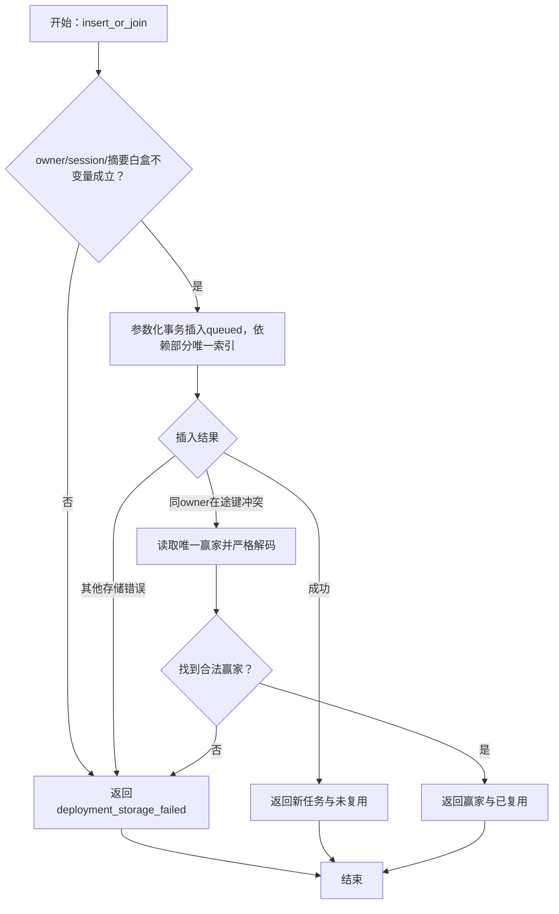
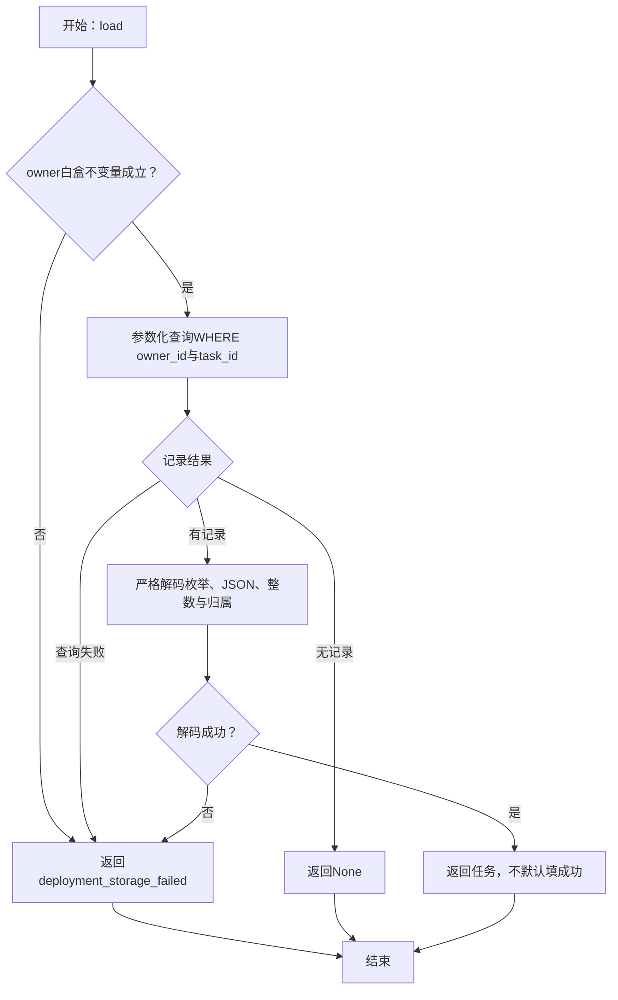
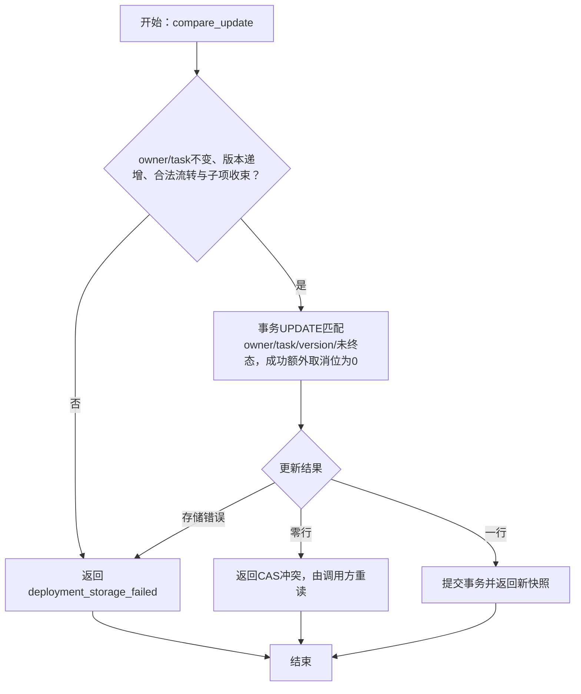
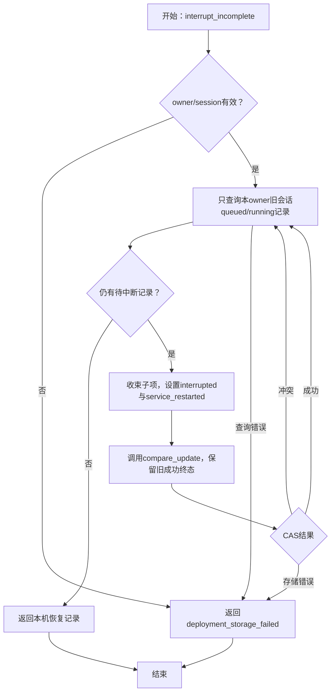
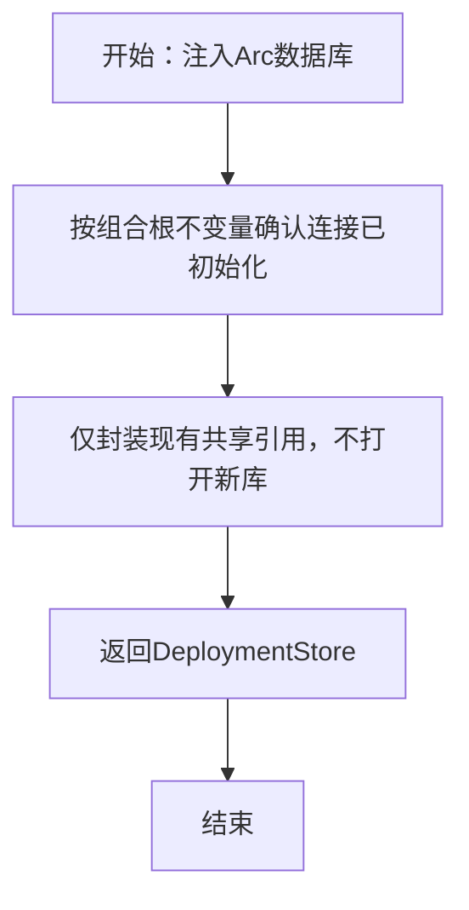

```json
{
  "编号": "015",
  "依赖": [
    "001"
  ]
}
```

# 015 实现部署任务数据与本机仓储 CAS

- 任务：实现部署任务数据与本机仓储 CAS
- 工作区：server（读写）——crates/interfaces/server/src/model_deployment.rs 的数据定义、model_deployment_store.rs；独立仓储测试
- 产出：契约 DTO/内部记录、owner 限定读取、在途去重与 CAS
- 前置任务：001 新增双数据库部署任务迁移
- 后置任务：008 实现受审归档安全解压；009 实现运行时实测与固定后端启动参数；011 实现权威工件核对与后端磁盘预检；014 接通可信启动与精确进程路由清理；016 实现双分支部署执行器与终态清理
- 设计依据：第二节 2.1–2.4；第四节对应结构；F14–F17、F48；第六节 6.4
- 验收标准：
  - DTO 严格保持契约字段/六态/七阶段/后端与空值语义，字段默认私有；TaskError 仅契约 code/message，不向外序列化路径/句柄。
  - 只封装已注入 Arc<Database>，不新建连接；SQL 值绑定，所有读取/更新带 owner，JSON/枚举/整数损坏报 deployment_storage_failed 而非默认成功。
  - insert_or_join 依赖部分唯一索引原子竞争，冲突读取同 owner 赢家，不先查后插；终态后允许新的任务 ID。
  - compare_update 同时匹配 owner/task_id/row_version/未终态，每次版本加一；成功额外 cancel_requested=0，取消与成功串行，CAS 冲突重读。
  - 终态有 finished_at、两个子项已收束；正常取消无伪 error，failed 原始与 cleanup_error 分列，迟到写入不覆盖终态。
  - interrupt_incomplete 只中断本 owner 上次会话 queued/running，子项相应中断，保留成功历史；不同 PostgreSQL owner 不受影响。
  - SQLite/PostgreSQL 独立测试覆盖竞争、owner隔离、坏JSON、CAS丢更新、取消先后与恢复；缺任一真实后端证据明确标未执行。

> 来源：开发序号5、用户于2026-11-24确认的 `../local-model-auto-deploy-dev-doc.md`、同目录流程图与接口契约；分支 `codex/local-model-auto-deploy`，工作区以 `../dev-context.md` 为准。任务定义不代表业务代码或实机验收已完成；实际执行次序只采用脚本生成的 `execution-order.md`。

## 范围与执行约束

- 本任务定义被其他服务器任务引用的数据，不实现后台 worker、HTTP 路由或新 database-sys 公共部署仓储。
- 只实现本任务摘录的定稿设计；新函数/方法/字段默认私有，跨文件和跨crate可见性不得超过开发文档第六节公开清单，不为测试导出内部实现。
- 注释与rustdoc使用中文；公共边界黑盒校验，内部公有函数白盒契约检查；私有函数不重复校验已保证参数，但新读取的网络/磁盘/归档/进程结果仍须验证。
- 测试写入独立文件；每个公有API/内部公有方法有独立测试，关键公共模块提供可编译# Examples，修复有回归；不使用unsafe、外部输入unwrap/expect或静默丢弃Result。
- 只写上述登记工作区和具体范围；project-root仅登记允许的Cargo.toml/Cargo.lock/README.md/本轮文档。不得覆盖用户target运行时、未跟踪server/docs文件、开发规范或dev-context.md。
- 编码/测试/提交状态由后续任务报告如实记录；提交使用Conventional Commits，提交前后均执行cargo fmt、cargo clippy、cargo test并记录实际feature/target与结果。真实硬件、许可、签名或测试资源缺失不填假证据。

## 实现内容

### 数据结构

- 名称：DeploymentCommand
- 类型：私有严格请求结构
- 说明：由新 POST 边界校验生成，后台不得重新接受客户端 URL。
- 结构：

```python
class DeploymentCommand:
    model: str  # 独占拥有；规范化的仓库身份
    source: ModelSource  # 独占拥有；严格来源枚举
    revision: str  # 独占拥有；用户修订，不静默替换
    variant_id: str  # 独占拥有；安全 GGUF 相对文件标识
    checksum: Sha256  # 独占拥有；期望摘要而非实际摘要
    backend: RequestedBackend  # 独占拥有；缺省 auto
```

---

- 名称：DeploymentTask
- 类型：模块内结构（跨文件类型 pub(crate)，字段 pub(super) 仅按需要开放）
- 说明：对外字段与契约 DeploymentTaskData 完全一致；内部加持久化和所有权证据，不序列化路径/进程句柄。
- 结构：

```python
class DeploymentTask:
    task_id: Uuid  # 独占拥有；部署 UUID，不是下载数字 ID
    owner_id: Uuid  # 独占拥有；本机用户数据根身份
    session_id: Uuid  # 独占拥有；创建任务的服务代次
    request_key: Sha256  # 独占拥有；完整请求去重键
    command: DeploymentCommand  # 独占拥有；规范化身份
    status: TaskStatus  # 独占拥有；契约六态
    stage: DeploymentStage  # 独占拥有；契约七阶段
    effective_backend: Optional[EffectiveBackend]  # 独占拥有；实测后填写
    backend_reason: Optional[str]  # 独占拥有；中文后端说明
    cancel_requested: bool  # 独占拥有；已持久化的取消意图
    model_download: PreparationProgress  # 独占拥有；本父任务的模型子快照
    runtime: RuntimeProgress  # 独占拥有；本父任务的运行时子快照
    estimate: Optional[DeploymentEstimate]  # 独占拥有；最近确定的预算
    deployment: Optional[DeploymentOwnership]  # 独占拥有；归属凭据，不是实时健康证明
    error: Optional[TaskError]  # 独占拥有；原始错误
    cleanup_error: Optional[TaskError]  # 独占拥有；独立清理错误
    created_at: Timestamp  # 独占拥有；RFC3339
    updated_at: Timestamp  # 独占拥有；最近持久化时间
    finished_at: Optional[Timestamp]  # 独占拥有；终态时间
    row_version: i64  # 独占拥有；CAS 代次
```

---

- 名称：PreparationProgress / RuntimeProgress
- 类型：私有 DTO；确有跨文件需要的类型 pub(crate)
- 说明：对应接口契约 4.2；运行时扩展而非另一套子状态。
- 结构：

```python
class PreparationProgress:
    status: TaskStatus  # 独占拥有；该父任务视角
    stage: Optional[DeploymentStage]  # 独占拥有；模型仅下载/校验，运行时仅准备
    detail: Optional[str]  # 独占拥有；可展示说明，不是新状态
    task_id: Optional[str]  # 独占拥有；模型下载数字 ID 转字符串；运行时恒 null
    completed_bytes: u64  # 独占拥有；真实文件/传输字节
    total_bytes: Optional[u64]  # 独占拥有；未知为 null
    download_speed: u64  # 独占拥有；非传输阶段为 0
    actual_sha256: Optional[str]  # 独占拥有；实际模型 SHA；运行时恒 null
    error: Optional[TaskError]  # 独占拥有；本分支错误

class RuntimeProgress(PreparationProgress):
    origin: Optional[str]  # 独占拥有；explicit/cache/bundled/downloaded
    version: Optional[str]  # 独占拥有；程序实测版本
```

---

- 名称：DeploymentEstimate / RuntimePackage / DiskCheck
- 类型：私有 DTO；需要跨文件的字段只在模块内开放
- 说明：字段精确遵循接口契约 4.3，不把未知值变成 0。
- 结构：

```python
class DeploymentEstimate:
    checked_at: Timestamp  # 独占拥有；检查时间
    model_download_bytes: Optional[u64]  # 独占拥有；预计增量，不是文件总量
    runtime_download_bytes: Optional[u64]  # 独占拥有；基础离线为 0
    runtime_packages: list[RuntimePackage]  # 独占拥有；固定所需包
    disk_checks: list[DiskCheck]  # 独占拥有；按文件系统合并
    requirements: list[str]  # 独占拥有；依赖及驱动的可信说明

class RuntimePackage:
    name: str  # 独占拥有；固定包名
    size_bytes: u64  # 独占拥有；固定压缩大小
    checksum: str  # 独占拥有；sha256: 前缀摘要
    origin: str  # 独占拥有；bundled/download
    download_required: bool  # 独占拥有；实际是否需要网络下载

class DiskCheck:
    storage: str  # 独占拥有；本设计新写入统一为 model_and_runtime
    required_bytes: u64  # 独占拥有；合并额外空间
    available_bytes: Optional[u64]  # 独占拥有；未知为空
    sufficient: Optional[bool]  # 独占拥有；未知不作通过
```

---

- 名称：DeploymentOwnership
- 类型：私有运行归属记录
- 说明：进程归 DeploymentService 独占拥有；该结构仅持归属凭据，不持裸 PID 所有权。
- 结构：

```python
class DeploymentOwnership:
    deployment_key: Sha256  # 独占拥有；完整实际模型/后端键
    model_id: str  # 独占拥有；34 字符路由 ID
    generation: Optional[u64]  # 独占拥有；实际事件代次
    route_attachment_id: Optional[i32]  # 独占拥有；具体路由 ID
    created_by_task: bool  # 独占拥有；false 表示只借用现有实例，不能清理他人资源
    originating_session: Uuid  # 独占拥有；归属会话，避免重启冒认
    runtime_fingerprint: Sha256  # 独占拥有；实际安装库存/显式程序摘要和版本证据
```

### 实现约束原文摘录

#### 2.1 唯一状态集合

```text
TaskStatus = queued | running | succeeded | failed | cancelled | interrupted
DeploymentStage = preflight | preparing_runtime | downloading_model | verifying | starting | health_checking | attaching_route
RequestedBackend = auto | cpu | cuda
EffectiveBackend = cpu | metal | cuda
```

父任务和两个准备分支都使用契约 TaskStatus，不增加 cancelling/ready/stopped 父状态。阶段与子阶段约束完全复用契约第 3、4 节。运行时尚未完成时父阶段为 preparing_runtime，之后显示模型分支 downloading_model/verifying；两分支完成后才进入 starting。

- 对外 stage 不直接序列化 Node 内部 DeploymentStage：Preparing/Queued 等内部进度留在 detail；Starting 映射 starting；WaitingReady/HealthChecking 映射 health_checking；InitialResult(Ready) 后核对路由时映射 attaching_route。
- 模型 actual_sha256 统一为实际计算出的 64 位小写十六进制；请求 checksum 保留 sha256: 前缀，两者比较先规范化摘要字节，不能用前缀差异误判或直接复制期望。实际字节只来自文件/传输；本地解压、探测、健康、路由不造百分比。运行时纯离线准备为 0/0；CUDA 两包合计；runtime.actual_sha256 固定 null。
- 终态保存历史结果，不被迟到子进度、心跳、取消或查询改写。子项终态按契约收束，不能留 queued/running；原始 error 与 cleanup_error 分列。

#### 2.2 三种键，不混用 ID

1. **请求去重键 request_key**：对规范化后的 source/model/revision/variant_id/checksum/requested_backend 按固定顺序 JSON 编码再 SHA-256；不以分隔符拼接，避免歧义。与 owner_id 一起唯一占用 queued/running，在取消清理结束前也不释放。
2. **模型工件键 artifact_key**：同上但不含 backend，保存完整身份；新文件写入 `models/<artifact_key>/`。不同源或摘要不混用。GGUF 文件名仅作展示，不作信任凭据。
3. **部署键 deployment_key**：owner_id + artifact_key + effective_backend 的完整摘要；model_id 为 `bc` 加该摘要前 32 位十六进制，恰好 34 个字符，满足现有本地挂载名称上限。数据库保留完整键，发现短 ID 对应其他完整键时失败，不覆盖。model_id 不包含 task_id，不能借重试绕过同模型/后端串行约束。

auto/cpu 等不同请求键最终得到同一部署键时，共用该键的启动互斥锁。锁跨启动、健康、接路由、提交/取消清理一直持有。若已有同身份、同后端、相同实测运行时指纹、同代次且当前健康/routable 的实例，任务借用它而非再启进程；取消借用任务不停止已有实例。已有实例不健康、不可路由或运行时指纹不同则报告当前阶段失败，要求使用现有停止入口处理，不擅自覆盖其他成功任务的进程。

#### 2.3 持久化与取消线性化

- POST 只在本机所有者就绪、后台队列可接收且 queued 已持久化后返回 202。后台预检耗时不阻塞响应。插入用部分唯一索引处理竞争，冲突后读取同 owner 在途记录，不用先查后插伪幂等。
- 所有状态更新采用 `WHERE owner_id=? AND task_id=? AND row_version=? AND status IN ('queued','running')` 的 CAS；取消与最终 succeeded 的事务在同一行上串行。成功更新额外要求 cancel_requested=0。CAS 冲突重读，不丢失已接受取消。
- HTTP DELETE 先提交取消意图，再唤醒父任务。不能先取消内存令牌后写库。原终态 succeeded/failed/interrupted 返回 409；cancelled 返回原快照 200；正在清理仍为 202。
- 并发上限为 32 个在途父任务和 4 个同时执行的准备作业；已存在的同键请求优先复用，满额时新请求以 503 拒绝且不留无 worker 的 queued。每个父任务持有自己的订阅取消令牌；共享准备作业持有独立令牌，父取消只解除订阅。模型和运行时已开始的共享作业即使最后一个订阅者退出，也完成有超时边界的一次缓存准备；不会启动模型。其服务级所有者负责最终清理暂存，并在无网络进展超时或服务关闭时结算。这样不会误取消仍被旧下载 HTTP 接口或其他父任务使用的下载。
- 启动调用不采用丢弃 future/abort JoinHandle 的方式取消。已经进入 deploy_prepared 的调用由拥有者等待其结算，再精确停止本次新建代次并撤销其路由。取消响应可立即 202，但 cancelled 必须等清理证据齐全；现有 readiness 上限 600 秒，期间界面说明“等待启动结算并清理”，不声称进程已停。排队但还未调用部署服务的任务直接退出，不创建进程。
- 失败后不删除已校验模型、共享归档和其他任务使用的运行时。仅删除已核实在自有 staging 根内的暂存；错误路径、链接或跨根删除请求必须拒绝。
- 正常取消清理成功时 error/cleanup_error 都为空；仅取消清理失败时两者指向 cleanup_failed，有原始阶段错误则保留原错误并单列 cleanup_error。进度每秒最多持久化一次，阶段/取消/终态立即写库。任何必要写库失败都禁止声称成功，清理新建资源；数据库仍不可用时 GET 返回存储错误而非编造终态，恢复后仍按中断处理。

#### 2.4 启动恢复与本机隔离

- owner_id 是用户数据根中原子创建并持久化的 UUID，不用主机名、IP 或数据库 URL 推断，不从请求读取。session_id 是本次服务实例 UUID。取得数据根单实例文件锁后，才做恢复和接受任务；锁失败服务不可接受自动部署。
- 文件锁从初始化持有到服务退出，防同一数据根的第二个进程把仍在运行的任务误标中断。共享 PostgreSQL 上其他数据根 owner 的记录不读取、不取消、不恢复。
- 恢复只对当前 owner 的 queued/running 标 interrupted，未完成子项相应中断。保留有效文件、摘要和断点；不重跑 deploy_prepared，不恢复旧 ready_to_chat。
- 可证明归属的旧 attachment 使用既有 LocalRouteAttacher 隔离/撤销；失败返回服务初始化错误并记受控日志，阻止接受新部署。已提交 interrupted 的记录只保留 service_restarted，不能再附加只适用于 failed 的 cleanup_error 或改写终态。未记录 attachment 或没有原进程句柄时不按 PID/进程名猜测终止；新会话没有同代次心跳即 fail-closed，向日志报告无法证明清理的残留。不能给旧数据库成功快照制造实时视图。
- owner 文件/受管根丢失或损坏时不得回退到“全表恢复”；初始化失败并给出修复提示。用户数据根不支持多机克隆共享运行实例。

---

#### 6.4 私有辅助类型约定

以下类型没有独立业务生命周期，不扩为新状态或公共接口：

- `TaskError` 仅 code/message，内容为契约 4.4；HTTP DTO 使用契约 DeploymentTaskData/DeploymentView，全字段按接口文档，无额外路径/程序字段。
- `DeploymentStore` 只共享 Arc<Database>；新建时不连接别的数据库。`ModelPreparations` / `ManagedRuntimes` 分别持有自身 HashMap 作业登记和 Arc<DownloadManager>，结果只在各自模块内共享。
- `HttpTransfer` 独占 task_id、gid、Url、根内目标路径、ResumeMetadata 和进度发送端，不持有用户给的可执行命令。`ResponseHeaders`/`TransferMode` 是 HTTP 内部解析结果，不序列化为部署状态。
- `CancelDecision` 表示已接受/已取消/未找到/不允许的内部返回分支，`TaskOutcome` 表示准备/启动结果或原始失败。它们不是新的父任务状态；不放入 HTTP status 字段。
- `DeploymentView` 是查询时临时投影，process_ready、route_status、observed_at 不作永久可信证明。新会话无可靠视图时保持 null/false。

### 函数定义

#### F14 DeploymentStore::insert_or_join

- 函数名称：`DeploymentStore::insert_or_join`
- 公开属性：公有函数（pub(super)）
- 多线程属性：异步
- 函数归属：DeploymentStore 方法
- 所属模块或包：`server::model_deployment_store`
- 职责说明：以部分唯一索引保证在途请求原子去重，冲突读取赢家任务。
- 入参列表：

| 名称 | 类型 | 是否必填 | 含义 |
| --- | --- | --- | --- |
| owner | `Uuid` | 是 | 当前本机 |
| session | `Uuid` | 是 | 当前会话 |
| command | `&DeploymentCommand` | 是 | 严格命令 |

- 返回值列表：

| 名称 | 类型 | 含义 |
| --- | --- | --- |
| result | `Result<(DeploymentTask, bool), TaskError>` | 新建或原在途任务；数据库事务已提交 |

- 错误返回：deployment_storage_failed
- 校验规则：白盒校验：owner/session 不为 nil、摘要规范，SQL 值只绑定参数。
- 调用关系：

| 方向 | 函数 |
| --- | --- |
| 调用 | Database::get_connection/pool；sqlx 事务 |
| 被调用 | DeploymentTasks::submit |

- 函数内部流程图（本任务依据定稿职责与上游状态流转设计）：



---

#### F15 DeploymentStore::load

- 函数名称：`DeploymentStore::load`
- 公开属性：公有函数（pub(super)）
- 多线程属性：异步
- 函数归属：DeploymentStore 方法
- 所属模块或包：`server::model_deployment_store`
- 职责说明：按 owner+task_id 读取并解码，不扫描所有历史。
- 入参列表：

| 名称 | 类型 | 是否必填 | 含义 |
| --- | --- | --- | --- |
| owner | `Uuid` | 是 | 当前本机 |
| task_id | `Uuid` | 是 | 稳定任务 ID |

- 返回值列表：

| 名称 | 类型 | 含义 |
| --- | --- | --- |
| result | `Result<Option<DeploymentTask>, TaskError>` | 本机记录或 None |

- 错误返回：deployment_storage_failed
- 校验规则：白盒校验：owner 不为 nil；枚举/JSON/整数解码为存储边界检查，坏数据不默认成功。
- 调用关系：

| 方向 | 函数 |
| --- | --- |
| 调用 | 现有 Database 参数化查询 |
| 被调用 | snapshot/cancel/run_task |

- 函数内部流程图（本任务依据定稿职责与上游状态流转设计）：



---

#### F16 DeploymentStore::compare_update

- 函数名称：`DeploymentStore::compare_update`
- 公开属性：公有函数（pub(super)）
- 多线程属性：异步
- 函数归属：DeploymentStore 方法
- 所属模块或包：`server::model_deployment_store`
- 职责说明：带 owner/row_version/未终态条件写入快照，取消与成功判定同事务线性化。
- 入参列表：

| 名称 | 类型 | 是否必填 | 含义 |
| --- | --- | --- | --- |
| expected | `&DeploymentTask` | 是 | 原版本 |
| next | `&DeploymentTask` | 是 | 本次完整下一快照 |

- 返回值列表：

| 名称 | 类型 | 含义 |
| --- | --- | --- |
| result | `Result<Option<DeploymentTask>, TaskError>` | Some 表示提交；None 表示 CAS 冲突需重读 |

- 错误返回：deployment_storage_failed
- 校验规则：白盒校验：任务/owner 不变，版本仅增一，流转符合六态，成功时取消位为 0，终态子项收束且 finished_at 非空。
- 调用关系：

| 方向 | 函数 |
| --- | --- |
| 调用 | sqlx 参数化 UPDATE；原子事务 |
| 被调用 | cancel/run_task/finish_task |

- 函数内部流程图（本任务依据定稿职责与上游状态流转设计）：



---

#### F17 DeploymentStore::interrupt_incomplete

- 函数名称：`DeploymentStore::interrupt_incomplete`
- 公开属性：公有函数（pub(super)）
- 多线程属性：异步
- 函数归属：DeploymentStore 方法
- 所属模块或包：`server::model_deployment_store`
- 职责说明：只将本机上次 queued/running 记录标为 interrupted，设置子状态和 service_restarted。
- 入参列表：

| 名称 | 类型 | 是否必填 | 含义 |
| --- | --- | --- | --- |
| owner | `Uuid` | 是 | 持有排他锁的本机所有者 |
| session | `Uuid` | 是 | 新会话 |

- 返回值列表：

| 名称 | 类型 | 含义 |
| --- | --- | --- |
| result | `Result<Vec<DeploymentOwnership>, TaskError>` | 需处理的旧归属证据；不包含其他 owner |

- 错误返回：deployment_storage_failed
- 校验规则：白盒校验：owner/session 有效，禁止无 owner WHERE 的全表更新；不把旧成功改为 interrupted。
- 调用关系：

| 方向 | 函数 |
| --- | --- |
| 调用 | DeploymentStore::compare_update；sqlx 事务 |
| 被调用 | DeploymentTasks::recover |

- 函数内部流程图（本任务依据定稿职责与上游状态流转设计）：



---

#### F48 DeploymentStore::new

- 函数名称：`DeploymentStore::new`
- 公开属性：公有函数（pub(super)）
- 多线程属性：普通
- 函数归属：DeploymentStore 方法
- 所属模块或包：`server::model_deployment_store`
- 职责说明：只封装现有共享连接，不新建数据库。
- 入参列表：

| 名称 | 类型 | 是否必填 | 含义 |
| --- | --- | --- | --- |
| db | `Arc<Database>` | 是 | 现有连接 |

- 返回值列表：

| 名称 | 类型 | 含义 |
| --- | --- | --- |
| result | `DeploymentStore` | 本模块仓储 |

- 错误返回：无
- 校验规则：白盒校验：连接已初始化；不重复外部配置校验。
- 调用关系：

| 方向 | 函数 |
| --- | --- |
| 调用 | 无 |
| 被调用 | DeploymentTasks::new |

- 函数内部流程图（本任务依据定稿职责与上游状态流转设计）：



---
