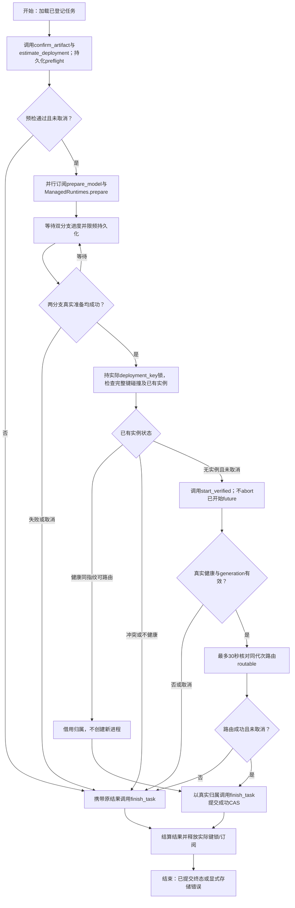
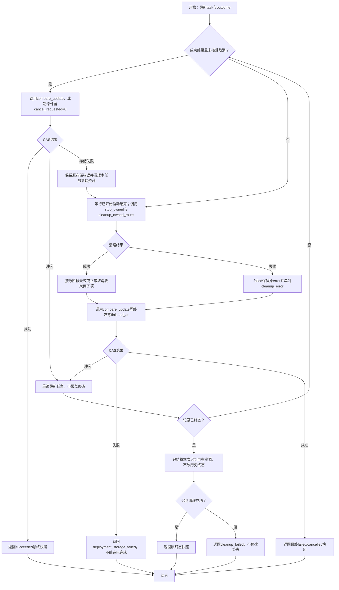

```json
{
  "编号": "016",
  "依赖": [
    "010",
    "011",
    "012",
    "014",
    "015"
  ]
}
```

# 016 实现双分支部署执行器与终态清理

- 任务：实现双分支部署执行器与终态清理
- 工作区：server（读写）——crates/interfaces/server/src/model_deployment.rs 中 run_task/finish_task 与独立编排测试
- 产出：阶段驱动、实际键串行、可证明成功与取消结算
- 前置任务：010 实现共享受管运行时准备与原子启用；011 实现权威工件核对与后端磁盘预检；012 实现模型共享下载与真实摘要启用；014 接通可信启动与精确进程路由清理；015 实现部署任务数据与本机仓储 CAS
- 后置任务：017 实现任务登记恢复与显式服务停机
- 设计依据：F11、F12；第二节 2.1–2.3；第六节 6.2；第四节 TaskContext 生命周期
- 验收标准：
  - 依次权威核对/重新预检，再并行订阅模型与运行时；两分支都成功才 starting，父阶段优先未就绪 runtime，两个真实子进度每秒最多持久化一次，阶段/取消/终态立即写。
  - 以 owner+artifact+实际后端的 deployment_key 串行，model_id=bc+32hex 共34字符；完整键碰撞检测失败，不用 task_id 绕过去重。
  - 锁覆盖启动、健康、路由、提交/清理；只借用身份/后端/运行时指纹一致且同代次健康可路由实例，不覆盖不健康或不同指纹的已有实例。
  - 启动→健康→同代次路由 routable→成功 CAS，路由核对最多30秒；部署服务 Ok 及下载完成不能直接 succeeded。
  - 取消先持久化，启动 future 不 abort/drop；等待最多现有 readiness 600秒结算后精确清理自有代次，清理前不 cancelled；借用不停止。
  - finish_task 保留原阶段错误、独立清理错误；成功 CAS 与取消竞争重读，必要存储失败禁止报告成功并清理新建资源。
  - TaskContext 仅共享能力和 owner_lock，不反持 DeploymentTasks/workers 形成 Arc 环；取消只放订阅，永久缓存不删。
  - 独立测试覆盖双准备等待、auto/cpu同实际键、重复启动、Ok(Unhealthy)、健康/路由失败、取消迟到、存储失败和清理失败。

> 来源：开发序号5、用户于2026-11-24确认的 `../local-model-auto-deploy-dev-doc.md`、同目录流程图与接口契约；分支 `codex/local-model-auto-deploy`，工作区以 `../dev-context.md` 为准。任务定义不代表业务代码或实机验收已完成；实际执行次序只采用脚本生成的 `execution-order.md`。

## 范围与执行约束

- 仅按契约8.2阶段错误码，不添加父状态；进程停止与路由撤销由任务014能力负责，本任务只协调一次清理。
- 只实现本任务摘录的定稿设计；新函数/方法/字段默认私有，跨文件和跨crate可见性不得超过开发文档第六节公开清单，不为测试导出内部实现。
- 注释与rustdoc使用中文；公共边界黑盒校验，内部公有函数白盒契约检查；私有函数不重复校验已保证参数，但新读取的网络/磁盘/归档/进程结果仍须验证。
- 测试写入独立文件；每个公有API/内部公有方法有独立测试，关键公共模块提供可编译# Examples，修复有回归；不使用unsafe、外部输入unwrap/expect或静默丢弃Result。
- 只写上述登记工作区和具体范围；project-root仅登记允许的Cargo.toml/Cargo.lock/README.md/本轮文档。不得覆盖用户target运行时、未跟踪server/docs文件、开发规范或dev-context.md。
- 编码/测试/提交状态由后续任务报告如实记录；提交使用Conventional Commits，提交前后均执行cargo fmt、cargo clippy、cargo test并记录实际feature/target与结果。真实硬件、许可、签名或测试资源缺失不填假证据。

## 实现内容

### 实现约束原文摘录

任务上下文 `TaskContext` 只共享 Store/Node/模型与运行时准备器、实际键锁表和 owner_lock，不反向持有 DeploymentTasks 或其 workers。worker 完成包装器必须处理/记录 Result；后台任务不持有自己的 JoinHandle 所有者，避免 Arc 环。每个上下文字段只释放自己的共享引用，不单独关闭他人资源。

`build_application` 私有组合函数返回 Router 和同一 DeploymentTasks 生命周期句柄；两个既有 create_app 公有函数继续只返回 Router，start_server 正常退出则显式调用 shutdown 并等待。低层 Router 被异常丢弃时只触发取消信号，不能在 Drop 中 await 或宣称清理完成；仍在结算的上下文持有 owner_lock，防旧任务未清理完新实例就取得锁。进程/运行时异常退出依赖既有 kill_on_drop 兜底，下次启动仍按 interrupted 处理，不把这种兜底当作正常取消验收。

所有权销毁顺序：先停止 UI 轮询（不等于取消服务任务），服务关机时通知/结算父任务，等待已开始的部署完成或失败并精确停止本会话自有代次（含成功后由服务持有的运行实例，不停止用户显式程序的其他进程），释放订阅，再结算共享准备/清理暂存，最后释放数据库引用和数据根文件锁。永久有效模型/运行时缓存不随服务析构删除。进程 kill_on_drop 是异常退出兜底，不能替代有错误返回的正常清理。

### 函数定义

#### F11 run_task

- 函数名称：`run_task`
- 公开属性：私有函数
- 多线程属性：异步
- 函数归属：独立函数
- 所属模块或包：`server::model_deployment`
- 职责说明：执行预检、两个并行准备、按实际键串行启动、健康/路由核对和终态提交。
- 入参列表：

| 名称 | 类型 | 是否必填 | 含义 |
| --- | --- | --- | --- |
| context | `TaskContext` | 是 | 各能力的共享引用，不反向持有 worker 所有者 |
| task_id | `Uuid` | 是 | 已持久化任务 |
| cancelled | `CancellationToken` | 是 | 仅该父任务通知 |

- 返回值列表：

| 名称 | 类型 | 含义 |
| --- | --- | --- |
| result | `Result<(), TaskError>` | 已提交终态或明确存储失败；不丢后台错误 |

- 错误返回：契约 8.2 全部适用阶段码；禁止新增对外码
- 校验规则：不校验；前置：submit/recover 已建立任务所有权。每阶段新外部数据仍按相应边界验证。
- 调用关系：

| 方向 | 函数 |
| --- | --- |
| 调用 | confirm_artifact；estimate_deployment；prepare_model；ManagedRuntimes::prepare；NodeDeploymentState::start_verified；finish_task |
| 被调用 | DeploymentTasks::submit 的服务级 worker |

- 函数内部流程图（本任务依据定稿职责与上游状态流转设计）：



---

#### F12 finish_task

- 函数名称：`finish_task`
- 公开属性：私有函数
- 多线程属性：异步
- 函数归属：独立函数
- 所属模块或包：`server::model_deployment`
- 职责说明：在取消/失败时先清理自有资源，再用 CAS 提交终态；成功提交同时检查取消位。
- 入参列表：

| 名称 | 类型 | 是否必填 | 含义 |
| --- | --- | --- | --- |
| task | `DeploymentTask` | 是 | 最新版本任务 |
| outcome | `TaskOutcome` | 是 | 阶段结果及原始错误 |
| ownership | `Option<DeploymentOwnership>` | 否 | 只允许本任务新建代次清理 |

- 返回值列表：

| 名称 | 类型 | 含义 |
| --- | --- | --- |
| result | `Result<DeploymentTask, TaskError>` | 最终快照；CAS 失败重读，绝不覆盖终态 |

- 错误返回：deployment_storage_failed；cleanup_failed
- 校验规则：不校验；前置：编排传入已建立归属的结果；不把阶段失败覆盖成正常取消。
- 调用关系：

| 方向 | 函数 |
| --- | --- |
| 调用 | NodeDeploymentState::stop_owned；DeploymentEventStore::cleanup_owned_route；DeploymentStore::compare_update |
| 被调用 | run_task |

- 函数内部流程图（本任务依据定稿职责与上游状态流转设计）：



---
