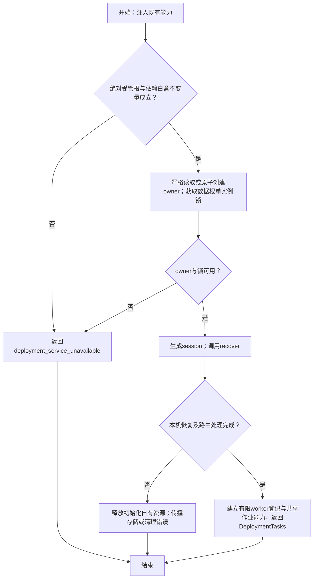
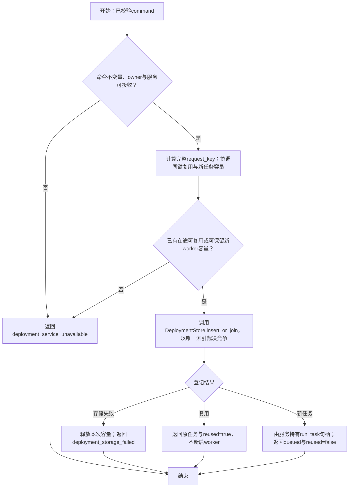
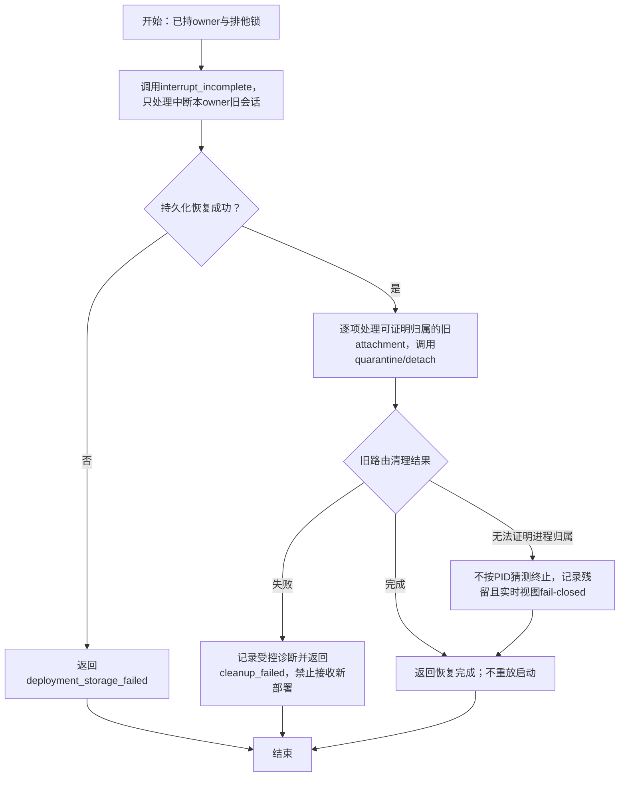
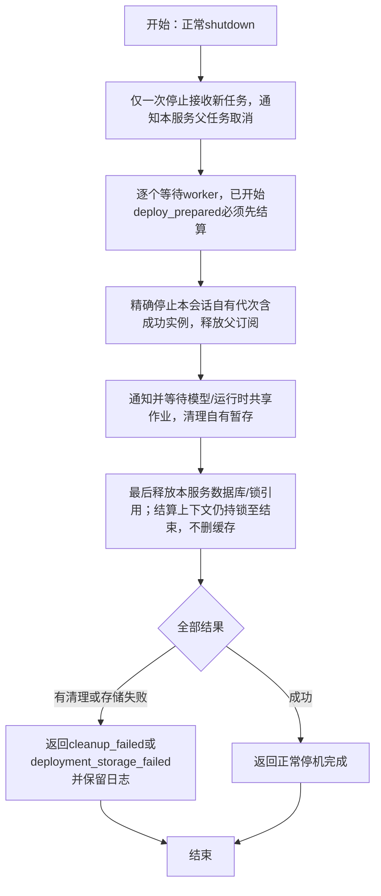
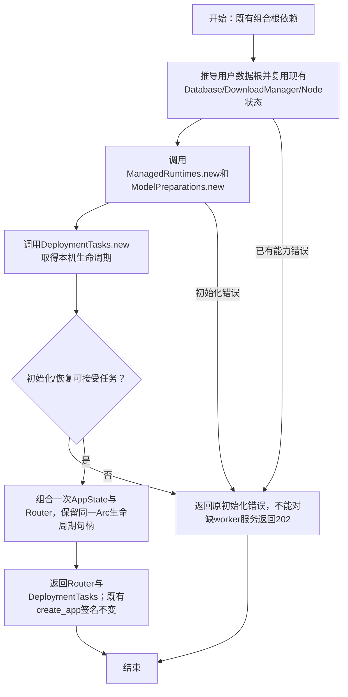

```json
{
  "编号": "017",
  "依赖": [
    "016"
  ]
}
```

# 017 实现任务登记恢复与显式服务停机

- 任务：实现任务登记恢复与显式服务停机
- 工作区：server（读写）——crates/interfaces/server/src/model_deployment.rs 的服务所有者；lib.rs/AppState/既有启动入口；Cargo.toml；独立生命周期测试
- 工作区：project-root（读写）——Cargo.lock（仅 fs2 等实际依赖）
- 产出：DeploymentTasks 生命周期、submit、owner锁与应用组合根
- 前置任务：016 实现双分支部署执行器与终态清理
- 后置任务：018 实现实时就绪视图与持久化取消
- 设计依据：F06、F07、F10、F52、F53；第二节 2.3、2.4；第四节所有权销毁顺序；第五节 5.2
- 验收标准：
  - 原子持久化数据根 UUID并取得单实例文件锁后恢复/接受任务；损坏/丢失 owner 不回退全表恢复，第二实例不得误中断首实例。
  - submit 先复用同键在途，再检查32父任务/4准备并发；新任务 queued 持久化且 worker 可接收才202，满额503不留下无 worker 记录。
  - 恢复只处理当前 owner 上次未完成任务为 interrupted，不重放启动；旧路由可证明归属才撤销，清理失败阻止接受新任务并日志报告，不给 interrupted 增添 failed 专属 cleanup_error。
  - build_application 返回 Router+同一生命周期句柄，既有 create_app 公共签名不变；唯一下载器/运行时/任务服务复用现有数据库与节点能力。
  - 正常 start_server 退出显式 shutdown：停止接收→通知并等父任务/已开始启动结算→精确停本会话自有实例/断订阅→结算共享准备与暂存→释放数据库引用/owner锁；不删永久缓存。
  - 异常 Drop 只发取消，不能声称清理完成；仍在结算的 TaskContext 共持 owner_lock；等待句柄和错误均不静默丢弃。
  - 独立测试覆盖锁冲突、坏owner、共享PG隔离、重启interrupted、队列上限、HTTP断开后worker继续、正常/异常停机与Arc环资源释放。

> 来源：开发序号5、用户于2026-11-24确认的 `../local-model-auto-deploy-dev-doc.md`、同目录流程图与接口契约；分支 `codex/local-model-auto-deploy`，工作区以 `../dev-context.md` 为准。任务定义不代表业务代码或实机验收已完成；实际执行次序只采用脚本生成的 `execution-order.md`。

## 范围与执行约束

- 本任务唯一拥有服务级 worker/锁释放流程；不按同名进程/PID猜测清理，不替用户现有显式运行时终止其他实例。
- 只实现本任务摘录的定稿设计；新函数/方法/字段默认私有，跨文件和跨crate可见性不得超过开发文档第六节公开清单，不为测试导出内部实现。
- 注释与rustdoc使用中文；公共边界黑盒校验，内部公有函数白盒契约检查；私有函数不重复校验已保证参数，但新读取的网络/磁盘/归档/进程结果仍须验证。
- 测试写入独立文件；每个公有API/内部公有方法有独立测试，关键公共模块提供可编译# Examples，修复有回归；不使用unsafe、外部输入unwrap/expect或静默丢弃Result。
- 只写上述登记工作区和具体范围；project-root仅登记允许的Cargo.toml/Cargo.lock/README.md/本轮文档。不得覆盖用户target运行时、未跟踪server/docs文件、开发规范或dev-context.md。
- 编码/测试/提交状态由后续任务报告如实记录；提交使用Conventional Commits，提交前后均执行cargo fmt、cargo clippy、cargo test并记录实际feature/target与结果。真实硬件、许可、签名或测试资源缺失不填假证据。

## 实现内容

### 数据结构

- 名称：DeploymentTasks / TaskWorker
- 类型：服务级所有者与任务级拥有者
- 说明：生命周期显式管理，不形成 Arc 引用环，不在 Drop 中假装完成异步清理。
- 结构：

```python
class DeploymentTasks:
    store: DeploymentStore  # 独占拥有；共享数据库引用的本模块仓储
    node: Arc[NodeDeploymentState]  # 共享；既有进程/路由门面
    artifacts: Arc[ModelPreparations]  # 共享；模型准备作业所有者
    runtimes: Arc[ManagedRuntimes]  # 共享；运行时准备作业所有者
    owner_id: Uuid  # 独占拥有；本机身份
    session_id: Uuid  # 独占拥有；本次会话
    owner_lock: Arc[File]  # 共享；与任务上下文共持，最后清理结束才释放单实例锁
    workers: Mutex[Map[Uuid, TaskWorker]]  # 独占拥有；后台任务及取消通知
    deployment_locks: Mutex[Map[Sha256, Weak[Mutex]]]  # 独占拥有；按实际键串行，弱引用避免无限增长
    shutdown: CancellationToken  # 独占拥有；服务关闭信号

class TaskWorker:
    task_id: Uuid  # 独占拥有；任务归属
    cancelled: CancellationToken  # 独占拥有；仅取消本订阅者
    join: JoinHandle  # 独占拥有；正常 shutdown 必须等待，不随请求断开丢弃
```

### 实现约束原文摘录

#### 2.4 启动恢复与本机隔离

- owner_id 是用户数据根中原子创建并持久化的 UUID，不用主机名、IP 或数据库 URL 推断，不从请求读取。session_id 是本次服务实例 UUID。取得数据根单实例文件锁后，才做恢复和接受任务；锁失败服务不可接受自动部署。
- 文件锁从初始化持有到服务退出，防同一数据根的第二个进程把仍在运行的任务误标中断。共享 PostgreSQL 上其他数据根 owner 的记录不读取、不取消、不恢复。
- 恢复只对当前 owner 的 queued/running 标 interrupted，未完成子项相应中断。保留有效文件、摘要和断点；不重跑 deploy_prepared，不恢复旧 ready_to_chat。
- 可证明归属的旧 attachment 使用既有 LocalRouteAttacher 隔离/撤销；失败返回服务初始化错误并记受控日志，阻止接受新部署。已提交 interrupted 的记录只保留 service_restarted，不能再附加只适用于 failed 的 cleanup_error 或改写终态。未记录 attachment 或没有原进程句柄时不按 PID/进程名猜测终止；新会话没有同代次心跳即 fail-closed，向日志报告无法证明清理的残留。不能给旧数据库成功快照制造实时视图。
- owner 文件/受管根丢失或损坏时不得回退到“全表恢复”；初始化失败并给出修复提示。用户数据根不支持多机克隆共享运行实例。

---

任务上下文 `TaskContext` 只共享 Store/Node/模型与运行时准备器、实际键锁表和 owner_lock，不反向持有 DeploymentTasks 或其 workers。worker 完成包装器必须处理/记录 Result；后台任务不持有自己的 JoinHandle 所有者，避免 Arc 环。每个上下文字段只释放自己的共享引用，不单独关闭他人资源。

`build_application` 私有组合函数返回 Router 和同一 DeploymentTasks 生命周期句柄；两个既有 create_app 公有函数继续只返回 Router，start_server 正常退出则显式调用 shutdown 并等待。低层 Router 被异常丢弃时只触发取消信号，不能在 Drop 中 await 或宣称清理完成；仍在结算的上下文持有 owner_lock，防旧任务未清理完新实例就取得锁。进程/运行时异常退出依赖既有 kill_on_drop 兜底，下次启动仍按 interrupted 处理，不把这种兜底当作正常取消验收。

所有权销毁顺序：先停止 UI 轮询（不等于取消服务任务），服务关机时通知/结算父任务，等待已开始的部署完成或失败并精确停止本会话自有代次（含成功后由服务持有的运行实例，不停止用户显式程序的其他进程），释放订阅，再结算共享准备/清理暂存，最后释放数据库引用和数据根文件锁。永久有效模型/运行时缓存不随服务析构删除。进程 kill_on_drop 是异常退出兜底，不能替代有错误返回的正常清理。

### 函数定义

#### F06 DeploymentTasks::new

- 函数名称：`DeploymentTasks::new`
- 公开属性：公有函数（pub(crate)）
- 多线程属性：异步
- 函数归属：DeploymentTasks 方法
- 所属模块或包：`server::model_deployment`
- 职责说明：注入现有能力，取得 owner/单实例锁，恢复本机记录后启动有限后台调度。
- 入参列表：

| 名称 | 类型 | 是否必填 | 含义 |
| --- | --- | --- | --- |
| db | `Arc<Database>` | 是 | 现有连接 |
| node | `Arc<NodeDeploymentState>` | 是 | 进程门面 |
| downloads | `Arc<DownloadManager>` | 是 | 唯一下载器 |
| runtimes | `Arc<ManagedRuntimes>` | 是 | 共享运行时所有者 |
| data_root | `PathBuf` | 是 | 组合根推导；测试临时根 |

- 返回值列表：

| 名称 | 类型 | 含义 |
| --- | --- | --- |
| result | `Result<Arc<DeploymentTasks>, TaskError>` | 初始化完成的服务；失败不接受任务 |

- 错误返回：deployment_service_unavailable；deployment_storage_failed；service_restarted 仅写恢复记录
- 校验规则：白盒校验：根是明确绝对用户数据根/测试根，连接可用，依赖不新建数据库；外部 owner 文件单独严格解码。
- 调用关系：

| 方向 | 函数 |
| --- | --- |
| 调用 | DeploymentTasks::recover；DeploymentStore；既有数据库路径接口 |
| 被调用 | create_app_with_node_request_state |

- 函数内部流程图（本任务依据定稿职责与上游状态流转设计）：



---

#### F07 DeploymentTasks::submit

- 函数名称：`DeploymentTasks::submit`
- 公开属性：公有函数（pub(crate)）
- 多线程属性：异步
- 函数归属：DeploymentTasks 方法
- 所属模块或包：`server::model_deployment`
- 职责说明：对已校验命令原子登记/复用任务，持有后台任务而非依赖 HTTP 请求存活。
- 入参列表：

| 名称 | 类型 | 是否必填 | 含义 |
| --- | --- | --- | --- |
| command | `DeploymentCommand` | 是 | HTTP 已校验命令 |

- 返回值列表：

| 名称 | 类型 | 含义 |
| --- | --- | --- |
| result | `Result<(DeploymentTask, bool), TaskError>` | 持久化快照及 reused |

- 错误返回：deployment_storage_failed；deployment_service_unavailable
- 校验规则：白盒校验：严格命令不变量、当前 owner 服务可接受作业；不重复解析原 JSON。
- 调用关系：

| 方向 | 函数 |
| --- | --- |
| 调用 | DeploymentStore::insert_or_join；run_task |
| 被调用 | create_deployment_task |

- 函数内部流程图（本任务依据定稿职责与上游状态流转设计）：



---

#### F10 DeploymentTasks::recover

- 函数名称：`DeploymentTasks::recover`
- 公开属性：私有函数
- 多线程属性：异步
- 函数归属：DeploymentTasks 方法
- 所属模块或包：`server::model_deployment`
- 职责说明：持锁启动时中断当前 owner 上次未完成记录，不重放启动。
- 入参列表：

| 名称 | 类型 | 是否必填 | 含义 |
| --- | --- | --- | --- |
| 无 | — | — | 无业务入参；方法接收者按所属类型借用 |

- 返回值列表：

| 名称 | 类型 | 含义 |
| --- | --- | --- |
| result | `Result<(), TaskError>` | 本机恢复结束 |

- 错误返回：deployment_storage_failed；cleanup_failed
- 校验规则：不校验；前置：owner 文件和排他锁已取得；读取记录属于新外部输入，按 schema 解码。
- 调用关系：

| 方向 | 函数 |
| --- | --- |
| 调用 | DeploymentStore::interrupt_incomplete；既有 LocalRouteAttacher 的 quarantine/detach |
| 被调用 | DeploymentTasks::new |

- 函数内部流程图（本任务依据定稿职责与上游状态流转设计）：



---

#### F52 DeploymentTasks::shutdown

- 函数名称：`DeploymentTasks::shutdown`
- 公开属性：公有函数（pub(crate)）
- 多线程属性：异步
- 函数归属：DeploymentTasks 方法
- 所属模块或包：`server::model_deployment`
- 职责说明：停止接受任务、通知父/共享作业并逐个等待清理，最后释放本会话拥有的模型实例和单实例锁。
- 入参列表：

| 名称 | 类型 | 是否必填 | 含义 |
| --- | --- | --- | --- |
| 无 | — | — | 无业务入参；方法接收者按所属类型借用 |

- 返回值列表：

| 名称 | 类型 | 含义 |
| --- | --- | --- |
| result | `Result<(), TaskError>` | 正常停机结果；有失败如实返回/记录，不谎报清理完成 |

- 错误返回：cleanup_failed；deployment_storage_failed
- 校验规则：白盒校验：服务生命周期只结算一次；不停止他人代次；异常 Drop 只能发取消信号，不冒充异步清理完成。
- 调用关系：

| 方向 | 函数 |
| --- | --- |
| 调用 | worker JoinHandle；stop_owned；共享准备结算 |
| 被调用 | start_server 的正常退出路径；测试应用生命周期 |

- 函数内部流程图（本任务依据定稿职责与上游状态流转设计）：



---

#### F53 build_application

- 函数名称：`build_application`
- 公开属性：私有函数
- 多线程属性：异步
- 函数归属：独立函数
- 所属模块或包：`server::lib`
- 职责说明：在既有 create_app 封装之下组合一次 AppState，同时向实际启动入口保留自动部署生命周期句柄。
- 入参列表：

| 名称 | 类型 | 是否必填 | 含义 |
| --- | --- | --- | --- |
| db | `Arc<Database>` | 是 | 现有连接 |
| enable_liveview | `bool` | 是 | 既有 Web 配置 |
| jwt_secret | `JwtSecret` | 是 | 既有认证 |
| internal_secret | `InternalSecret` | 是 | 既有内部密钥 |
| node_request_state | `NodeRequestState` | 是 | 既有节点状态 |

- 返回值列表：

| 名称 | 类型 | 含义 |
| --- | --- | --- |
| result | `Result<(Router, Arc<DeploymentTasks>), anyhow::Error>` | 路由与同一套服务生命周期；create_app 公有签名不变 |

- 错误返回：原初始化错误；任务服务失败不接受 202
- 校验规则：不校验；前置：既有公有构造器完成参数边界校验；数据根由组合根推导。
- 调用关系：

| 方向 | 函数 |
| --- | --- |
| 调用 | ManagedRuntimes::new；DeploymentTasks::new；原 AppState/路由初始化 |
| 被调用 | create_app_with_node_request_state；start_server |

- 函数内部流程图（本任务依据定稿职责与上游状态流转设计）：



---
