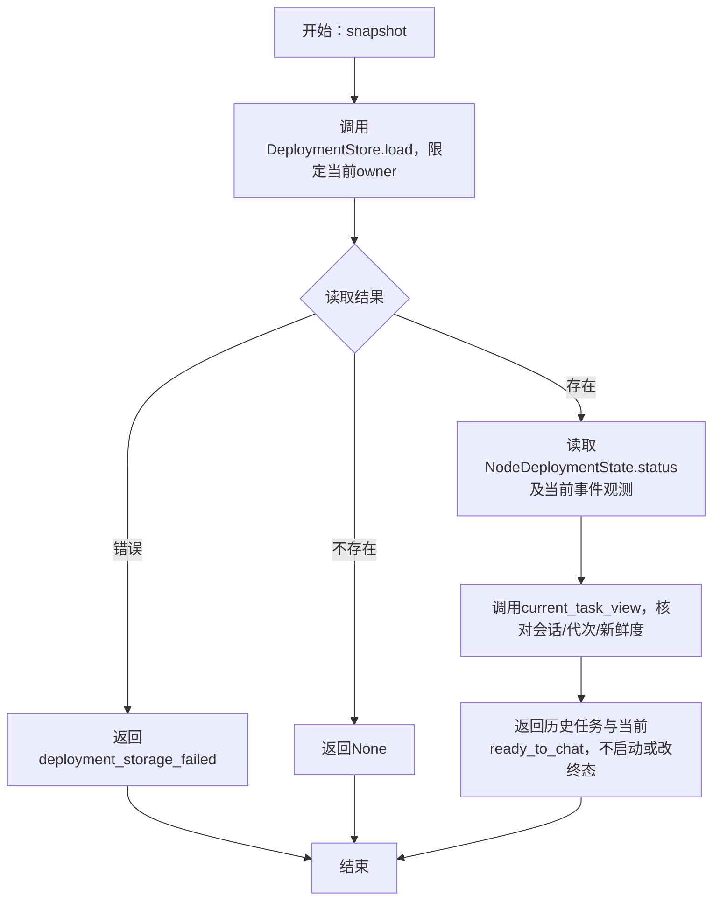
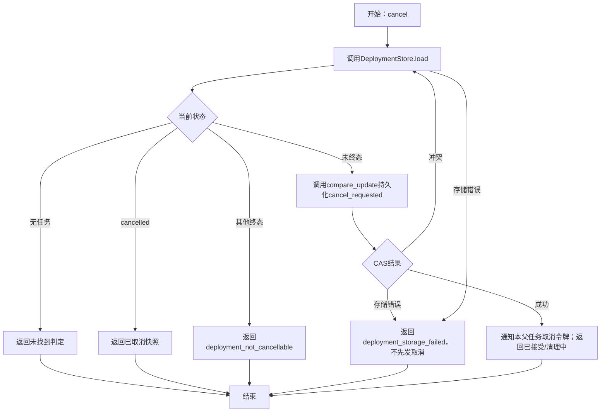
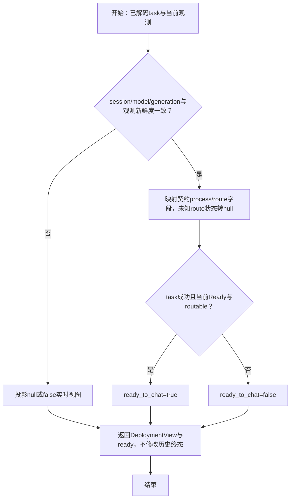

```json
{
  "编号": "018",
  "依赖": [
    "017"
  ]
}
```

# 018 实现实时就绪视图与持久化取消

- 任务：实现实时就绪视图与持久化取消
- 工作区：server（读写）——crates/interfaces/server/src/model_deployment.rs 中 snapshot/cancel/current_task_view；独立竞争测试
- 产出：不伪造实时健康的任务查询与取消判定
- 前置任务：017 实现任务登记恢复与显式服务停机
- 后置任务：019 实现异步部署任务 HTTP 契约
- 设计依据：F08、F09、F13；第二节 2.3；第六节 6.2
- 验收标准：
  - snapshot 读取本owner记录，实时比较session/model/generation/Ready/routable/新鲜度；succeeded历史不保证当前ready，新会话或停机后ready=false。
  - 非契约route_status如lost映射null与ready=false，原状态保留诊断，不把历史健康值当实时证明；GET不启动模型或改终态。
  - cancel 先CAS落 cancel_requested 再通知，仅本父任务；未找到/已取消/清理中/其他终态区分，成功先提交则拒绝取消，取消先提交阻止迟到成功。
  - 查询/取消的数据库失败可见；正常取消和清理失败按契约独立返回，不把取消已接受当自有进程已停止。
  - 独立测试覆盖旧会话、换代、过期心跳、路由丢失、借用实例、CAS竞争、重复取消与存储错误。

> 来源：开发序号5、用户于2026-11-24确认的 `../local-model-auto-deploy-dev-doc.md`、同目录流程图与接口契约；分支 `codex/local-model-auto-deploy`，工作区以 `../dev-context.md` 为准。任务定义不代表业务代码或实机验收已完成；实际执行次序只采用脚本生成的 `execution-order.md`。

## 范围与执行约束

- current_task_view 仅对已解码任务做业务投影，不重复参数安全校验；完成模型停止继续既有接口。
- 只实现本任务摘录的定稿设计；新函数/方法/字段默认私有，跨文件和跨crate可见性不得超过开发文档第六节公开清单，不为测试导出内部实现。
- 注释与rustdoc使用中文；公共边界黑盒校验，内部公有函数白盒契约检查；私有函数不重复校验已保证参数，但新读取的网络/磁盘/归档/进程结果仍须验证。
- 测试写入独立文件；每个公有API/内部公有方法有独立测试，关键公共模块提供可编译# Examples，修复有回归；不使用unsafe、外部输入unwrap/expect或静默丢弃Result。
- 只写上述登记工作区和具体范围；project-root仅登记允许的Cargo.toml/Cargo.lock/README.md/本轮文档。不得覆盖用户target运行时、未跟踪server/docs文件、开发规范或dev-context.md。
- 编码/测试/提交状态由后续任务报告如实记录；提交使用Conventional Commits，提交前后均执行cargo fmt、cargo clippy、cargo test并记录实际feature/target与结果。真实硬件、许可、签名或测试资源缺失不填假证据。

## 实现内容

### 函数定义

#### F08 DeploymentTasks::snapshot

- 函数名称：`DeploymentTasks::snapshot`
- 公开属性：公有函数（pub(crate)）
- 多线程属性：异步
- 函数归属：DeploymentTasks 方法
- 所属模块或包：`server::model_deployment`
- 职责说明：合并持久化任务和当前同代次视图，计算 ready_to_chat。
- 入参列表：

| 名称 | 类型 | 是否必填 | 含义 |
| --- | --- | --- | --- |
| task_id | `Uuid` | 是 | 已通过边界格式校验 |

- 返回值列表：

| 名称 | 类型 | 含义 |
| --- | --- | --- |
| result | `Result<Option<DeploymentTaskData>, TaskError>` | 只返回当前 owner；实时视图缺失时 ready_to_chat=false |

- 错误返回：deployment_storage_failed
- 校验规则：白盒校验：当前服务 owner 已初始化；不信任数据库中的历史健康值。
- 调用关系：

| 方向 | 函数 |
| --- | --- |
| 调用 | DeploymentStore::load；NodeDeploymentState::status；current_task_view |
| 被调用 | get_deployment_task；POST/DELETE 响应适配 |

- 函数内部流程图（本任务依据定稿职责与上游状态流转设计）：



---

#### F09 DeploymentTasks::cancel

- 函数名称：`DeploymentTasks::cancel`
- 公开属性：公有函数（pub(crate)）
- 多线程属性：异步
- 函数归属：DeploymentTasks 方法
- 所属模块或包：`server::model_deployment`
- 职责说明：CAS 提交 cancel_requested 后通知该父任务，返回契约取消判定。
- 入参列表：

| 名称 | 类型 | 是否必填 | 含义 |
| --- | --- | --- | --- |
| task_id | `Uuid` | 是 | 本机任务 ID |

- 返回值列表：

| 名称 | 类型 | 含义 |
| --- | --- | --- |
| result | `Result<CancelDecision, TaskError>` | 未找到/不可取消/已接受/已取消的内部判定，由 HTTP 映射 |

- 错误返回：deployment_storage_failed；deployment_not_cancellable
- 校验规则：白盒校验：owner 与任务版本一致，先持久化再通知；错误不伪装成功。
- 调用关系：

| 方向 | 函数 |
| --- | --- |
| 调用 | DeploymentStore::load；DeploymentStore::compare_update |
| 被调用 | cancel_deployment_task |

- 函数内部流程图（本任务依据定稿职责与上游状态流转设计）：



---

#### F13 current_task_view

- 函数名称：`current_task_view`
- 公开属性：私有函数
- 多线程属性：普通
- 函数归属：独立函数
- 所属模块或包：`server::model_deployment`
- 职责说明：严格比较会话/模型/代次，投影契约 DeploymentView 并计算实时可对话状态。
- 入参列表：

| 名称 | 类型 | 是否必填 | 含义 |
| --- | --- | --- | --- |
| task | `&DeploymentTask` | 是 | 历史结果 |
| current | `Option<&DeploymentSnapshot>` | 否 | 既有事件存储的实时视图 |
| session_id | `Uuid` | 是 | 本会话 |

- 返回值列表：

| 名称 | 类型 | 含义 |
| --- | --- | --- |
| result | `(Option<DeploymentView>, bool)` | 非同代次/非本会话/过期观测为 false；未知路由值投影 null |

- 错误返回：无
- 校验规则：不校验；前置：task 已按 schema 解码；比较当前观测是业务判定，不是重复参数检查。
- 调用关系：

| 方向 | 函数 |
| --- | --- |
| 调用 | 无；纯投影 |
| 被调用 | DeploymentTasks::snapshot |

- 函数内部流程图（本任务依据定稿职责与上游状态流转设计）：



---
