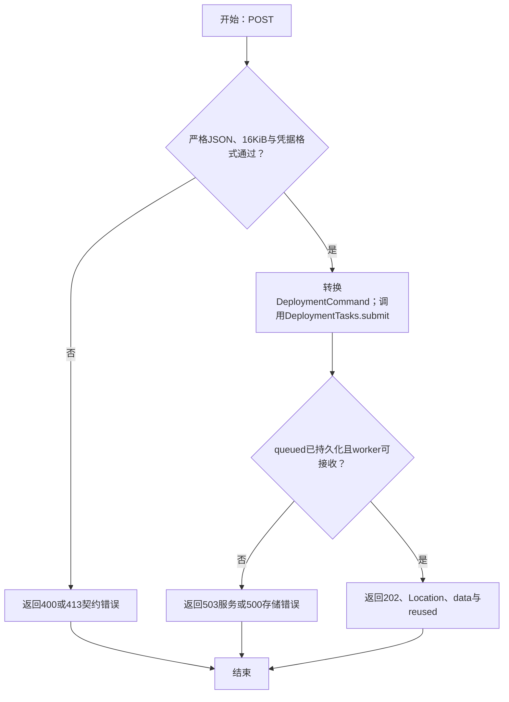
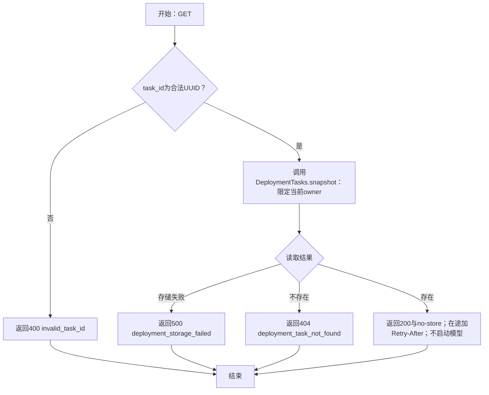
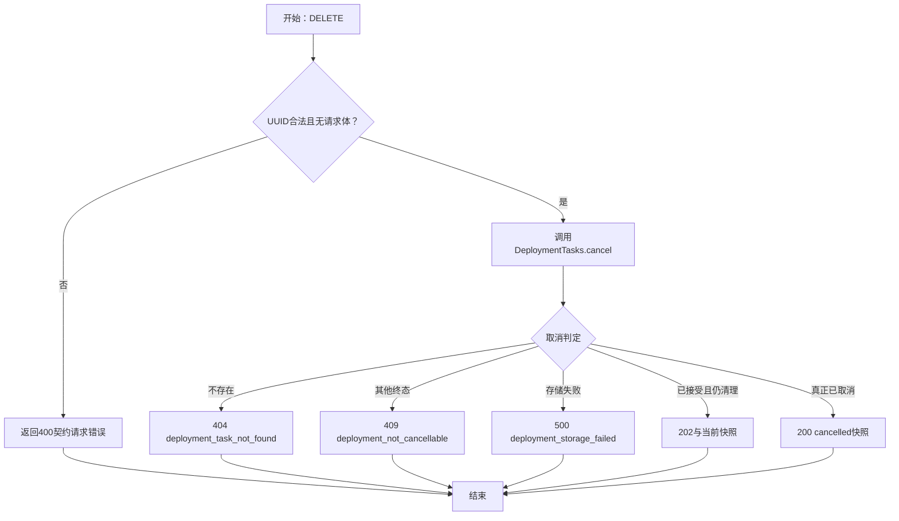
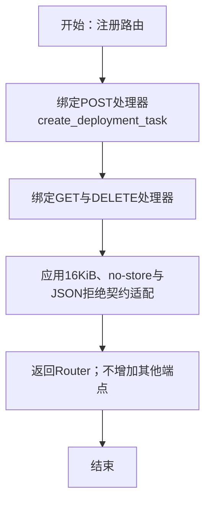

```json
{
  "编号": "019",
  "依赖": [
    "018"
  ]
}
```

# 019 实现异步部署任务 HTTP 契约

- 任务：实现异步部署任务 HTTP 契约
- 工作区：server（读写）——crates/interfaces/server/src/api/model_deployments.rs、api/mod.rs、api/openapi.rs、README.md；独立 HTTP 黑盒测试
- 产出：三新增路由、严格边界及 OpenAPI 定义
- 前置任务：018 实现实时就绪视图与持久化取消
- 后置任务：021 实现任务客户端轮询与刷新恢复；024 扩展四目标便携发行与证据门禁；025 同步本机自动部署用户说明与支持边界
- 设计依据：F01–F03、F05；公有接口契约第一至八节
- 验收标准：
  - POST只接model/source/revision/variant_id/checksum/backend凭据，严格16KiB JSON；未知/重复/错类型字段、null backend及URL/path/executable/version等拒绝，精确按契约400/413。
  - 只有queued持久化且worker可接受才202，带Location、顶层reused与任务；不长请求等待下载，不自动重试副作用，不HTTP自调用手动部署。
  - GET按UUID和owner返回200/no-store；在途Retry-After:1；查询failed/cancelled/interrupted仍success:true，任务错误留data.error。
  - DELETE无请求体，清理中202、真正cancelled200、其他终态409；非法ID400、其他owner/不存在404；存储与服务不可用按约定500/503。
  - 响应全字段/空值/六态/七阶段/错误码与定稿契约逐项一致，不泄露路径或密钥，不新增任意下载/执行/驱动安装接口。
  - 新增路由不替换既有下载/手动启动/查询/停止语义；沿现有Node信任策略；OpenAPI、中文接口说明及每个公有边界的独立测试同步。

> 来源：开发序号5、用户于2026-11-24确认的 `../local-model-auto-deploy-dev-doc.md`、同目录流程图与接口契约；分支 `codex/local-model-auto-deploy`，工作区以 `../dev-context.md` 为准。任务定义不代表业务代码或实机验收已完成；实际执行次序只采用脚本生成的 `execution-order.md`。

## 范围与执行约束

- HTTP处理器/DTO保持Rust私有，只有routes为pub(super)；限体与JSON拒绝使用统一契约适配。
- 只实现本任务摘录的定稿设计；新函数/方法/字段默认私有，跨文件和跨crate可见性不得超过开发文档第六节公开清单，不为测试导出内部实现。
- 注释与rustdoc使用中文；公共边界黑盒校验，内部公有函数白盒契约检查；私有函数不重复校验已保证参数，但新读取的网络/磁盘/归档/进程结果仍须验证。
- 测试写入独立文件；每个公有API/内部公有方法有独立测试，关键公共模块提供可编译# Examples，修复有回归；不使用unsafe、外部输入unwrap/expect或静默丢弃Result。
- 只写上述登记工作区和具体范围；project-root仅登记允许的Cargo.toml/Cargo.lock/README.md/本轮文档。不得覆盖用户target运行时、未跟踪server/docs文件、开发规范或dev-context.md。
- 编码/测试/提交状态由后续任务报告如实记录；提交使用Conventional Commits，提交前后均执行cargo fmt、cargo clippy、cargo test并记录实际feature/target与结果。真实硬件、许可、签名或测试资源缺失不填假证据。

## 实现内容

### 函数定义

#### F01 create_deployment_task

- 函数名称：`create_deployment_task`
- 公开属性：公有接口（Rust 私有）
- 多线程属性：异步
- 函数归属：独立函数
- 所属模块或包：`server::api::model_deployments`
- 职责说明：校验并适配 POST，不在处理器里下载或启动模型。
- 入参列表：

| 名称 | 类型 | 是否必填 | 含义 |
| --- | --- | --- | --- |
| state | `State<AppState>` | 是 | 注入状态 |
| body | `Result<Json<CreateDeploymentRequest>, JsonRejection>` | 是 | 16KiB 限制下严格 JSON |

- 返回值列表：

| 名称 | 类型 | 含义 |
| --- | --- | --- |
| result | `Response` | 202 与 Location/data/reused；失败为契约 HTTP 错误 |

- 错误返回：400 invalid_deployment_request；413 request_too_large；503 deployment_service_unavailable；500 deployment_storage_failed
- 校验规则：黑盒校验：拒绝未知/重复/错类型字段，逐项执行契约第 5 节格式/长度/枚举约束，再转换 DeploymentCommand。
- 调用关系：

| 方向 | 函数 |
| --- | --- |
| 调用 | DeploymentTasks::submit |
| 被调用 | api::model_deployments::routes |

- 函数内部流程图（本任务依据定稿职责与上游状态流转设计）：



---

#### F02 get_deployment_task

- 函数名称：`get_deployment_task`
- 公开属性：公有接口（Rust 私有）
- 多线程属性：异步
- 函数归属：独立函数
- 所属模块或包：`server::api::model_deployments`
- 职责说明：读取本机任务及同代次实时视图，不触发启动。
- 入参列表：

| 名称 | 类型 | 是否必填 | 含义 |
| --- | --- | --- | --- |
| state | `State<AppState>` | 是 | 本机门面 |
| task_id | `Path<String>` | 是 | 不透明部署 UUID |

- 返回值列表：

| 名称 | 类型 | 含义 |
| --- | --- | --- |
| result | `Response` | 200；Cache-Control:no-store；运行中 Retry-After:1 |

- 错误返回：400 invalid_task_id；404 deployment_task_not_found；500 deployment_storage_failed
- 校验规则：黑盒校验：UUID 格式和当前 owner 归属；没有本机记录视为未找到。
- 调用关系：

| 方向 | 函数 |
| --- | --- |
| 调用 | DeploymentTasks::snapshot |
| 被调用 | api::model_deployments::routes |

- 函数内部流程图（本任务依据定稿职责与上游状态流转设计）：



---

#### F03 cancel_deployment_task

- 函数名称：`cancel_deployment_task`
- 公开属性：公有接口（Rust 私有）
- 多线程属性：异步
- 函数归属：独立函数
- 所属模块或包：`server::api::model_deployments`
- 职责说明：登记取消意图，区分已接受和清理完成。
- 入参列表：

| 名称 | 类型 | 是否必填 | 含义 |
| --- | --- | --- | --- |
| state | `State<AppState>` | 是 | 本机门面 |
| task_id | `Path<String>` | 是 | 部署 UUID |

- 返回值列表：

| 名称 | 类型 | 含义 |
| --- | --- | --- |
| result | `Response` | 202 清理中或 200 已取消；不把 cancel 转成 stop |

- 错误返回：400 invalid_task_id；404 deployment_task_not_found；409 deployment_not_cancellable；500 deployment_storage_failed
- 校验规则：黑盒校验：UUID/owner；无请求体；终态按契约拒绝或幂等返回。
- 调用关系：

| 方向 | 函数 |
| --- | --- |
| 调用 | DeploymentTasks::cancel |
| 被调用 | api::model_deployments::routes |

- 函数内部流程图（本任务依据定稿职责与上游状态流转设计）：



---

#### F05 routes

- 函数名称：`routes`
- 公开属性：公有函数（pub(super)）
- 多线程属性：普通
- 函数归属：独立函数
- 所属模块或包：`server::api::model_deployments`
- 职责说明：仅注册三个新增任务路由、限体和 no-store/拒绝适配。
- 入参列表：

| 名称 | 类型 | 是否必填 | 含义 |
| --- | --- | --- | --- |
| 无 | — | — | 无业务入参；方法接收者按所属类型借用 |

- 返回值列表：

| 名称 | 类型 | 含义 |
| --- | --- | --- |
| result | `Router<AppState>` | 新增任务路由；不改变旧手动和下载路由 |

- 错误返回：无
- 校验规则：白盒校验：无外部参数，编译期限定路由集合。
- 调用关系：

| 方向 | 函数 |
| --- | --- |
| 调用 | create/get/cancel_deployment_task |
| 被调用 | server::api::routes |

- 函数内部流程图（本任务依据定稿职责与上游状态流转设计）：



---
