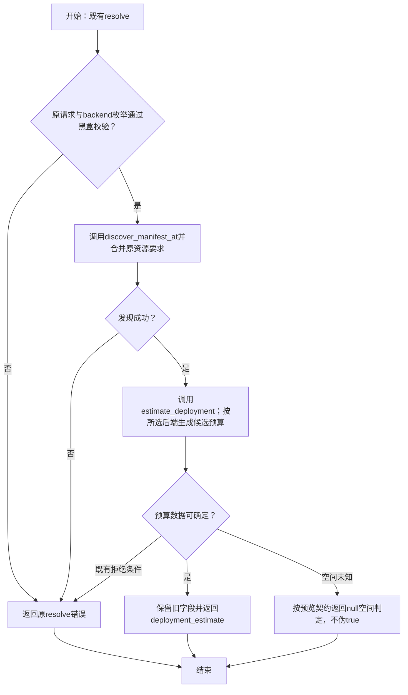

```json
{
  "编号": "020",
  "依赖": [
    "011",
    "010"
  ]
}
```

# 020 扩展目录解析后端与预算预览

- 任务：扩展目录解析后端与预算预览
- 工作区：server（读写）——crates/interfaces/server/src/api/model_resolution.rs、api/openapi.rs、README.md；独立 resolve 兼容测试
- 产出：向后兼容 backend 与 deployment_estimate
- 前置任务：011 实现权威工件核对与后端磁盘预检；010 实现共享受管运行时准备与原子启用
- 后置任务：022 接通目录自动部署与真实双进度界面；025 同步本机自动部署用户说明与支持边界
- 设计依据：F04；第三节 3.1、3.3；接口契约解析扩展条款
- 验收标准：
  - 原请求省略backend仍auto，旧响应字段/错误码不改；合法cpu/auto/cuda按平台校验，非法枚举/类型拒绝。
  - 候选含契约deployment_estimate及原资源要求，不为CPU放行清空VRAM或最低内存/磁盘配置；CPU判定不套GPU专用显存下限。
  - 预算复用estimate_deployment无下载/解压/启动副作用，未知磁盘为null不伪true；部署提交后仍需重新预检。
  - 同模型切换后端可得到对应候选/预算；OpenAPI与服务端文档/独立HTTP测试覆盖旧客户端兼容与不支持平台后端。

> 来源：开发序号5、用户于2026-11-24确认的 `../local-model-auto-deploy-dev-doc.md`、同目录流程图与接口契约；分支 `codex/local-model-auto-deploy`，工作区以 `../dev-context.md` 为准。任务定义不代表业务代码或实机验收已完成；实际执行次序只采用脚本生成的 `execution-order.md`。

## 范围与执行约束

- 不新增接口，不将discover_manifest_at以下私有函数导出，不在预览准备CUDA。
- 只实现本任务摘录的定稿设计；新函数/方法/字段默认私有，跨文件和跨crate可见性不得超过开发文档第六节公开清单，不为测试导出内部实现。
- 注释与rustdoc使用中文；公共边界黑盒校验，内部公有函数白盒契约检查；私有函数不重复校验已保证参数，但新读取的网络/磁盘/归档/进程结果仍须验证。
- 测试写入独立文件；每个公有API/内部公有方法有独立测试，关键公共模块提供可编译# Examples，修复有回归；不使用unsafe、外部输入unwrap/expect或静默丢弃Result。
- 只写上述登记工作区和具体范围；project-root仅登记允许的Cargo.toml/Cargo.lock/README.md/本轮文档。不得覆盖用户target运行时、未跟踪server/docs文件、开发规范或dev-context.md。
- 编码/测试/提交状态由后续任务报告如实记录；提交使用Conventional Commits，提交前后均执行cargo fmt、cargo clippy、cargo test并记录实际feature/target与结果。真实硬件、许可、签名或测试资源缺失不填假证据。

## 实现内容

### 函数定义

#### F04 resolve_model（既有扩展）

- 函数名称：`resolve_model（既有扩展）`
- 公开属性：公有接口（保持 Rust 私有）
- 多线程属性：异步
- 函数归属：独立函数
- 所属模块或包：`server::api::model_resolution`
- 职责说明：保留原解析响应，添加 backend 与候选预算，按后端判定可部署候选。
- 入参列表：

| 名称 | 类型 | 是否必填 | 含义 |
| --- | --- | --- | --- |
| state | `State<AppState>` | 是 | 既有注入状态 |
| request | `ResolveModelRequest` | 是 | 旧字段加可选 backend，默认 auto |

- 返回值列表：

| 名称 | 类型 | 含义 |
| --- | --- | --- |
| result | `Response` | 原 resolve 响应；候选额外含 deployment_estimate |

- 错误返回：沿用既有 resolve 错误码；不新增 HTTP 错误码
- 校验规则：黑盒校验：既有模型/来源/修订校验加 backend 严格枚举；不能抹掉原资源要求。
- 调用关系：

| 方向 | 函数 |
| --- | --- |
| 调用 | discover_manifest_at；estimate_deployment |
| 被调用 | 既有 resolve 路由 |

- 函数内部流程图（本任务依据定稿职责与上游状态流转设计）：



---
