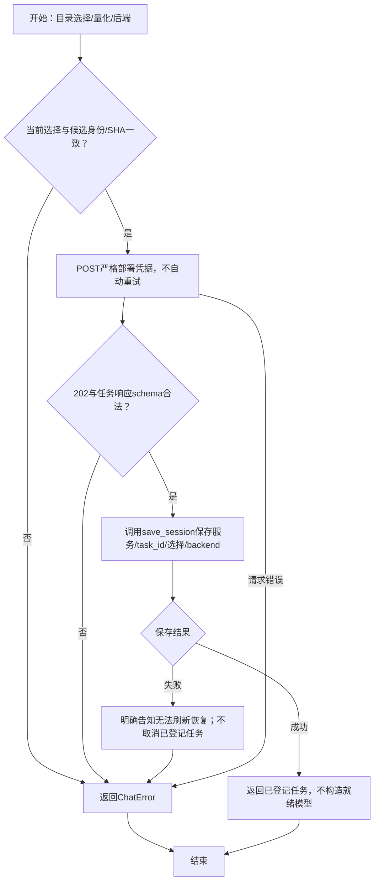
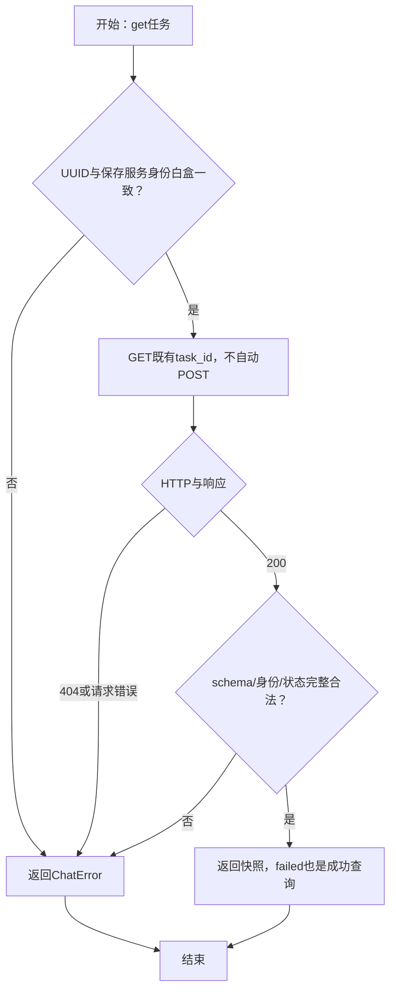
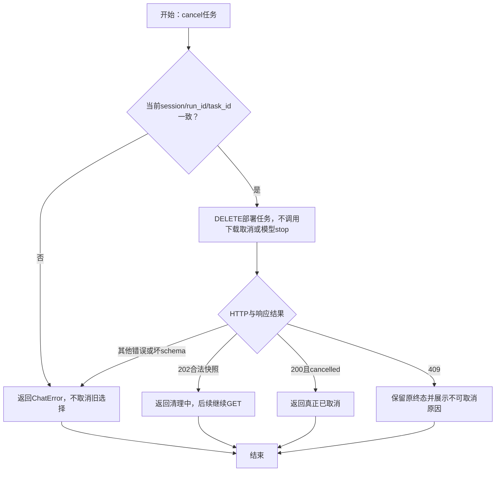
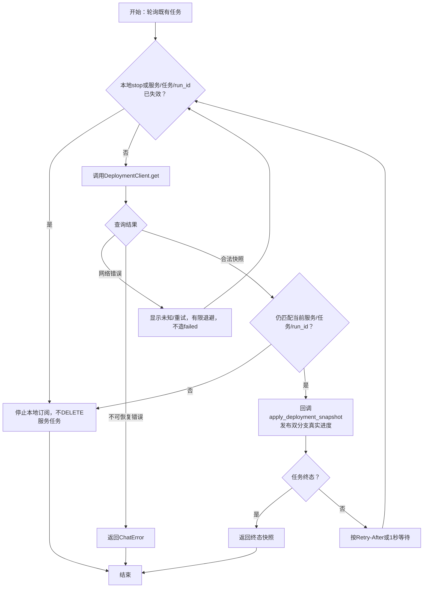
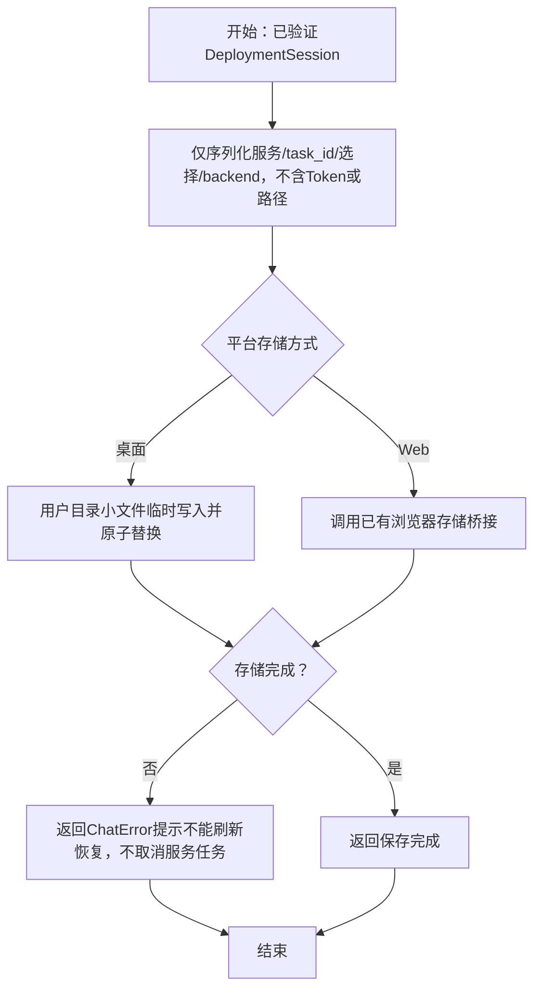
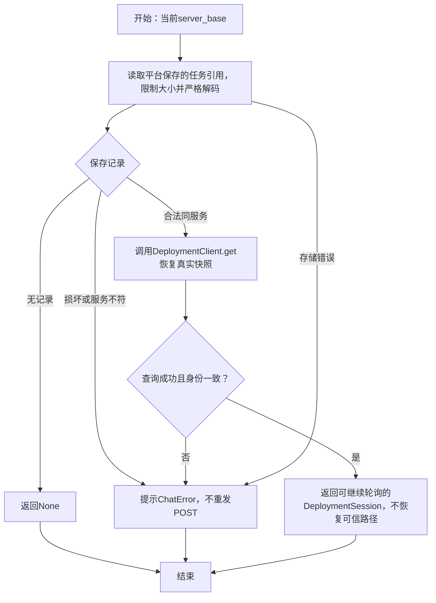
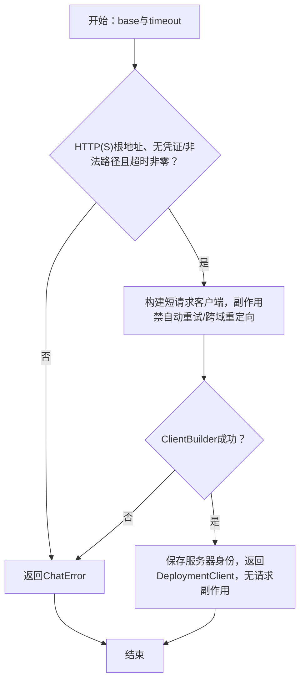

```json
{
  "编号": "021",
  "依赖": [
    "019"
  ]
}
```

# 021 实现任务客户端轮询与刷新恢复

- 任务：实现任务客户端轮询与刷新恢复
- 工作区：client（读写）——crates/interfaces/client/src/domains/chat/deployment.rs、mod.rs 及现有平台存储桥接；独立请求/存储测试
- 产出：DeploymentClient、严格任务DTO与可恢复DeploymentSession
- 前置任务：019 实现异步部署任务 HTTP 契约
- 后置任务：022 接通目录自动部署与真实双进度界面
- 设计依据：F38–F43、F51；第六节 6.3；接口契约全部任务响应
- 验收标准：
  - 构造器校验HTTP(S)服务根/无嵌入凭证/合法路径/非零超时，无请求副作用；POST/DELETE不自动重试或跨域重定向。
  - submit只提交所选凭据和后端，收到202立刻保存服务/task_id/选择/backend；不以202构造PreparedModel。
  - GET/DELETE按所属服务与UUID；failed是成功查询，404不重POST，取消202继续查询，200cancelled才显示完成，409不伪造取消状态。
  - 按Retry-After或1秒轮询、网络错误有限退避，断网显示未知/重试不自造服务failed；run_id/task_id/服务隔离迟到结果。
  - 桌面原子小文件/Web存储保存非敏感引用，不保存API Token、文件路径或可信文件凭据；恢复严格限大小解码，核对服务后只GET，不自动POST。
  - 停止轮询不等于取消服务任务；存储失败明确提示但不撤销已登记任务；独立测试覆盖未知状态/身份漂移、服务切换、刷新、迟到结果及存储错误。

> 来源：开发序号5、用户于2026-11-24确认的 `../local-model-auto-deploy-dev-doc.md`、同目录流程图与接口契约；分支 `codex/local-model-auto-deploy`，工作区以 `../dev-context.md` 为准。任务定义不代表业务代码或实机验收已完成；实际执行次序只采用脚本生成的 `execution-order.md`。

## 范围与执行约束

- 客户端方法仅chat内pub(super)，不新建公开SDK或新认证体系；每个新增内部公有方法有独立测试。
- 只实现本任务摘录的定稿设计；新函数/方法/字段默认私有，跨文件和跨crate可见性不得超过开发文档第六节公开清单，不为测试导出内部实现。
- 注释与rustdoc使用中文；公共边界黑盒校验，内部公有函数白盒契约检查；私有函数不重复校验已保证参数，但新读取的网络/磁盘/归档/进程结果仍须验证。
- 测试写入独立文件；每个公有API/内部公有方法有独立测试，关键公共模块提供可编译# Examples，修复有回归；不使用unsafe、外部输入unwrap/expect或静默丢弃Result。
- 只写上述登记工作区和具体范围；project-root仅登记允许的Cargo.toml/Cargo.lock/README.md/本轮文档。不得覆盖用户target运行时、未跟踪server/docs文件、开发规范或dev-context.md。
- 编码/测试/提交状态由后续任务报告如实记录；提交使用Conventional Commits，提交前后均执行cargo fmt、cargo clippy、cargo test并记录实际feature/target与结果。真实硬件、许可、签名或测试资源缺失不填假证据。

## 实现内容

### 数据结构

- 名称：DeploymentSession
- 类型：chat 模块内状态
- 说明：目录任务与本地替身分支分开，不能为适配新接口伪造本地路径。
- 结构：

```python
class DeploymentSession:
    server_base: str  # 独占拥有；任务所属服务，换服务不能继续取消旧任务
    task_id: str  # 独占拥有；部署 UUID
    run_id: u64  # 独占拥有；现有过期结果隔离标识
    selection: CatalogSelection  # 独占拥有；目录选择
    requested_backend: RequestedBackend  # 独占拥有；用户主动选择
    snapshot: Optional[DeploymentTaskData]  # 独占拥有；最近真实状态
```

### 实现约束原文摘录

准备状态持久化只保存 server_base、task_id、选择身份与 backend，不保存模型路径、推理密钥或自造终态。桌面写用户数据根的小 JSON；Web 用已有页面浏览器存储调用方式保存任务 ID，LiveView 刷新重新 GET。无法恢复记录时显示未恢复，不重新 POST。

### 函数定义

#### F38 DeploymentClient::submit

- 函数名称：`DeploymentClient::submit`
- 公开属性：公有函数（pub(super)）
- 多线程属性：异步
- 函数归属：DeploymentClient 方法
- 所属模块或包：`client::domains::chat::deployment`
- 职责说明：以已选凭据和后端提交异步任务，立刻保存 task_id。
- 入参列表：

| 名称 | 类型 | 是否必填 | 含义 |
| --- | --- | --- | --- |
| selection | `&CatalogSelection` | 是 | 目录模型/来源/修订 |
| variant | `&ModelVariant` | 是 | 量化凭据 |
| backend | `RequestedBackend` | 是 | 用户确认选择 |

- 返回值列表：

| 名称 | 类型 | 含义 |
| --- | --- | --- |
| result | `Result<DeploymentTaskData, ChatError>` | 202 任务，不以此创建 PreparedModel |

- 错误返回：沿用 ChatError；保留服务端请求错误中文原因
- 校验规则：白盒校验：候选身份/摘要与当前选择一致；服务端响应再做 schema 检查，禁自动重试副作用请求。
- 调用关系：

| 方向 | 函数 |
| --- | --- |
| 调用 | POST 新任务接口；save_session |
| 被调用 | HttpBackend::deploy_catalog |

- 函数内部流程图（本任务依据定稿职责与上游状态流转设计）：



---

#### F39 DeploymentClient::get

- 函数名称：`DeploymentClient::get`
- 公开属性：公有函数（pub(super)）
- 多线程属性：异步
- 函数归属：DeploymentClient 方法
- 所属模块或包：`client::domains::chat::deployment`
- 职责说明：按已有 task_id 查询，无自动 POST。
- 入参列表：

| 名称 | 类型 | 是否必填 | 含义 |
| --- | --- | --- | --- |
| task_id | `&str` | 是 | 所属服务的 UUID |

- 返回值列表：

| 名称 | 类型 | 含义 |
| --- | --- | --- |
| result | `Result<DeploymentTaskData, ChatError>` | 最新快照；任务 failed 仍是成功查询结果 |

- 错误返回：ChatError；404 不创建替代任务
- 校验规则：白盒校验：task_id 与保存服务匹配；响应身份/状态/字段一致，未知状态不当成功。
- 调用关系：

| 方向 | 函数 |
| --- | --- |
| 调用 | GET 新任务接口 |
| 被调用 | poll；刷新恢复 |

- 函数内部流程图（本任务依据定稿职责与上游状态流转设计）：



---

#### F40 DeploymentClient::cancel

- 函数名称：`DeploymentClient::cancel`
- 公开属性：公有函数（pub(super)）
- 多线程属性：异步
- 函数归属：DeploymentClient 方法
- 所属模块或包：`client::domains::chat::deployment`
- 职责说明：请求取消部署任务，不使用旧下载取消接口或已运行模型停止接口。
- 入参列表：

| 名称 | 类型 | 是否必填 | 含义 |
| --- | --- | --- | --- |
| task_id | `&str` | 是 | 当前任务 UUID |

- 返回值列表：

| 名称 | 类型 | 含义 |
| --- | --- | --- |
| result | `Result<DeploymentTaskData, ChatError>` | 202 后继续查询；200 cancelled 才显示取消完成 |

- 错误返回：ChatError；409 展示原终态而非改写
- 校验规则：白盒校验：当前 session/run_id 对应同一任务；不发裸模型 ID。
- 调用关系：

| 方向 | 函数 |
| --- | --- |
| 调用 | DELETE 新任务接口 |
| 被调用 | 页面取消操作 |

- 函数内部流程图（本任务依据定稿职责与上游状态流转设计）：



---

#### F41 DeploymentClient::poll

- 函数名称：`DeploymentClient::poll`
- 公开属性：公有函数（pub(super)）
- 多线程属性：异步
- 函数归属：DeploymentClient 方法
- 所属模块或包：`client::domains::chat::deployment`
- 职责说明：按 Retry-After 或一秒间隔查询，有限退避网络错误，发布两个独立分支真实进度。
- 入参列表：

| 名称 | 类型 | 是否必填 | 含义 |
| --- | --- | --- | --- |
| task_id | `String` | 是 | 所属任务 |
| run_id | `u64` | 是 | 客户端过期结果隔离 |
| callback | `Callback<DeploymentTaskData>` | 是 | 界面回调 |
| stop | `CancellationToken` | 是 | 只停止轮询，不自动取消服务任务 |

- 返回值列表：

| 名称 | 类型 | 含义 |
| --- | --- | --- |
| result | `Result<DeploymentTaskData, ChatError>` | 任务终态快照；刷新后可继续 |

- 错误返回：ChatError；连接中断显示未知/重试，不自造服务端 failed
- 校验规则：白盒校验：当前任务/服务不变；每次响应 identity/run_id 比较，终态不被旧响应覆盖。
- 调用关系：

| 方向 | 函数 |
| --- | --- |
| 调用 | DeploymentClient::get；ChatState::apply_deployment_snapshot |
| 被调用 | HttpBackend::deploy_catalog；刷新恢复 |

- 函数内部流程图（本任务依据定稿职责与上游状态流转设计）：



---

#### F42 save_session

- 函数名称：`save_session`
- 公开属性：私有函数
- 多线程属性：异步
- 函数归属：独立函数
- 所属模块或包：`client::domains::chat::deployment`
- 职责说明：按平台保存可恢复任务引用，不保存密钥或模型路径。
- 入参列表：

| 名称 | 类型 | 是否必填 | 含义 |
| --- | --- | --- | --- |
| session | `&DeploymentSession` | 是 | 已收到服务端 task_id |

- 返回值列表：

| 名称 | 类型 | 含义 |
| --- | --- | --- |
| result | `Result<(), ChatError>` | 本地恢复记录已保存；失败明确告知不会刷新恢复 |

- 错误返回：ChatError；不取消已经成功登记的服务任务
- 校验规则：不校验；前置：submit/get 已验证服务和 ID；存储是新边界，IO/浏览器异常必须传播。
- 调用关系：

| 方向 | 函数 |
| --- | --- |
| 调用 | 桌面原子小文件；Web 浏览器存储桥接 |
| 被调用 | DeploymentClient::submit；刷新恢复 |

- 函数内部流程图（本任务依据定稿职责与上游状态流转设计）：



---

#### F43 restore_session

- 函数名称：`restore_session`
- 公开属性：私有函数
- 多线程属性：异步
- 函数归属：独立函数
- 所属模块或包：`client::domains::chat::deployment`
- 职责说明：读取保存的任务 ID，校验所属服务后查询；不重建旧可信文件凭据。
- 入参列表：

| 名称 | 类型 | 是否必填 | 含义 |
| --- | --- | --- | --- |
| server_base | `&Url` | 是 | 当前客户端服务 |

- 返回值列表：

| 名称 | 类型 | 含义 |
| --- | --- | --- |
| result | `Result<Option<DeploymentSession>, ChatError>` | 可继续查询的引用或无记录 |

- 错误返回：ChatError；记录损坏/服务不符提示，不重新 POST
- 校验规则：不校验；前置：配置地址已通过客户端构造边界；持久化内容须严格解码、限大小、核对身份。
- 调用关系：

| 方向 | 函数 |
| --- | --- |
| 调用 | DeploymentClient::get；平台存储读取 |
| 被调用 | 聊天页面挂载 |

- 函数内部流程图（本任务依据定稿职责与上游状态流转设计）：



---

#### F51 DeploymentClient::new

- 函数名称：`DeploymentClient::new`
- 公开属性：公有函数（pub(super)）
- 多线程属性：普通
- 函数归属：DeploymentClient 方法
- 所属模块或包：`client::domains::chat::deployment`
- 职责说明：建立短请求任务客户端和服务器身份，复用目录客户端的配置约定。
- 入参列表：

| 名称 | 类型 | 是否必填 | 含义 |
| --- | --- | --- | --- |
| base | `&str` | 是 | 主服务根地址 |
| timeout | `Duration` | 是 | 单次请求超时 |

- 返回值列表：

| 名称 | 类型 | 含义 |
| --- | --- | --- |
| result | `Result<DeploymentClient, ChatError>` | 任务客户端；无请求副作用 |

- 错误返回：ChatError
- 校验规则：黑盒校验：地址 HTTP(S)、无嵌入凭证/非法路径、非零超时；任务 POST/DELETE 禁自动重试和跨域重定向。
- 调用关系：

| 方向 | 函数 |
| --- | --- |
| 调用 | reqwest::ClientBuilder |
| 被调用 | HttpBackend 构造 |

- 函数内部流程图（本任务依据定稿职责与上游状态流转设计）：



---
