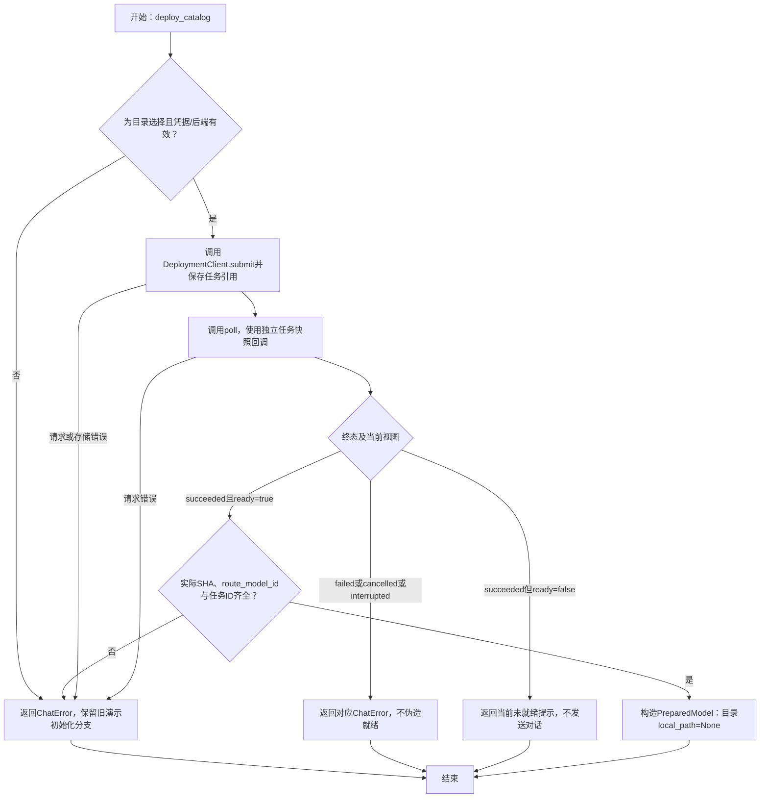
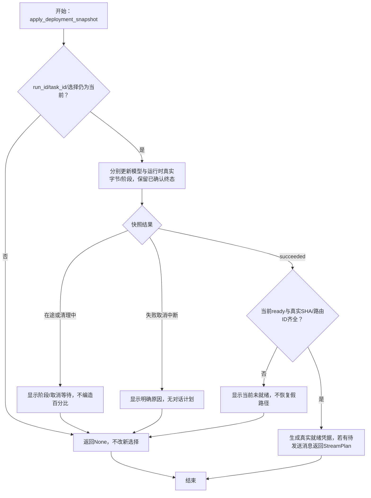

```json
{
  "编号": "022",
  "依赖": [
    "020",
    "021"
  ]
}
```

# 022 接通目录自动部署与真实双进度界面

- 任务：接通目录自动部署与真实双进度界面
- 工作区：client（读写）——crates/interfaces/client/src/domains/chat/{backend,catalog,page,state,model}.rs、相关组件、README.md；独立状态/界面测试
- 产出：任务驱动目录准备、后端/预算确认与无假路径就绪凭据
- 前置任务：020 扩展目录解析后端与预算预览；021 实现任务客户端轮询与刷新恢复
- 后置任务：023 接通 BurnCloud 路由真实对话与 SSE；025 同步本机自动部署用户说明与支持边界
- 设计依据：F44、F45；第五节 5.2；第六节 6.3
- 验收标准：
  - 目录准备走submit/poll，取消用新DELETE；不再下载后调手动deploy_model_with_route；旧演示/本地替身初始化不无关重构。
  - auto/cpu可选，仅Windows展示主动cuda；后端切换使旧候选/预算失效并重新resolve；POST前展示新增网络/磁盘、CUDA双包和驱动要求供确认。
  - 分别展示模型下载/校验与运行时离线解压/双包下载/探测，只有真实下载字节可百分比；未知总量和健康/路由/解压只显示阶段，安全重下可回退字节。
  - PreparedModel.local_path为Option，目录必须真实actual_sha256、route_model_id、deployment_task_id及当前ready_to_chat才就绪，不造本地路径。
  - apply只消费当前run_id/task_id/选择快照；succeeded但ready=false不触发待发送消息，旧回调不覆盖新选择；刷新恢复GET，关闭卡片仅断轮询。
  - 清理中的取消维持可见等待，不提前显示已停止；failed/cancelled/interrupted明确展示原因；VC++提示仅固定相对依赖位置与用户授权，不执行任意命令。
  - 沿现有Token管理输入/选择数据面Token并只放内存，不日志/持久化、不造万能Token；独立状态测试覆盖真实成功、未就绪、刷新及迟到隔离。

> 来源：开发序号5、用户于2026-11-24确认的 `../local-model-auto-deploy-dev-doc.md`、同目录流程图与接口契约；分支 `codex/local-model-auto-deploy`，工作区以 `../dev-context.md` 为准。任务定义不代表业务代码或实机验收已完成；实际执行次序只采用脚本生成的 `execution-order.md`。

## 范围与执行约束

- ChatBackend只增加chat模块内必需的deploy_catalog方法，不扩成跨crate插件体系；数据面传输由任务023负责。
- 只实现本任务摘录的定稿设计；新函数/方法/字段默认私有，跨文件和跨crate可见性不得超过开发文档第六节公开清单，不为测试导出内部实现。
- 注释与rustdoc使用中文；公共边界黑盒校验，内部公有函数白盒契约检查；私有函数不重复校验已保证参数，但新读取的网络/磁盘/归档/进程结果仍须验证。
- 测试写入独立文件；每个公有API/内部公有方法有独立测试，关键公共模块提供可编译# Examples，修复有回归；不使用unsafe、外部输入unwrap/expect或静默丢弃Result。
- 只写上述登记工作区和具体范围；project-root仅登记允许的Cargo.toml/Cargo.lock/README.md/本轮文档。不得覆盖用户target运行时、未跟踪server/docs文件、开发规范或dev-context.md。
- 编码/测试/提交状态由后续任务报告如实记录；提交使用Conventional Commits，提交前后均执行cargo fmt、cargo clippy、cargo test并记录实际feature/target与结果。真实硬件、许可、签名或测试资源缺失不填假证据。

## 实现内容

### 数据结构

- 名称：PreparedModel
- 类型：chat 模块内状态
- 说明：目录任务与本地替身分支分开，不能为适配新接口伪造本地路径。
- 结构：

```python
class PreparedModel:
    model: ChatModel  # 独占拥有；沿用模型
    variant: ModelVariant  # 独占拥有；沿用变体
    actual_sha256: str  # 独占拥有；来自成功任务的真实模型摘要
    local_path: Optional[str]  # 独占拥有；仅旧本地替身/手动分支使用，目录部署为 None
    route_model_id: Optional[str]  # 独占拥有；目录任务返回的服务端路由 ID
    deployment_task_id: Optional[str]  # 独占拥有；刷新后核对当前 ready_to_chat
```

### 实现约束原文摘录

#### 6.3 客户端展示和真实推理

- 后端选项提供 auto/cpu，仅 Windows 展示可选 cuda。切换后端重新 resolve，展示预计新增网络量、完整 CUDA 双包量/缓存增量、磁盘空间和依赖/驱动要求，用户确认后才 POST。
- 卡片同时展示“模型：下载/校验”和“运行时：离线解压/在线双包/探测”。解压、探测、健康、路由只显示文字阶段；下载总量未知时不显示百分比，安全重下允许字节回退。
- 页面刷新优先恢复 task_id 后 GET；关闭卡片/断开 WebSocket 只停止 UI 订阅，主动点取消才 DELETE。旧 run_id 响应、旧服务器任务和旧 task_id 不修改新选择。
- 新目录链路没有 model_path 响应，因此 PreparedModel.local_path 改为 Option，仅旧分支使用；目录分支依据真实 actual_sha256、route_model_id 和 ready_to_chat 构造就绪凭据，不填入虚构路径以通过旧 is_valid。
- 现有 HttpBackend.generate 不能继续对目录模型调用 LocalBackend.generate。目录会话必须以任务返回 model_id 向主服务 `/v1/chat/completions` 发出真实请求，不能直连进程端口。这个数据面端点已存在，不在本轮增加新公共 HTTP 入口。
- 数据面原有令牌验证不能绕过：聊天界面提供现有 BurnCloud API Token 的内存输入/选择，用户仍通过原令牌管理能力创建令牌；不新建自动发令牌体系、不硬编码万能 Token。缺少/无效令牌明确提示使用既有管理入口，不能回退模拟回复。令牌不属于运行时部署前置，不写部署任务/恢复记录/日志，不要求用户配置运行时环境变量。
- SSE 必须支持分块 UTF-8/多行数据/半帧、错误与完成标记；流截断视为失败。没有真实 usage/TTFT/tokens 数据时不显示模拟指标或费用；本期不引入新计费或认证语义。

### 函数定义

#### F44 HttpBackend::deploy_catalog

- 函数名称：`HttpBackend::deploy_catalog`
- 公开属性：公有函数（ChatBackend 的 pub(super) 模块内契约）
- 多线程属性：异步（沿现有 BackendFuture）
- 函数归属：HttpBackend 方法
- 所属模块或包：`client::domains::chat::backend`
- 职责说明：目录分支改为提交/查询自动部署，旧本地替身 initialize 保留。
- 入参列表：

| 名称 | 类型 | 是否必填 | 含义 |
| --- | --- | --- | --- |
| request | `InitializationRequest` | 是 | 含当前后端选择 |
| callback | `Callback<DeploymentTaskData>` | 是 | 新任务进度回调 |

- 返回值列表：

| 名称 | 类型 | 含义 |
| --- | --- | --- |
| result | `BackendFuture<PreparedModel>` | 仅成功且当前 ready_to_chat 时构造含 route_model_id 的就绪模型 |

- 错误返回：ChatError；后台 failed/cancelled/interrupted 明确映射
- 校验规则：白盒校验：是目录选择且凭据有效；缺少真实摘要/路由 ID/ready_to_chat 不放行。
- 调用关系：

| 方向 | 函数 |
| --- | --- |
| 调用 | DeploymentClient::submit/poll；不再调用 deploy_model_with_route |
| 被调用 | page::spawn_preparation 的目录分支 |

- 函数内部流程图（本任务依据定稿职责与上游状态流转设计）：



---

#### F45 ChatState::apply_deployment_snapshot

- 函数名称：`ChatState::apply_deployment_snapshot`
- 公开属性：公有函数（pub(super)）
- 多线程属性：普通
- 函数归属：ChatState 方法
- 所属模块或包：`client::domains::chat::state`
- 职责说明：按 run_id/任务 ID 消费最新快照，分别呈现模型和运行时，不线性伪造阶段事件。
- 入参列表：

| 名称 | 类型 | 是否必填 | 含义 |
| --- | --- | --- | --- |
| run_id | `u64` | 是 | 本地操作代次 |
| snapshot | `DeploymentTaskData` | 是 | 已解码快照 |

- 返回值列表：

| 名称 | 类型 | 含义 |
| --- | --- | --- |
| result | `Option<StreamPlan>` | 仅真正成功可触发待发送消息；旧代次返回 None |

- 错误返回：ChatError 保存在界面状态；不新增服务端错误码
- 校验规则：白盒校验：当前 run_id/task_id/选择一致；succeeded 但 ready=false 不触发对话；不保存假路径。
- 调用关系：

| 方向 | 函数 |
| --- | --- |
| 调用 | 现有准备 UI 与过期回调防护 |
| 被调用 | DeploymentClient::poll 回调；刷新恢复 |

- 函数内部流程图（本任务依据定稿职责与上游状态流转设计）：



---
