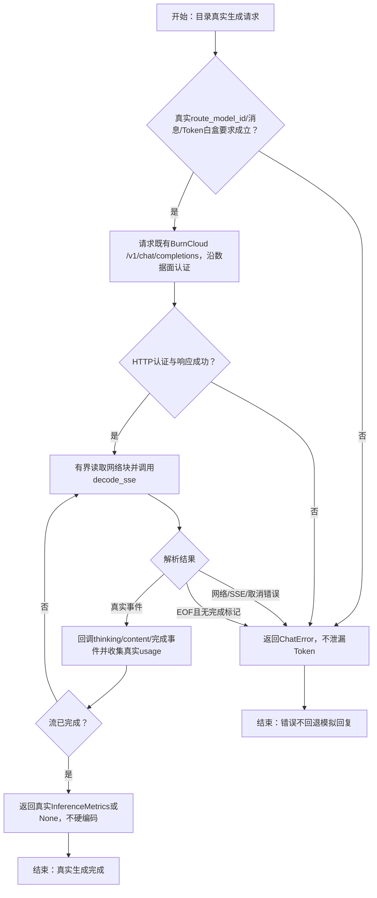
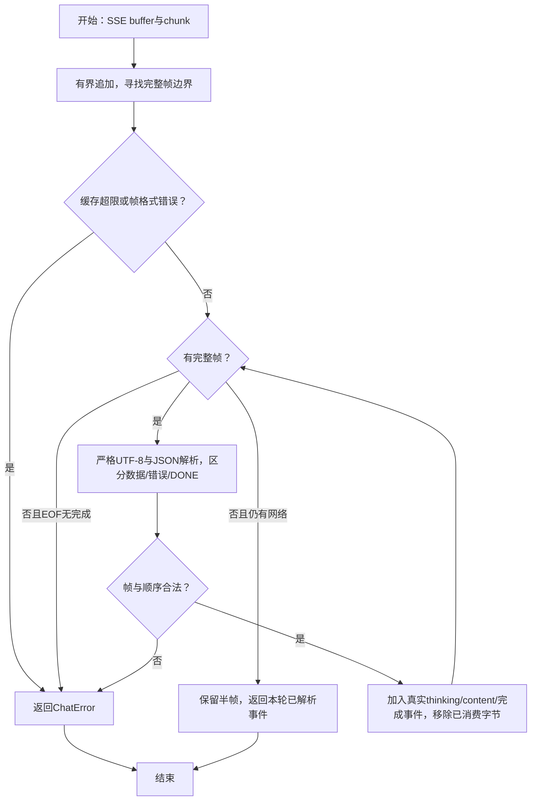

```json
{
  "编号": "023",
  "依赖": [
    "022"
  ]
}
```

# 023 接通 BurnCloud 路由真实对话与 SSE

- 任务：接通 BurnCloud 路由真实对话与 SSE
- 工作区：client（读写）——crates/interfaces/client/src/domains/chat/inference.rs、backend.rs 生成分支及相关展示；独立协议/认证测试
- 产出：真实数据面请求、分块SSE解析与真实推理指标
- 前置任务：022 接通目录自动部署与真实双进度界面
- 后置任务：024 扩展四目标便携发行与证据门禁；025 同步本机自动部署用户说明与支持边界
- 设计依据：F46、F47；第五节 5.2；第六节 6.3
- 验收标准：
  - 目录HttpBackend::generate只调用既有BurnCloud /v1/chat/completions与真实route_model_id/历史消息；不直连裸llama-server，不回退模拟文本。
  - 使用用户现有合法数据面Token，只内存持有，401/403明确报错，不绕过认证、不新增万能凭证。
  - SSE按网络任意分块与UTF-8边界解析，区分thinking/content/错误/完成，缓存有界、帧长/顺序严格，EOF无完成标记报错。
  - usage/速度/时长取真实响应；缺数据返回None，不硬编码指标；错误帧/超长帧/取消传播为现有ChatError。
  - 独立测试覆盖分块、多帧、半UTF-8、错误帧、[DONE]、缺完成、认证失败与无usage；目录接口失败不走演示生成，旧演示分支仅保留原用途。

> 来源：开发序号5、用户于2026-11-24确认的 `../local-model-auto-deploy-dev-doc.md`、同目录流程图与接口契约；分支 `codex/local-model-auto-deploy`，工作区以 `../dev-context.md` 为准。任务定义不代表业务代码或实机验收已完成；实际执行次序只采用脚本生成的 `execution-order.md`。

## 范围与执行约束

- 真实路由对话的单元/集成测试不等于四平台干净环境验收；后者必须独立保存实际请求与响应。
- 只实现本任务摘录的定稿设计；新函数/方法/字段默认私有，跨文件和跨crate可见性不得超过开发文档第六节公开清单，不为测试导出内部实现。
- 注释与rustdoc使用中文；公共边界黑盒校验，内部公有函数白盒契约检查；私有函数不重复校验已保证参数，但新读取的网络/磁盘/归档/进程结果仍须验证。
- 测试写入独立文件；每个公有API/内部公有方法有独立测试，关键公共模块提供可编译# Examples，修复有回归；不使用unsafe、外部输入unwrap/expect或静默丢弃Result。
- 只写上述登记工作区和具体范围；project-root仅登记允许的Cargo.toml/Cargo.lock/README.md/本轮文档。不得覆盖用户target运行时、未跟踪server/docs文件、开发规范或dev-context.md。
- 编码/测试/提交状态由后续任务报告如实记录；提交使用Conventional Commits，提交前后均执行cargo fmt、cargo clippy、cargo test并记录实际feature/target与结果。真实硬件、许可、签名或测试资源缺失不填假证据。

## 实现内容

### 函数定义

#### F46 generate_via_router

- 函数名称：`generate_via_router`
- 公开属性：公有函数（pub(super)）
- 多线程属性：异步
- 函数归属：独立函数
- 所属模块或包：`client::domains::chat::inference`
- 职责说明：目录模型通过既有 BurnCloud /v1/chat/completions 生成，不直连 llama-server、不回退模拟文本。
- 入参列表：

| 名称 | 类型 | 是否必填 | 含义 |
| --- | --- | --- | --- |
| base | `&Url` | 是 | 主服务根 |
| request | `GenerationRequest` | 是 | 真实 route_model_id 与历史消息 |
| api_token | `&str` | 是 | 用户在已有 Token 页面管理的数据面令牌，仅本次内存持有 |
| callback | `Callback<GenerationEvent>` | 是 | 真实流事件 |

- 返回值列表：

| 名称 | 类型 | 含义 |
| --- | --- | --- |
| result | `Result<Option<InferenceMetrics>, ChatError>` | 解析真实 SSE；无 usage/速度数据时返回 None，不硬编码示例指标 |

- 错误返回：沿用既有数据面 HTTP/SSE 错误映射 ChatError，不新增端点或绕过认证
- 校验规则：白盒校验：route_model_id/消息非空，API Token 不写日志/恢复文件；SSE 做长度、UTF-8、帧序及完成标记校验。
- 调用关系：

| 方向 | 函数 |
| --- | --- |
| 调用 | 既有 /v1/chat/completions；decode_sse |
| 被调用 | HttpBackend::generate 的目录分支；本地替身分支保留 |

- 函数内部流程图（本任务依据定稿职责与上游状态流转设计）：



---

#### F47 decode_sse

- 函数名称：`decode_sse`
- 公开属性：私有函数
- 多线程属性：普通
- 函数归属：独立函数
- 所属模块或包：`client::domains::chat::inference`
- 职责说明：跨网络分块解析真实 OpenAI SSE，区分 thinking/content/完成与错误。
- 入参列表：

| 名称 | 类型 | 是否必填 | 含义 |
| --- | --- | --- | --- |
| buffer | `&mut Vec<u8>` | 是 | 有界未完成帧缓存 |
| chunk | `&[u8]` | 是 | 本轮网络块 |

- 返回值列表：

| 名称 | 类型 | 含义 |
| --- | --- | --- |
| result | `Result<Vec<GenerationEvent>, ChatError>` | 本轮完整事件；半帧留存；EOF 无完成标记报错 |

- 错误返回：ChatError；不得伪造回复或推理指标
- 校验规则：不校验；前置：调用方已建立数据面请求；网络帧本身作为新外部输入严格解析。
- 调用关系：

| 方向 | 函数 |
| --- | --- |
| 调用 | serde_json；SSE 空行分帧 |
| 被调用 | generate_via_router |

- 函数内部流程图（本任务依据定稿职责与上游状态流转设计）：



---
