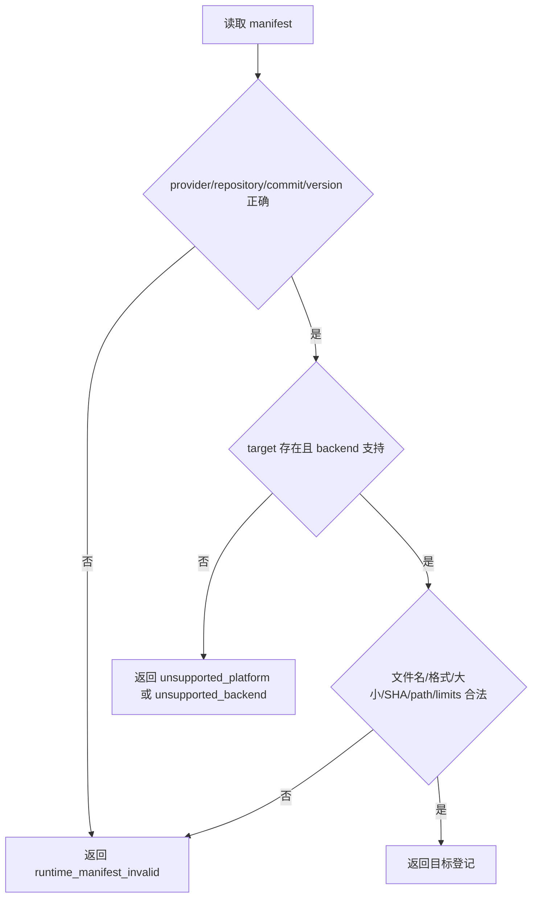

{
  "编号": "026",
  "依赖": []
}

# 026 登记 Gitee 固定运行时 manifest

- 任务：登记方案二四目标 Gitee 运行时资源和可信字段校验。
- 工作区：runtime-assets（读写）——`deploy/runtime/manifest.json`、`deploy/runtime/README.md`。
- 产出：新的 manifest schema、四个目标资源登记、固定 commit/大小/SHA/server path 校验和运行时来源说明。
- 前置任务：历史 `005` 的运行时资源登记仅作为参考；本任务替代其 b8581/GitHub 生产来源部分。
- 后置任务：027、028、029、030、031。
- 验收标准：
  - manifest 固定 `provider=gitee`、repository、commit `51d01f6e526bc6d45b9d252b1d2d487efb6625d8` 和 version `b12757`。
  - Windows x64、macOS x64、macOS ARM64、Ubuntu x64 的文件名、格式、字节数、SHA-256、`server_relative_path` 与技术书一致；SHA-256 为 64 位连续小写十六进制。
  - `xcframework` 不进入桌面 `llama-server` target 映射；CUDA 不生成 Gitee 资源条目。
  - manifest 能拒绝缺字段、非法摘要、非法路径、平台不匹配和 backend 不支持，并返回 `runtime_manifest_invalid` 或 `unsupported_backend`。
  - 资源登记脚本对固定 commit 的实际归档重新计算大小和 SHA-256；Git blob id 不被当作归档 SHA-256。

## 实现内容

### 数据结构

---

名称：`RuntimeManifest`；类型：代码结构；说明：固定 Gitee 运行时可信清单；结构字段见 `gitee-runtime-download-dev-doc.md` 第四节。

---

名称：`RuntimePackage`；类型：代码结构；说明：单个目标归档的文件名、格式、大小、摘要和服务端路径；结构字段见开发文档第四节。

### 函数定义

---

函数名称：`validate_manifest`
公开属性：私有函数
多线程属性：普通
函数归属：独立函数
所属模块或包：`node_runtime::manifest`
职责说明：校验固定 provider/repository/commit、target/backend、摘要格式、文件路径和归档限制。
入参列表：`manifest: &RuntimeManifest`、`current_target: &str`、`requested_backend: Backend`。
返回值列表：通过校验的 `&RuntimeTarget`。
错误返回：`runtime_manifest_invalid`、`unsupported_platform`、`unsupported_backend`。
校验规则：白盒断言。
调用关系：调用 `validate_sha256`、`validate_relative_path`、`validate_archive_limits`；被 `resolve_runtime_entry` 调用。

函数内部流程图：

---
