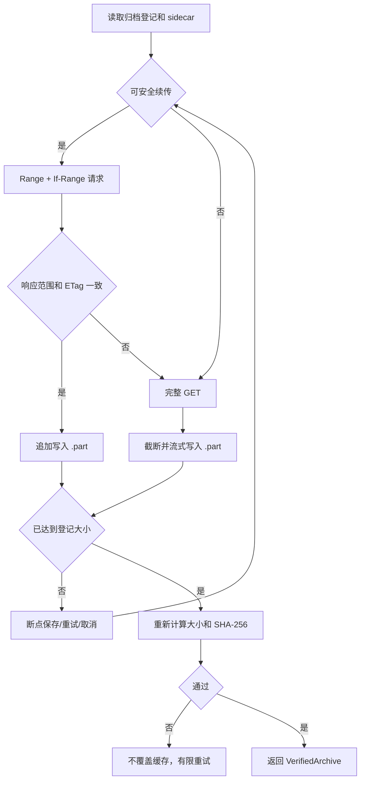
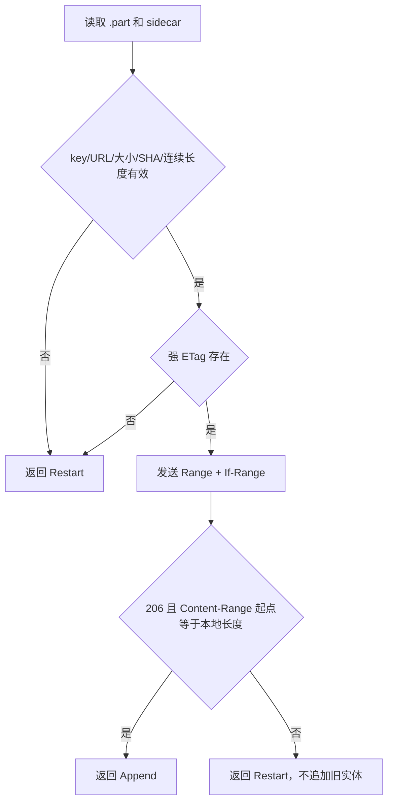

{
  "编号": "027",
  "依赖": ["026"]
}

# 027 实现原生 Gitee 运行时下载与断点恢复

- 任务：实现不依赖 aria2 的 reqwest 流式运行时归档下载、`.part` sidecar、Range/ETag 恢复、取消和有限重试。
- 工作区：download（读写）——`crates/platform/storage/download/src/runtime_http.rs` 或等价运行时传输模块。
- 产出：运行时专用 HTTP 传输模块、断点元数据读写、真实字节进度事件和独立错误映射。
- 前置任务：026。
- 后置任务：031、034。
- 验收标准：
  - 归档始终以 response stream 写入 `.part`，不整体读入内存，不启动 aria2。
  - 只有强 ETag、Range 起点、Content-Range 起点、总长度和本地连续长度一致时才追加；不一致或 Range 返回 200 时安全重下。
  - 连接中断、无进展、5xx 支持有限重试；403/404/固定来源不可用不切换 URL。
  - 取消保留可验证的连续 `.part` 和 sidecar；下载完成后重新计算完整 SHA-256 和文件大小。
  - SHA-256/长度校验失败不覆盖有效缓存，进度可在实体变化时回退。

## 实现内容

### 数据结构

---

名称：`RuntimePartialMetadata`；类型：代码结构；说明：记录固定 URL、commit、强 ETag、连续长度和预期摘要；字段见开发文档第四节。

---

名称：`VerifiedArchive`；类型：代码结构；说明：已完成大小和 SHA-256 校验的归档句柄；不得代表只有期望摘要的未校验文件。

### 函数定义

---

函数名称：`download_runtime_archive`
公开属性：私有函数
多线程属性：异步
函数归属：独立函数
所属模块或包：`runtime_http`
职责说明：流式下载固定 Gitee 归档，发布真实字节进度并返回 `VerifiedArchive`。
入参列表：`entry`、`download_dir`、`progress`、`cancellation`。
返回值列表：已校验 `VerifiedArchive`。
错误返回：`runtime_source_unavailable`、`runtime_download_failed`、`runtime_size_mismatch`、`runtime_checksum_mismatch`、取消错误。
校验规则：白盒断言。
调用关系：调用 `resume_or_restart_download`、`append_stream`、`verify_archive_digest`；被运行时准备器调用。

函数内部流程图：

---

函数名称：`resume_or_restart_download`
公开属性：私有函数
多线程属性：异步
函数归属：独立函数
所属模块或包：`runtime_http`
职责说明：根据 sidecar、强 ETag 和 HTTP 响应决定追加或从零开始。
入参列表：`partial`、`entry`、`client`。
返回值列表：`ResumeMode::Append` 或 `ResumeMode::Restart`。
错误返回：`runtime_download_failed`。
校验规则：白盒断言。
调用关系：被 `download_runtime_archive` 调用。

函数内部流程图：

---
