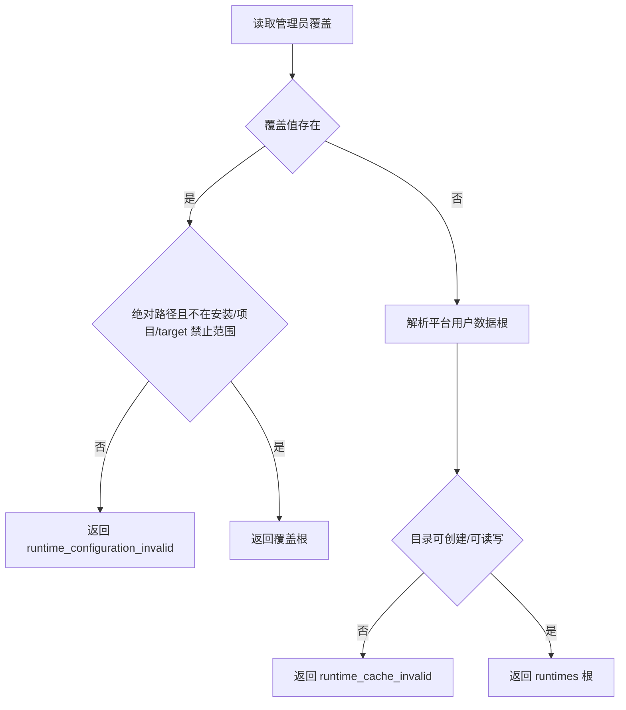
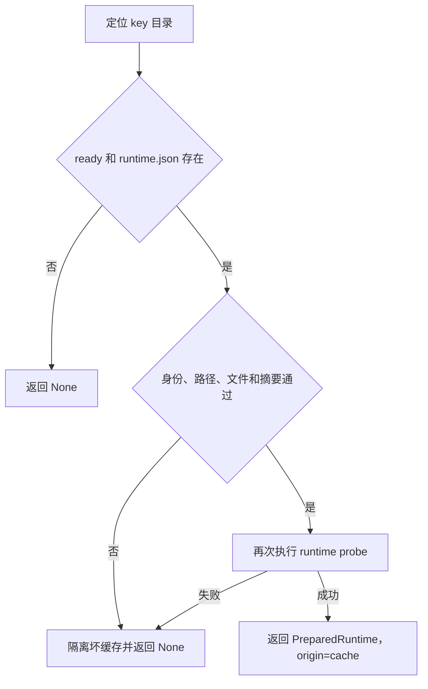
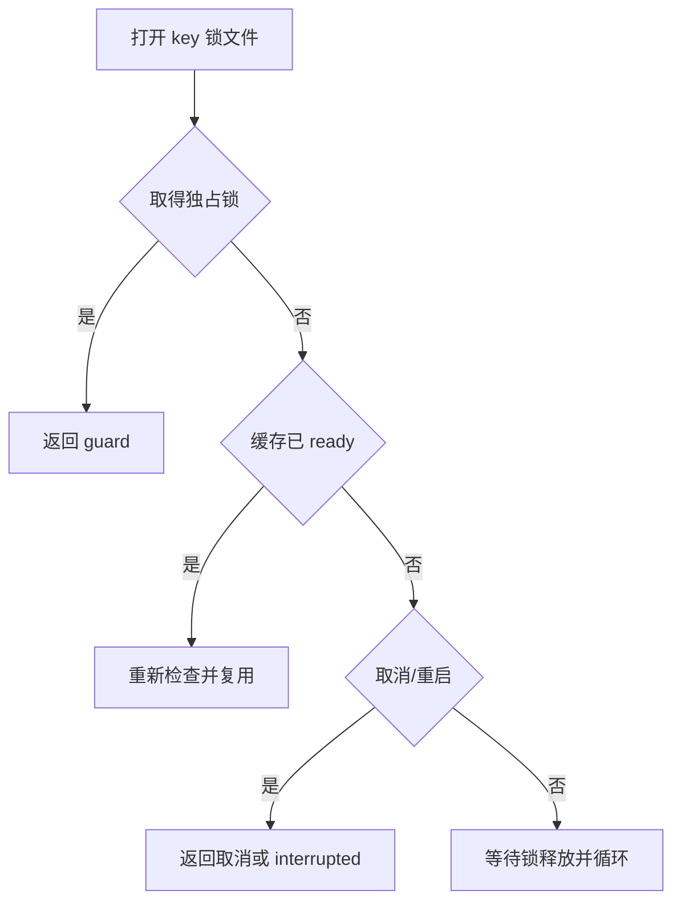

{
  "编号": "028",
  "依赖": ["026"]
}

# 028 实现运行时缓存、安装锁和共享准备作业

- 任务：实现用户数据目录缓存布局、`BURNCLOUD_RUNTIME_CACHE_DIR`、key 隔离、跨线程/跨进程安装锁和共享订阅。
- 工作区：server（读写）——`crates/interfaces/server/src/node_runtime/`。
- 产出：缓存 key、缓存命中校验、安装锁、staging 生命周期和共享作业引用计数/取消语义。
- 前置任务：026。
- 后置任务：029、031、034。
- 验收标准：
  - 缓存路径符合 `runtimes/downloads`、`<version>/<target>/<package_kind>/<sha256>`、`.staging` 约定，默认不写安装目录、项目目录或 `target`。
  - 同一版本/target/package_kind/SHA 只有一个安装作业写入；多个部署任务共享同一作业。
  - 取消一个订阅者不删除其他订阅者需要的缓存；最后订阅者取消可停止作业但保留安全断点。
  - ready、runtime.json、实际文件、路径边界和摘要均通过后才算缓存命中；坏缓存被隔离，旧有效版本保留。
  - 服务重启后未完成作业不伪造 ready，新任务可以安全恢复或重建。

## 实现内容

### 数据结构

---

名称：`RuntimeCacheKey`；类型：代码结构；说明：版本、target、包类型和归档摘要的共享身份；字段见开发文档第四节。

---

名称：`RuntimeInstallJob`；类型：代码结构；说明：共享运行时安装作业的状态、订阅者、进度和取消令牌。

### 函数定义

---

函数名称：`read_runtime_cache_root`
公开属性：私有函数
多线程属性：普通
函数归属：独立函数
所属模块或包：`node_runtime::cache`
职责说明：解析管理员缓存根或用户数据根，并拒绝危险默认位置。
入参列表：`installation_root`、`target_dir`、`override_value`。
返回值列表：可信缓存根 `PathBuf`。
错误返回：`runtime_configuration_invalid`、`runtime_cache_invalid`。
校验规则：白盒断言。
调用关系：被 `LlamaCppRuntimePreparer::prepare` 调用。

函数内部流程图：

---

函数名称：`check_cached_runtime`
公开属性：私有函数
多线程属性：并发
函数归属：独立函数
所属模块或包：`node_runtime::cache`
职责说明：按 key 检查 ready、runtime.json、摘要、server path 和再次探测。
入参列表：`cache_root`、`key`、`request`。
返回值列表：`Option<PreparedRuntime>`。
错误返回：`runtime_cache_invalid`、`runtime_probe_failed`。
校验规则：白盒断言。
调用关系：调用 `read_runtime_metadata`、`verify_cached_archive`、`probe_runtime`；被 `prepare` 调用。

函数内部流程图：

---

函数名称：`acquire_runtime_install_lock`
公开属性：私有函数
多线程属性：并发
函数归属：独立函数
所属模块或包：`node_runtime::cache`
职责说明：以 key 为粒度取得跨进程安装锁，等待时可取消并能识别服务重启。
入参列表：`cache_root`、`key`、`cancellation`。
返回值列表：持锁 `RuntimeInstallLock`。
错误返回：`runtime_install_conflict`、取消错误、`interrupted`。
校验规则：白盒断言。
调用关系：调用平台文件锁；被运行时准备器调用。

函数内部流程图：

---
