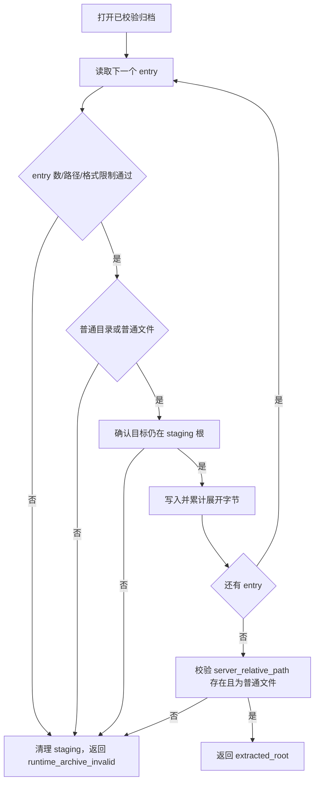
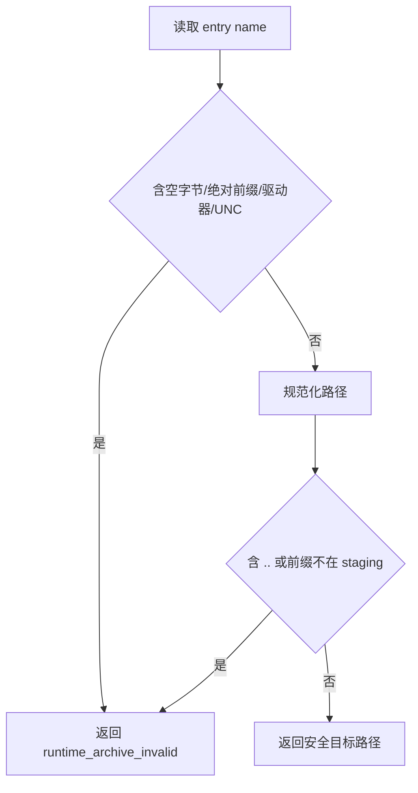

{
  "编号": "029",
  "依赖": ["026", "028"]
}

# 029 实现 ZIP 与 TAR.GZ 安全解压

- 任务：实现运行时归档的路径、链接和展开资源限制，并将合法内容写入同文件系统 staging。
- 工作区：server（读写）——`crates/interfaces/server/src/node_runtime/archive.rs` 及独立测试文件。
- 产出：ZIP/TAR.GZ 解压器、路径边界校验、entry 限制和 staging 清理。
- 前置任务：026、028。
- 后置任务：030、031、034。
- 验收标准：
  - 拒绝绝对路径、UNC/驱动器路径、`..`、越出 staging 的路径和特殊文件。
  - 第一版拒绝符号链接、硬链接及其他特殊 entry；不产生链接链或 staging 外写入。
  - 超过最大路径 4096、entry 100000、单文件 2 GiB、总展开 4 GiB 时立即失败。
  - 归档格式与 target 不匹配、缺失 manifest 指定 `server_relative_path` 或目标不是普通文件时返回 `runtime_archive_invalid`。
  - 失败只清理本次 staging，不删除既有有效缓存。

## 实现内容

### 数据结构

---

名称：`RuntimeArchiveLimits`；类型：代码结构；说明：路径、entry、单文件和总展开上限；字段见开发文档第四节。

---

名称：`ExtractedRuntime`；类型：代码结构；说明：安全展开 staging 根及归档库存摘要。

### 函数定义

---

函数名称：`extract_runtime_archive`
公开属性：私有函数
多线程属性：异步
函数归属：独立函数
所属模块或包：`node_runtime::archive`
职责说明：逐 entry 将 ZIP/TAR.GZ 写入 staging，执行路径和资源限制。
入参列表：`archive`、`staging_root`、`limits`、`cancellation`。
返回值列表：安全的 `extracted_root`。
错误返回：`runtime_archive_invalid`、取消错误、I/O 错误。
校验规则：白盒断言。
调用关系：调用 `validate_archive_entry_path`、`validate_entry_kind`、`write_entry_with_limits`；被 `prepare` 调用。

函数内部流程图：

---

函数名称：`validate_archive_entry_path`
公开属性：私有函数
多线程属性：普通
函数归属：独立函数
所属模块或包：`node_runtime::archive`
职责说明：在写入前拒绝绝对路径、驱动器前缀、`..` 和规范化后越界的 entry。
入参列表：`entry_name`、`staging_root`。
返回值列表：安全目标路径。
错误返回：`runtime_archive_invalid`。
校验规则：白盒断言。
调用关系：被 `extract_runtime_archive` 调用。

函数内部流程图：

---
