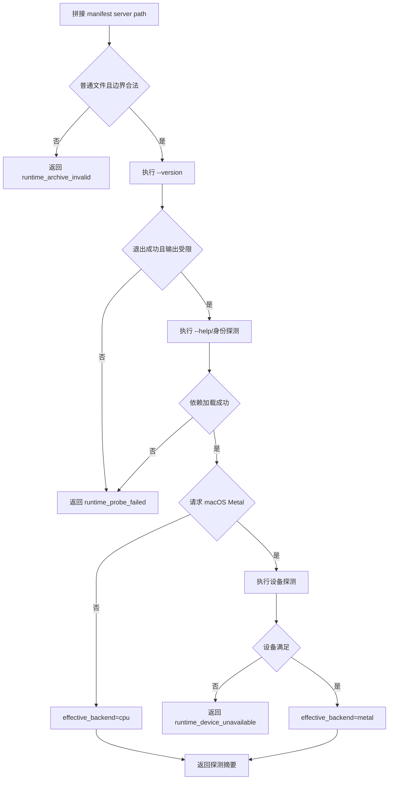

{
  "编号": "030",
  "依赖": ["026", "029"]
}

# 030 实现运行时版本、依赖和设备探测

- 任务：在安全 staging 或显式路径上探测 `llama-server` 身份、依赖、版本和目标 backend 能力。
- 工作区：server（读写）——`crates/interfaces/server/src/node_runtime/probe.rs` 及独立测试文件。
- 产出：探测摘要、`server_relative_path` 定位、CPU/Metal backend 判定和稳定错误映射。
- 前置任务：026、029。
- 后置任务：031、034、036。
- 验收标准：
  - 只执行 manifest 指定的 `llama-server`，缺少文件、目录、链接或普通文件条件不满足时失败。
  - `--version`/`--help` 能加载动态依赖并以允许退出码完成；立即退出或依赖缺失返回 `runtime_probe_failed`。
  - Windows/Linux CPU 能记录 `effective_backend=cpu`；macOS Metal 执行实际设备探测。
  - macOS 显式 Metal 无设备返回 `runtime_device_unavailable`；auto 的实际选择在元数据和进度中可观察。
  - 探测输出受长度限制，不把完整路径、环境变量或堆栈泄露到客户端错误。

## 实现内容

### 数据结构

---

名称：`RuntimeProbeSummary`；类型：代码结构；说明：版本、依赖、设备和实际 backend 的受控摘要；字段见开发文档第四节。

### 函数定义

---

函数名称：`probe_runtime`
公开属性：私有函数
多线程属性：异步
函数归属：独立函数
所属模块或包：`node_runtime::probe`
职责说明：定位服务端程序并执行版本、帮助、动态依赖和 backend 探测。
入参列表：`extracted_root`、`entry`、`requested_backend`、`cancellation`。
返回值列表：`PreparedRuntimeCandidate`。
错误返回：`runtime_archive_invalid`、`runtime_probe_failed`、`runtime_device_unavailable`、取消错误。
校验规则：白盒断言。
调用关系：调用 `locate_server`、`run_version_probe`、`run_help_probe`、`probe_metal_devices`；被 `prepare` 调用。

函数内部流程图：

---
