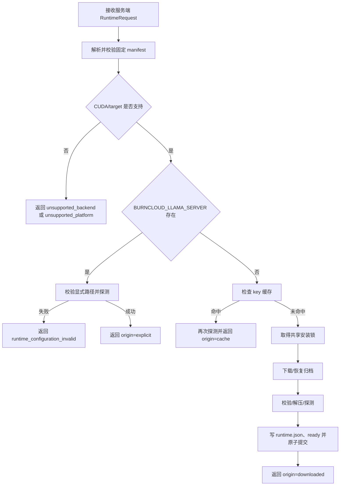

{
  "编号": "031",
  "依赖": ["027", "028", "029", "030"]
}

# 031 接入 LlamaCppRuntimePreparer 与现有 DeploymentService

- 任务：将 manifest、下载、缓存、解压、探测和原子提交串成 `LlamaCppRuntimePreparer`，返回既有 `PreparedRuntime` 并复用部署服务生命周期。
- 工作区：server（读写）——`crates/interfaces/server/src/node_runtime.rs`、`crates/interfaces/server/src/node_deployment.rs`。
- 产出：方案二运行时准备主流程、错误转换、来源优先级和现有部署链路接入。
- 前置任务：027、028、029、030。
- 后置任务：032、034、035。
- 验收标准：
  - 来源优先级严格为显式路径、有效缓存、固定 Gitee 下载；显式配置存在但无效时不回退。
  - `LlamaCppRuntimePreparer` 只返回已验证 `PreparedRuntime`，不负责进程启动、readiness、health、路由、停止或模型 GGUF 下载。
  - 运行时准备成功后调用现有 `DeploymentService::deploy_prepared`；启动参数和进程代次逻辑不被重写。
  - 取消、共享作业、服务重启和失败清理的语义与流程图一致。
  - CUDA 在 preflight 明确返回 `unsupported_backend`，不以 CPU 成功掩盖请求。

## 实现内容

### 数据结构

---

名称：`PreparedRuntime`；类型：代码结构；说明：已验证的 `llama-server` 路径、版本、来源、实际 backend 和探测摘要；字段见开发文档第四节。

### 函数定义

---

函数名称：`LlamaCppRuntimePreparer::prepare`
公开属性：公有接口（现有 `RuntimePreparer` trait 方法）
多线程属性：异步、并发安全
函数归属：`LlamaCppRuntimePreparer` 的 trait 实现
所属模块或包：`crates/interfaces/server/src/node_runtime.rs`
职责说明：执行来源选择、缓存共享、Gitee 下载、解压、探测和原子提交，返回 `PreparedRuntime`。
入参列表：`request: RuntimeRequest`、`progress: RuntimeProgressSink`、`cancellation: CancellationToken`。
返回值列表：已验证 `PreparedRuntime`。
错误返回：`unsupported_platform`、`unsupported_backend`、`runtime_configuration_invalid`、`runtime_cache_invalid`、`runtime_download_failed`、`runtime_archive_invalid`、`runtime_probe_failed`、`runtime_device_unavailable`、取消/中断错误。
校验规则：黑盒校验。
调用关系：调用 manifest/cache/download/extract/probe/commit 内部函数；被 `node_deployment` 调用，结果交给 `DeploymentService::deploy_prepared`。

函数内部流程图：

---
