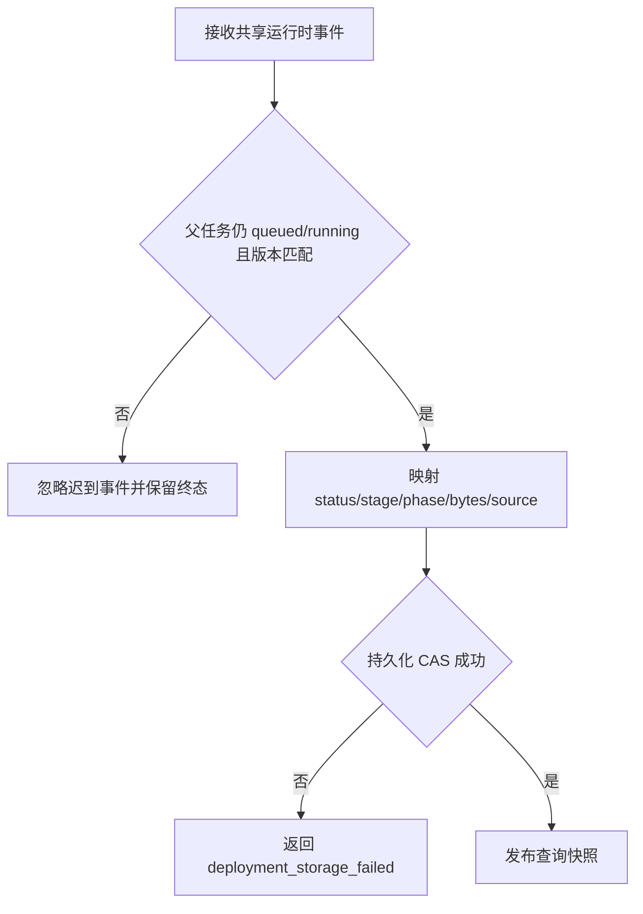

{
  "编号": "032",
  "依赖": ["031"]
}

# 032 接入自动部署 RuntimeProgress 与错误契约

- 任务：将运行时共享准备事件接入现有自动部署任务快照、POST/GET/DELETE 接口和 resolve 预算，不新增 runtime HTTP API。
- 工作区：server（读写）——`crates/interfaces/server/src/node_deployment.rs`、任务 DTO/仓储、OpenAPI 类型及独立测试。
- 产出：修订后的 `RuntimeProgress`、来源/phase/包身份字段、错误码映射、共享作业取消隔离和预算展示。
- 前置任务：031。
- 后置任务：033、034、035。
- 验收标准：
  - 父 stage 仍为 `preparing_runtime`，详细 phase 可观察 `cache_checking/waiting_for_shared_job/downloading/verifying/extracting/probing/committing/ready`。
  - `origin` 仅返回 `explicit/cache/downloaded`；不再返回 `bundled`。
  - RuntimeProgress 的字节、总大小、实际摘要和错误语义与接口契约一致；实体变化时进度可回退。
  - POST 不接受版本/URL/commit/SHA/路径；GET 终态查询仍 HTTP 200；DELETE 取消一个任务不删除共享缓存。
  - CUDA 返回 `unsupported_backend`；固定来源、摘要、归档和探测错误能稳定映射到 TaskError。

## 实现内容

### 数据结构

---

名称：`RuntimeProgress`；类型：代码结构；说明：自动部署查询中的运行时子进度；字段见接口契约第四节。

---

名称：`RuntimePreparationPhase`；类型：枚举；说明：运行时详细阶段；枚举值必须与接口契约第三节一致。

### 函数定义

---

函数名称：`publish_runtime_progress`
公开属性：私有函数
多线程属性：并发
函数归属：独立函数
所属模块或包：`node_deployment::progress`
职责说明：把共享作业事件映射到指定父任务，防止迟到事件覆盖终态。
入参列表：`task_id`、`event`、`store`。
返回值列表：可持久化 `RuntimeProgress`。
错误返回：`deployment_storage_failed`。
校验规则：白盒断言。
调用关系：被下载、解压、探测和部署任务执行器调用。

函数内部流程图：

---
