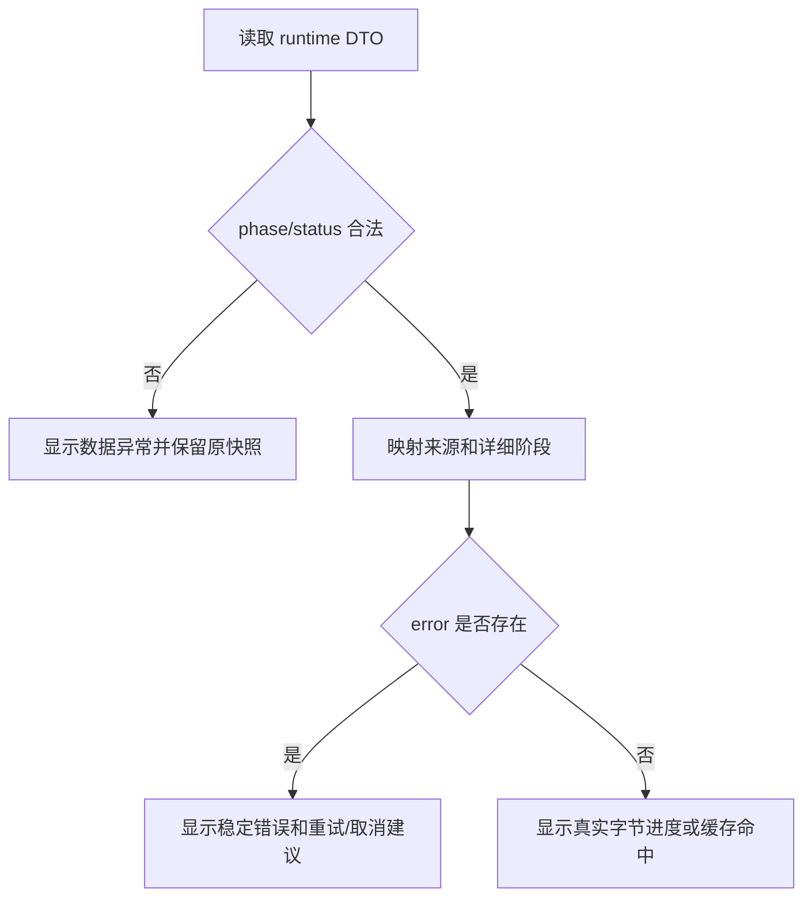

{
  "编号": "033",
  "依赖": ["032"]
}

# 033 更新客户端运行时双进度展示和取消体验

- 任务：使现有自动部署客户端消费方案二 RuntimeProgress，不把运行时共享作业当作独立可取消任务。
- 工作区：client（读写）——现有本机自动部署页面、任务 DTO、轮询/刷新和取消交互。
- 产出：运行时来源、下载/校验/解压/探测阶段、缓存命中、固定版本和可操作错误展示。
- 前置任务：032。
- 后置任务：034、035。
- 验收标准：
  - 客户端显示模型分支和运行时分支的真实状态，不用一个伪造总百分比替代。
  - `downloaded` 显示 Gitee 固定资源下载，`cache` 显示复用已校验缓存，`explicit` 显示管理员配置；不显示或提交任意 URL/本地路径。
  - 运行时下载 `total_bytes` 未知时不显示假 0；远端实体变化时允许进度回退。
  - 取消只取消当前部署任务；共享准备作业仍被其他任务使用时不提示“全局删除”。
  - `unsupported_backend`、摘要错误、归档错误、探测错误和服务重启均显示稳定可操作原因；刷新 GET 可以恢复界面。

## 实现内容

### 数据结构

---

名称：客户端运行时进度视图；类型：代码结构；说明：由服务端 `RuntimeProgress` 映射，不拥有服务端 manifest 或本地路径。

### 函数定义

---

函数名称：`map_runtime_progress`
公开属性：私有函数
多线程属性：普通
函数归属：独立函数
所属模块或包：现有 client 自动部署模块
职责说明：将服务端 runtime 子进度映射为可展示的阶段和说明。
入参列表：`RuntimeProgressDto`。
返回值列表：客户端只读视图模型。
错误返回：非法字段按刷新失败展示，不猜测默认 backend。
校验规则：黑盒校验。
调用关系：被轮询/刷新 UI 调用。

函数内部流程图：

---
