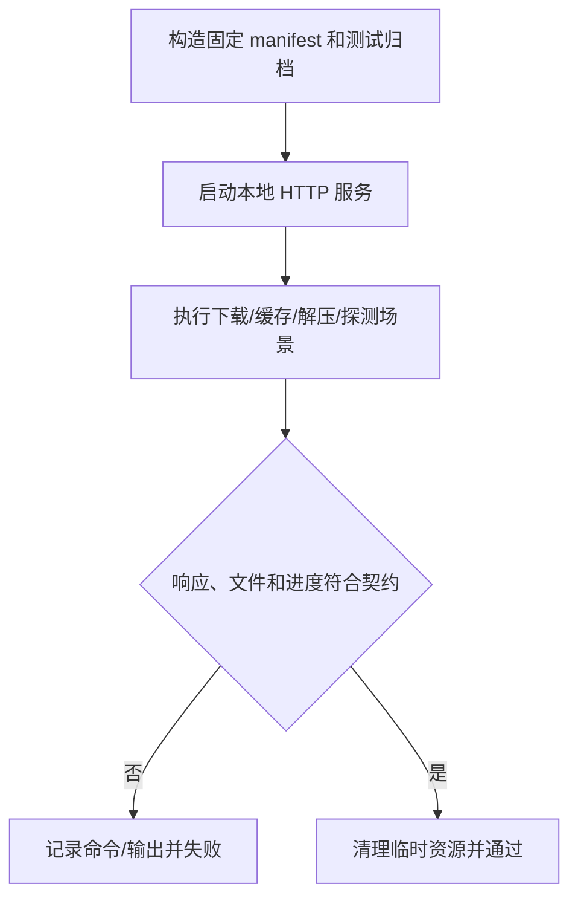

{
  "编号": "034",
  "依赖": ["026", "027", "028", "029", "030", "031", "032", "033"]
}

# 034 编写并执行运行时单元与集成测试

- 任务：覆盖 manifest、HTTP 断点、缓存并发、安全解压、探测、接口进度和取消共享语义。
- 工作区：download（读写）——运行时 HTTP 测试；server（读写）——运行时准备/接口集成测试；client（读写）——进度映射测试。
- 产出：独立测试文件、测试资源、测试报告中的真实命令和输出。
- 前置任务：026、027、028、029、030、031、032、033。
- 后置任务：036。
- 验收标准：
  - 单元测试覆盖四 target 映射、backend/target 校验、固定 URL、大小/SHA 校验、manifest 缺字段和摘要格式错误。
  - 安全解压覆盖绝对路径、`..`、符号链接、硬链接、entry/单文件/总大小限制和缺少 server path。
  - 本地 HTTP 服务覆盖 200、206、ETag 变化、Range 返回 200、Content-Range 异常、连接中断、取消、403/404/重定向/5xx。
  - 覆盖坏缓存、旧版本保留、同 key 并发锁、共享取消隔离、服务重启断点恢复、探测立即退出和 CUDA `unsupported_backend`。
  - 测试代码与生产源文件分离；按仓库约束执行 `cargo fmt`、`cargo clippy`、`cargo test` 并如实记录失败。

## 实现内容

### 函数定义

---

函数名称：运行时下载、缓存、解压、探测和进度的测试夹具
公开属性：私有函数
多线程属性：异步、并发
函数归属：独立测试函数
所属模块或包：各模块独立测试文件
职责说明：用本地 HTTP 服务、临时用户数据根和测试归档验证运行时设计，不导出生产内部 API。
入参列表：测试场景参数。
返回值列表：断言通过或测试失败。
错误返回：保留真实失败输出，不吞掉 Result。
校验规则：黑盒校验和白盒断言。
调用关系：调用待测模块私有可测试边界；被 `cargo test` 调用。

函数内部流程图：

---
